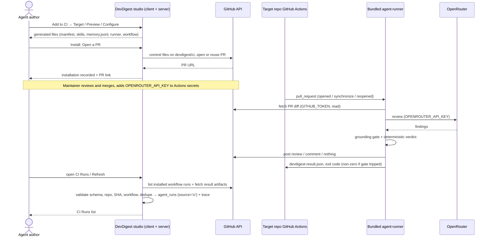

# Spec: Export to CI (worktree B) — Export Wizard, bundled agent-runner workflow, protected ingest, CI Runs, agent CI tab
Date: 2026-10-13
Status: approved (2026-10-13, user: all recommended defaults confirmed; four spec gaps fixed)
Supersedes: none

> Lesson scope: **L06 — "Export to CI"** (`README.md:87`, L06 row). Worktree B of the lesson: it owns the CI export
> engine, its routes, the CI Runs page and the agent CI tab. It must **not** change the multi-run review service or the
> PR feed (worktree A's area). L07/L08 items visible in the mockups (sidebar *Memory*, *Multi-Agent Review*, *Agent
> Performance*, the agent *Stats* tab) are intentionally absent from this repo and are **not** part of this spec.
>
> Why root `specs/`: the behaviour spans `server/` (export, GitHub PR creation, ingest, persistence), `client/` (wizard,
> CI tab, CI Runs page, nav), the bundled `agent-runner/` package (what runs in the target repo's CI) and the
> `@devdigest/shared` contracts both copies of which carry the manifest/artifact schemas.
>
> What already exists (verified, starting point — not a design to redo): the `agent-runner/` package (HEAD `2d78769`:
> manifest load + Zod validation, diff fetch, `reviewPullRequest` with the grounding gate, deterministic gate on
> `ci_fail_on`, `devdigest-result.json`, post as review/comment/none, exit code); shared contracts `AgentManifest`,
> `CiExportInput`, `CiInstallation`, `CiRun`, `CiResultArtifact` (server copy of `contracts/eval-ci.ts`; the client copy
> lacks `AgentManifest`); tables `ci_installations`, `ci_runs` and `agent_runs.source ('local'|'ci')`; the `GitHubClient`
> port's `commitFiles` / `findOpenPr` / `openPullRequest`; the agent's `ci_fail_on` field ("CI gate" in the Config tab);
> the `ci` i18n namespace. Missing: a server `ci` module, any route, the wizard, the CI tab, the CI Runs page, ingest.
> Prior art exists on `upstream/emdash/export-to-ci-4sp` (`specs/2026-07-08-export-to-ci.md`, resolved Q1–Q8); it is
> cited below only as a source of recommended defaults, not as an agreed decision for this repo.

## Accepted simplifications (2026-10-13, user) — these OVERRIDE the ACs/OQs named below

The user asked for a simple implementation. Where a row below conflicts with an AC, edge case or OQ elsewhere in this
document, **the row wins**; everything not listed stays as written. Source: `2026-10-13-export-to-ci.plan.md`
("Deviations from spec"). Also decided: the server adds `yaml@^2.6.1` (D1); a second agent in the same repository only
gets a Preview warning (R3); the implementer writes no tests in this workflow (tests are a separate optional step).

| AC / item | Spec says | Plan does | Why |
|---|---|---|---|
| All `Verify:` clauses that call for new unit/RTL/`.it` tests (e.g. AC-7, AC-8, AC-11, AC-17, AC-21–29, AC-34, AC-35, AC-53–58) | A specific new test per AC | No new tests from the implementer. Acceptance is typecheck + existing tests + build + manual demo-repo run. The tests become the optional test-writer step | User: implementer writes no tests |
| AC-6 edge case "existing workflow → 'will be replaced'" | Preview marks a file that already exists on the default branch | Not shown. Preview does no GitHub read; the PR diff shows the change | Simplicity, no extra GitHub call |
| AC-19 / OQ-6 (c) | Neutral, then "verified by run <time>" | Configure always shows the neutral "required — cannot be checked from DevDigest". The CI tab shows the last-run time per installation as plain information | Simplicity |
| AC-34, AC-56, OQ-14 | Dependencies include the `reviewer-core` revision baked into the bundle | Runner version, Node version, model, manifest version and skill versions only. No reviewer-core revision, no bundle sha256 | User dropped it |
| AC-40 edge case (merged/closed PR) + OQ-16 | Reset `devdigest/ci` to the default head when it is safe; otherwise `branch_conflict` 409 | If the branch exists, add one commit on top (existing `commitFiles` behaviour). If there is no open PR, open a new one. No reset, no `branch_conflict` | User dropped reset logic |
| AC-43 | Message names the specific missing permission; `branch_conflict` code | GitHub 401 → `token_missing`, 404 → `repo_not_accessible`, 403 → `token_permission_missing` with one fixed message naming all three needed permissions (contents, pull requests, workflows write), other errors → `github_unavailable`. Zip stays available | A 403 does not reliably say which permission; simpler |
| AC-44 | Header has **Update CI config** and **Add to CI** | Only **Add to CI**. Running the wizard again for the same repo upserts the installation and adds a commit to `devdigest/ci` | User dropped the separate update flow |
| AC-48 | Notice says the change reaches CI after **Update CI config** is merged | Notice says it reaches CI after you export again (**Add to CI**) and merge the PR | Follows AC-44 |
| AC-49, OQ-15 | Update CI config opens a prefilled wizard | Dropped (no prefill; the installation does not store triggers or post mode) | User dropped it |
| AC-51 | **Add repository** opens the picker with installed repos marked | Dropped. **Add to CI** opens the wizard on the Target step (repo picker) | Simplicity |
| AC-53 | The repo id is compared with the installation's repository id | The artifact `repository_id` is compared with the Actions run's `repository.id`. The run is fetched from the installation's repo, so they are equivalent. No repo id is stored | Avoids a column and an extra GitHub call |
| AC-61 | Filters: time range, agent, repository, status | Agent and repository only, client-side | User |
| AC-62, OQ-13 | Ingest on open + Refresh, auto-refresh 60 s | Same, implemented as one `POST /ci/runs/sync` (ingest, then list) used as the query function, with `refetchInterval: 60_000` | Single endpoint |
| OQ-17 | Exporting a different agent shows "replaces <agent>" | Preview shows a warning when another agent is installed in that repo. Nothing is deleted from the repo (see R3) | User: warning only |
| OQ-18 | Statuses pending / active / outdated / error | Stored status is `pending` or `active` only. "Outdated" is a derived client badge (installed manifest/workflow version < current). No `error` and no `repo_disconnected` | User dropped extra statuses |
| AC-65 | The fork note is on Configure **or** Install | Shown on both Configure and Install as a static note | — |
| Delivery / e2e | e2e flow implied for user-visible flows (AGENTS.md validation) | No e2e flow 16. Manual verification on a demo repo replaces it | User |

**Changes after live testing (2026-10-14, user-approved):** the generated workflow has ONE job (`review`); the
`fork-notice` job was removed, fork PRs are skipped by `if: head.repo.full_name == github.repository` on that job and get
no job-summary notice (deviation from AC-28's notice; AC-65's UI note stays). Install asks GitHub for the repository's
real default branch (`GitHubClient.getDefaultBranch`) instead of trusting the stored `default_branch`. Only the workflow
file is `editable` in `CiPreview` (AC-10). `CiInstallation` carries `current_workflow_version` so the studio and the UI
share one "outdated" threshold (AC-45). Install and zip success logs carry target, branch, base and outcome.

## Problem and user

An **agent author** tunes a review agent (model, system prompt, skills, gate policy) in the local studio. While the
agent runs only on that machine, **the team** cannot rely on it on every PR: nobody else sees its reviews, and it
cannot block a merge. Export to CI moves the agent's configuration into the target repository as a versioned
**manifest** and runs the same review on every pull request inside the repository's own GitHub Actions, using a
**bundled agent-runner** checked into the repo.

A **repository maintainer** must be able to review the install PR and trust it: least-privilege token, no secret in
files or logs, PR code never executed with secrets, forks handled safely. The **agent author** then needs to see the CI
results back in the studio (CI Runs page, the agent's CI tab), linked to the correct repository, PR and commit.

The same manifest guarantees the same configuration, not byte-identical output (model answers vary, CI tool versions
differ), so every CI run records which manifest version, model, dependencies and commit SHA produced it.

## Goals / Non-goals

- **Goals**
  - G1: An Export Wizard (Target → Preview → Configure → Install) opened from the agent's CI tab.
  - G2: The agent is serialized to `.devdigest/agents/<slug>.yaml`, validated by the **same** `AgentManifest` Zod schema
    the agent-runner uses; skills, `.devdigest/memory.jsonl`, the runner bundle and an editable
    `.github/workflows/devdigest-review.yml` are generated alongside it.
  - G3: Install either opens a PR from branch `devdigest/ci` (never a direct write to the default branch) or downloads
    the files as a zip.
  - G4: The generated workflow is secure by construction (least-privilege `GITHUB_TOKEN`, secret only from Actions
    Secrets, no `pull_request_target`, external actions pinned to a full commit SHA, PR text treated as data).
  - G5: The workflow runs the bundled agent-runner, which reviews with `reviewer-core` (grounding gate mandatory),
    publishes per the chosen mode, writes `devdigest-result.json`, and exits non-zero when the gate trips.
  - G6: The studio ingests CI results only through a verified channel, validates them, and stores each as an
    `agent_runs` row with `source='ci'` plus a reproducibility trace.
  - G7: A workspace-wide **CI Runs** page and an agent **CI** tab (installations, workflow version, history, Fail CI on).
- **Non-goals**
  - CircleCI, Jenkins and Generic CLI generators (shown only if actually implemented — see AC-4).
  - A published marketplace action: `uses: devdigest/review-action@v1` from the mockup is a placeholder and is not
    generated (AC-21).
  - Making CI output byte-identical to a local run; repo-intel context and attached project-context docs in CI runs
    (the manifest carries model, prompt, skills, strategy and gate only).
  - Reading, storing or displaying the value of `OPENROUTER_API_KEY` in the studio.
  - Any change to the multi-run review service, the PR feed, or the PR list cost totals.
  - L07/L08 items in the mockups (Memory page, Multi-Agent Review, Agent Performance, Stats tab).
  - Automatically configuring branch protection / rulesets (the user does this in GitHub; the UI explains how).

## User stories

- **US-1**: As an agent author, I want to export my agent to a repository's GitHub Actions through a guided wizard that
  opens a PR, so that my team gets the agent's review on every PR without me running it locally.
- **US-2**: As an agent author, I want to download the generated files as a zip, so that I can install them by hand
  where the studio cannot open a PR.
- **US-3**: As a repository maintainer, I want the install PR to be safe and reviewable (permissions, triggers, secret
  handling, what code runs), so that I can merge it without opening a supply-chain or secret-leak hole.
- **US-4**: As a team member opening a PR, I want the agent's grounded review posted on my PR and a failing check when
  the gate trips, so that a CRITICAL finding can block the merge through a required check.
- **US-5**: As an agent author, I want every CI run of every agent visible in one CI Runs page with repository, PR,
  agent, verdict, findings, cost, duration and a link to the job, so that I can follow the agent's behaviour in CI.
- **US-6**: As an agent author, I want the agent's CI tab to show where it is installed, which workflow/manifest version
  each repo runs, its CI history and the Fail CI on policy, and to update an out-of-date installation, so that I can
  manage the deployment.
- **US-7**: As a workspace owner, I want CI results accepted only through a verified channel and stored with manifest
  version, model, dependencies and commit SHA, so that a forged or replayed result cannot pollute the history and every
  run is explainable.

## Acceptance criteria (EARS)

### Wizard entry and Target step

- **AC-1** (event-driven, covers US-1): WHEN the user clicks **Add to CI** on the agent's CI tab, the system shall open
  the Export Wizard modal titled "Export to CI" with the subtitle naming the agent and a four-step indicator Target →
  Preview → Configure → Install, positioned on Target. — *Verify: RTL test clicks Add to CI, asserts dialog role, title,
  agent name and the four steps with Target current.*
- **AC-2** (ubiquitous, covers US-1): The wizard shall let the user pick the target repository from the workspace's
  connected repositories, preselecting the active repository. — *Verify: RTL test with two connected repos asserts the
  active one is preselected and the other selectable.* (See OQ-8.)
- **AC-3** (ubiquitous, covers US-1): The Target step shall offer **GitHub Actions** as the recommended, preselected
  target. — *Verify: RTL test asserts the GitHub Actions card is selected and carries the "recommended" tag.*
- **AC-4** (optional feature, covers US-1): WHERE a CircleCI, Jenkins or Generic CLI file generator is implemented, the
  Target step shall show that target as selectable; WHERE it is not implemented, the step shall not offer it. —
  *Verify: unit test of the target list against the set of registered generators; with only GHA registered, exactly
  one card renders.*
- **AC-5** (state-driven, covers US-1): WHILE no target repository is selected, the wizard shall keep **Continue**
  disabled. — *Verify: RTL test with no connected repo asserts Continue is disabled and the "connect a repository"
  message is shown.*

### Preview step and manifest

- **AC-6** (event-driven, covers US-1, US-3): WHEN the user continues from Target, the system shall list the files to
  create: `.devdigest/agents/<slug>.yaml`, one `.devdigest/skills/<skill-slug>.md` per enabled linked skill in the
  agent's order, `.devdigest/memory.jsonl`, the bundled runner file at `.devdigest/runner/index.mjs`, and `.github/workflows/devdigest-review.yml`. —
  *Verify: route test of the preview endpoint for an agent with two skills returns exactly these paths; RTL test shows
  them in the file list.*
- **AC-7** (ubiquitous, covers US-1, US-7): The system shall derive the manifest from the agent's current saved version
  (name, provider, model, system prompt, skill slugs, strategy, `ci_fail_on`, agent version) and shall validate it with
  the shared `AgentManifest` schema before showing or writing it. `AgentManifest` gains two optional fields, `version` (agent version number) and `skill_versions` (skill slug → version), mirrored in both `@devdigest/shared` copies. — *Verify: server unit test serializes an agent,
  parses the YAML back with `AgentManifest.safeParse` and asserts success and field equality.*
- **AC-8** (ubiquitous, covers US-7): The studio and the agent-runner shall validate the manifest with the same single
  `AgentManifest` definition from `@devdigest/shared`. — *Verify: parity test feeds the same fixture manifests (valid
  and invalid) to the studio's validator and the runner's `loadAgentManifest` and asserts identical accept/reject.*
- **AC-9** (ubiquitous, covers US-1): The manifest slug shall be derived deterministically from the agent name
  (lowercase kebab-case), so re-exporting the same agent produces the same path. — *Verify: unit test
  "Security Reviewer" → `security-reviewer`, stable across two calls.*
- **AC-10** (event-driven, covers US-1): WHEN the user selects a file in the list, the system shall show its contents;
  the workflow file shall be editable and every other file read-only. — *Verify: RTL test selects the manifest
  (read-only, no editor) and the workflow (editable tag, typing changes the content).*
- **AC-11** (unwanted behaviour, covers US-3): IF the edited workflow is not valid YAML, or uses a `pull_request_target`
  or comment-based trigger, or grants `GITHUB_TOKEN` permissions beyond `contents: read` and `pull-requests: write`, or
  references an external action not pinned to a 40-character commit SHA, THEN the system shall block Install and name
  the violated rule. — *Verify: unit test per rule on the workflow validator; RTL test shows the message and a disabled
  Install.* (See OQ-11 for block-vs-warn.)
- **AC-12** (unwanted behaviour, covers US-1): IF the agent's provider cannot be expressed as an OpenRouter model the
  runner can call, THEN the system shall refuse the export with a message telling the user what to change, instead of
  writing a manifest the runner cannot execute. — *Verify: route test with a non-exportable agent returns a typed error
  code; RTL test renders the message.* (See OQ-7.)
- **AC-13** (unwanted behaviour, covers US-1): IF the runner bundle is not available to the studio at export time, THEN
  the system shall fail the preview with an explicit "runner bundle missing" error and shall not offer an install
  without the runner. — *Verify: route test with the bundle absent returns the typed error; no PR is opened.*

### Configure step

- **AC-14** (ubiquitous, covers US-1): The Configure step shall offer trigger chips `pull_request:opened`,
  `pull_request:synchronize` (both selected by default) and `pull_request:reopened` (unselected by default). —
  *Verify: RTL test asserts the three chips and their default state.*
- **AC-15** (unwanted behaviour, covers US-1): IF the user deselects every trigger, THEN the system shall disable
  **Continue** and say at least one trigger is required. — *Verify: RTL test.*
- **AC-16** (ubiquitous, covers US-1, US-4): The Configure step shall offer "Post results as": **GitHub review**
  (recommended, default), **PR comment**, **None (exit code only)**. — *Verify: RTL test of the radio group and default.*
- **AC-17** (event-driven, covers US-4): WHEN the user picks a post mode, the generated files shall carry that mode so
  the runner in CI publishes exactly that way (review, comment, or nothing). — *Verify: generator unit test per mode
  asserts the mode reaches the runner's input; runner test asserts `pr_comment` posts a comment and `none` posts
  nothing.*
- **AC-18** (ubiquitous, covers US-3): The Configure step shall list the secrets the workflow expects —
  `OPENROUTER_API_KEY` (to add under the repo's Settings → Secrets and variables → Actions) and `GITHUB_TOKEN`
  (provided automatically by Actions) — without reading or asking for any secret value. — *Verify: RTL test asserts
  both names and the instruction; network log of the wizard shows no secret-value request.*
- **AC-19** (ubiquitous, covers US-3): The status shown next to `OPENROUTER_API_KEY` shall never claim the secret is
  set unless that is backed by evidence the studio actually has. — *Verify: RTL test with no ingested run shows the
  neutral "required — cannot be checked from DevDigest" state.* (See OQ-6 for the evidence rule.)
- **AC-20** (ubiquitous, covers US-4): The Configure step shall show the info note that blocking a merge needs both
  **Fail CI on** (so the check exits non-zero) and the check being a **required status check** in the repository's
  ruleset/branch protection, and that a `REQUEST_CHANGES` review alone blocks only under the repository's review rules.
  — *Verify: RTL test asserts the note text keys.*

### Generated workflow (security invariants)

- **AC-21** (ubiquitous, covers US-3): The generated workflow shall run the bundled runner checked into the repository
  and shall not reference `devdigest/review-action` or any unpublished action. — *Verify: generator unit test asserts
  the run step invokes the bundled runner path and the YAML contains no `devdigest/review-action`.*
- **AC-22** (ubiquitous, covers US-3): The generated workflow shall declare `permissions` explicitly with only
  `contents: read` and `pull-requests: write`, leaving every other scope unset (= none). — *Verify: generator unit
  test parses the YAML and asserts the exact permissions map.*
- **AC-23** (ubiquitous, covers US-3): The generated workflow shall trigger only on `pull_request` with the selected
  activity types, and never on `pull_request_target`, `issue_comment`, `pull_request_review_comment` or
  `workflow_run`. — *Verify: generator unit test on the `on:` block.*
- **AC-24** (ubiquitous, covers US-3): The generated workflow shall pin every external action it uses to a full
  40-character commit SHA. — *Verify: generator unit test: every `uses:` matches `@[0-9a-f]{40}`.*
- **AC-25** (ubiquitous, covers US-3): The generated workflow shall pass `OPENROUTER_API_KEY` only from
  `secrets.OPENROUTER_API_KEY` as an environment variable of the runner step, and the key name shall be
  `OPENROUTER_API_KEY` everywhere (never `OPENAI_API_KEY`). — *Verify: generator unit test; grep of the generated
  YAML.*
- **AC-26** (ubiquitous, covers US-3): The generated workflow shall not interpolate PR-controlled values (title, body,
  branch name, comment text, commit messages) into shell commands; such values reach the runner only as data. —
  *Verify: generator unit test asserts no `${{ github.event.pull_request.title|body|head.ref }}` or
  `github.head_ref` inside any `run:`.*
- **AC-27** (ubiquitous, covers US-3): The workflow shall not execute code from the PR head with access to
  `OPENROUTER_API_KEY`: the runner and the manifest it uses shall come from a trusted ref, and the PR's changes shall
  reach the runner only as the diff fetched through the GitHub API. — *Verify: generator unit test on the checkout ref;
  manual review step 2 of the verification flow.* (See OQ-4.)
- **AC-28** (state-driven, covers US-3, US-4): WHILE a PR comes from a fork, the workflow shall not attempt to obtain
  secrets through `pull_request_target` or any other workaround, and shall end without a review and without a secret.
  — *Verify: generator unit test on the fork condition; manual run on a fork PR shows no secret use.* (See OQ-5 for
  skip-vs-fail.)
- **AC-29** (ubiquitous, covers US-4): The workflow's check (workflow + job name) shall be stable across exports and
  updates, so a repository can mark it as a required status check once. — *Verify: generator unit test asserts the
  same `name`/job id for two different configurations.*

### agent-runner in CI

- **AC-30** (event-driven, covers US-4): WHEN the workflow runs on a matching PR event, the runner shall load and
  validate the manifest, fetch the PR diff, run the `reviewer-core` review with the grounding gate, and compute the
  verdict deterministically from the grounded findings and the manifest's `ci_fail_on`. — *Verify: existing
  `agent-runner/src/run.test.ts` cases plus a parity test with a fixture PR.*
- **AC-31** (event-driven, covers US-4): WHEN the gate is triggered (e.g. `ci_fail_on: critical` and at least one
  grounded CRITICAL finding), the runner shall exit non-zero so the check turns red. — *Verify: runner unit test exit
  code 1; acceptance run on the test PR.*
- **AC-32** (event-driven, covers US-4): WHEN the gate is not triggered, the runner shall exit 0, regardless of the
  model's self-reported verdict. — *Verify: runner unit test with model verdict "request_changes" and no blockers →
  exit 0.*
- **AC-33** (unwanted behaviour, covers US-4): IF the manifest is invalid, a skill file is missing, the CI context is
  unresolvable, the diff fetch fails or the model call fails, THEN the runner shall exit non-zero, post nothing and
  write no success artifact. — *Verify: existing runner hard-fail tests.*
- **AC-34** (ubiquitous, covers US-4, US-7): On every completed review the runner shall write `devdigest-result.json`
  conforming to the shared result-artifact schema, including the repository, PR number, head commit SHA, manifest
  version, model, runner/dependency versions, verdict, blocker count, severity counts, cost and duration. — *Verify:
  runner unit test parses the written file with the shared schema and asserts each field.*
- **AC-35** (ubiquitous, covers US-3): `devdigest-result.json`, the posted review/comment and the job log shall contain
  no secret value (`OPENROUTER_API_KEY`, `GITHUB_TOKEN`, any `Authorization` header). — *Verify: runner test with
  sentinel secret values asserts they appear in none of the outputs; manual log inspection in the verification flow.*
- **AC-36** (ubiquitous, covers US-3): The runner shall treat the diff, PR title/body, branch names and comments as
  untrusted data wrapped by `reviewer-core`'s untrusted-content guard, and shall never run them as commands or let
  them change its permissions or behaviour. — *Verify: existing runner test asserting `<untrusted …>` wrapping; review of
  the runner for `exec`/`spawn` on PR text.*

### Install step

- **AC-37** (ubiquitous, covers US-1, US-2): The Install step shall offer **Open a PR with these files**
  (recommended, default) and **Download files as .zip**, and the PR option shall name the target repository, the PR
  title "Add DevDigest CI review" and the actual number of generated files. — *Verify: RTL test asserts both options and
  that the count equals the Preview list length.*
- **AC-38** (event-driven, covers US-1): WHEN the user installs with "Open a PR", the system shall commit all generated
  files (including any workflow edits) as one commit on branch `devdigest/ci` created from the repository's default
  branch, and open a PR from `devdigest/ci` into the default branch. — *Verify: service test with the GitHub mock asserts
  one `commitFiles` call on `devdigest/ci` and one PR into the default branch.*
- **AC-39** (ubiquitous, covers US-3): The system shall never write to the repository's default branch or any branch
  other than `devdigest/ci`. — *Verify: service test asserts every GitHub write targets `devdigest/ci`.*
- **AC-40** (state-driven, covers US-1): WHILE an open PR from `devdigest/ci` already exists, a new install or update
  shall add a commit to that branch and reuse the open PR instead of opening a second one. — *Verify: service test with
  `findOpenPr` returning a URL asserts no new PR is opened and the URL is returned.*
- **AC-41** (event-driven, covers US-1): WHEN the PR is opened or reused, the system shall record the installation
  (agent, repository, target, manifest version, workflow version, PR URL) and show a success state with a link to the
  PR. — *Verify: `.it` test asserts the installation row; RTL test asserts the PR link.*
- **AC-42** (event-driven, covers US-2): WHEN the user picks "Download files as .zip", the browser shall download one
  zip containing exactly the generated files (with any workflow edits) at their repository paths, and no GitHub write
  shall happen. — *Verify: unit test of the zip contents; service test asserts no GitHub write call.*
- **AC-43** (unwanted behaviour, covers US-1): IF the studio's GitHub token is missing, cannot read the repository, or
  lacks a permission the PR install needs (contents write, pull requests write, workflow files write), THEN the system
  shall fail the install with a message naming the missing permission (typed error codes include `branch_conflict`, returned as 409 when `devdigest/ci` has commits beyond DevDigest's own, OQ-16), leave no partial branch behind when the commit
  itself failed, and keep the zip option available. — *Verify: service tests with the GitHub mock returning 401/403/404
  per call assert the typed error code; RTL test renders the message.*

### CI tab on the agent page

- **AC-44** (ubiquitous, covers US-6): The agent editor shall have a **CI** tab showing a "CI deployment" header with
  "Active in N repos", **Update CI config** and **Add to CI** actions, and one row per installation with repository,
  target (GitHub Actions), last run status and its relative time. — *Verify: RTL test with two installations.*
- **AC-45** (ubiquitous, covers US-6): Each installation row shall show the installed manifest/workflow version and
  mark it **outdated** when the agent's current version or the generator's workflow version is newer. — *Verify: RTL
  test with installed version 3 and agent version 4 shows "outdated".*
- **AC-46** (ubiquitous, covers US-6): The CI tab shall show this agent's CI run history (newest first) with the same
  fields as the CI Runs page. — *Verify: RTL test renders runs filtered to the agent.*
- **AC-47** (ubiquitous, covers US-6, US-4): The CI tab shall show and let the user change **Fail CI on**
  (never / critical / warning / any), backed by the agent's single `ci_fail_on` setting (the same value as the Config
  tab's "CI gate"). — *Verify: RTL test changes the value and asserts the agent update request; the Config tab shows the
  same value.*
- **AC-48** (event-driven, covers US-6): WHEN `ci_fail_on` or any other exported agent field changes, the system shall
  mark existing installations outdated and tell the user the change reaches CI only after **Update CI config** is
  merged. — *Verify: RTL test after a change shows the notice and the outdated badge.*
- **AC-49** (event-driven, covers US-6): WHEN the user clicks **Update CI config** for an installation, the system shall
  open the wizard for that repository with its last configuration prefilled and install through the same
  `devdigest/ci` branch/PR rules (AC-38 – AC-40). — *Verify: RTL test asserts prefilled target repo, triggers and post
  mode; service test as AC-40.* (See OQ-15.)
- **AC-50** (state-driven, covers US-6): WHILE the agent has no installation, the CI tab shall show an empty state with
  **Add to CI** as the primary action. — *Verify: RTL test.*
- **AC-51** (event-driven, covers US-6): WHEN the user clicks **Add repository**, the system shall open the wizard with
  the repository picker focused and already-installed repositories marked. — *Verify: RTL test.*

### Ingest

- **AC-52** (ubiquitous, covers US-7): The system shall accept a CI result only through a verified channel — fetched by
  the studio itself from the installed repository's GitHub Actions run through its authenticated GitHub API access, or
  through an authenticated endpoint — and never from an unauthenticated request. — *Verify: route/service test: there is
  no unauthenticated write path; an unauthenticated POST (if an endpoint exists) is rejected with 401.* (See OQ-1.)
- **AC-53** (unwanted behaviour, covers US-7): IF a result fails schema validation, or its GitHub repository id does not match the
  installation's repository id (the repository name is taken from the run, so a rename does not reject results), or its head commit SHA does not match the commit of the
  Actions run that produced it, or it did not come from the installed workflow, THEN the system shall reject it, store
  nothing, and log the rejection reason. — *Verify: service test per mismatch with the GitHub mock.*
- **AC-54** (event-driven, covers US-7): WHEN a result is accepted, the system shall store it as one `agent_runs` row
  with `source='ci'`, linked to the agent, with model, duration, cost, findings count, verdict and blockers, plus the
  repository, PR number, commit SHA and job URL. — *Verify: `.it` test asserts the row.*
- **AC-55** (unwanted behaviour, covers US-7): IF the same Actions run (and attempt) is ingested again, THEN the system
  shall not create a second run. — *Verify: `.it` test ingests twice, asserts one row.*
- **AC-56** (event-driven, covers US-7): WHEN a result is accepted, the system shall store a trace recording manifest
  version, model, dependencies (runner version, `reviewer-core` revision, skills with versions) and commit SHA, with
  `source: 'ci'`. — *Verify: `.it` test reads the trace and asserts the fields.* (See OQ-14.)
- **AC-57** (ubiquitous, covers US-7): Ingested CI runs shall not change the PR feed: they shall not appear in or add
  cost to the PR list, the PR timeline or the multi-run views. — *Verify: `.it` test: after ingesting a CI run for an
  imported PR, the PR list cost and PR run history are unchanged.* (See OQ-2.)
- **AC-58** (event-driven, covers US-5, US-7): WHEN an installed workflow run finished without a result artifact (hard
  failure, cancelled, skipped), the system shall show it as failed/skipped with its job link and no findings or cost,
  rather than dropping it silently. — *Verify: service test with a failed Actions run and no artifact.*

### CI Runs page

- **AC-59** (ubiquitous, covers US-5): The sidebar shall have a **CI Runs** item under a **GLOBAL** section leading to a
  workspace-wide CI Runs page. — *Verify: RTL/app-shell test asserts the item and its href.*
- **AC-60** (ubiquitous, covers US-5): The CI Runs page shall list CI runs newest first with repository, PR (number,
  linked to GitHub), agent, verdict, findings (count with severity breakdown), cost, duration and a link to the GitHub
  Actions job. — *Verify: RTL test with fixture runs asserts each column and the job link `href`.*
- **AC-61** (optional feature, covers US-5): WHERE the user sets filters (time range, agent, repository, status), the
  page shall show only matching runs. — *Verify: RTL test per filter.*
- **AC-62** (event-driven, covers US-5): WHEN the user opens the page or clicks **Refresh**, the system shall ingest new
  results for all installations before listing. — *Verify: RTL test asserts the refresh call and the updated list.*
  (See OQ-13.)
- **AC-63** (state-driven, covers US-5): WHILE loading, when there are no runs, or when the request fails, the page shall
  show a skeleton, the "No CI runs yet" empty state, or an error state with retry respectively. — *Verify: RTL tests
  for the three states.*
- **AC-64** (unwanted behaviour, covers US-5): IF cost is unknown for a run, THEN the page shall show "—", not `$0`. —
  *Verify: RTL test with `cost_usd: null`.*
- **AC-65** (state-driven, covers US-3, US-4): WHILE the wizard shows the Configure or Install step for GitHub Actions, the
  system shall display a note that fork PRs run without secrets and that a skipped job may satisfy a required status
  check, so required-check protection can be bypassed by forks. — *Verify: RTL test finds the note on Configure.*

## Edge cases

- `devdigest/ci` already exists with an **open** PR → add a commit, reuse the PR (AC-40).
- `devdigest/ci` exists but its PR was **merged or closed** → the branch is updated from the current default branch and a
  new PR is opened; never force-push over unrelated commits on that branch without telling the user
  (new — see OQ-16).
- `.github/workflows/devdigest-review.yml` already exists on the default branch (previous install or a hand-made file)
  → the Preview shows the file as "will be replaced" and the PR diff shows the change (covers AC-6, AC-38).
- Another `.devdigest/agents/*.yaml` already exists in the repo (a different agent installed) → the runner expects
  exactly one manifest; the export must not silently produce two (new — see OQ-17).
- Agent name collides with another agent's slug in the same repo → see OQ-17 (one-agent-per-repo vs per-agent
  workflows).
- Agent has zero skills → manifest `skills: []`, no skill files, file count adjusts (AC-6, AC-37).
- Agent's provider is `openai`/`anthropic` (e.g. `gpt-4.1` in the mockup) → AC-12 / OQ-7.
- Studio GitHub token is fine-grained and does not include the target repo → 404 on read; message names "repository
  access" (AC-43; `server/INSIGHTS.md` "A fine-grained GitHub PAT only sees the repositories chosen…").
- Token lacks the workflow-file permission → GitHub rejects the commit that touches `.github/workflows/`; message names
  the missing permission and the zip stays available (AC-43).
- Runner bundle not built (it is git-ignored) → AC-13.
- No repository connected in the workspace → AC-5.
- The install PR itself (`devdigest/ci`) triggers the new workflow before the files exist on the trusted ref → the run
  must end with a clear "not installed on base yet" notice, not a red check that blocks the install PR (covers AC-27;
  see OQ-4).
- Fork PR → no secret, no review (AC-28); if the job is skipped, a required check may count as passed — see OQ-5.
- `OPENROUTER_API_KEY` not yet added → runner hard-fails (AC-33); CI Runs shows the run as failed with the job link
  (AC-58); the CI tab hint points to Settings → Secrets and variables → Actions.
- Model failure / rate limit in CI → hard fail, nothing posted (AC-33).
- Grounding drops every finding → valid zero-finding APPROVE, exit 0 (AC-30, AC-32).
- Same Actions run re-run (attempt 2) → one row per attempt or update in place, never a duplicate of the same attempt
  (AC-55).
- Replayed or hand-crafted artifact from another repo or another commit → rejected (AC-53).
- Artifact larger than the size bound or with unknown fields → rejected or unknown fields dropped by the schema (AC-53).
- PR not imported into the studio → the run still lists with repository + PR number linking to GitHub (AC-60).
- Agent deleted after install → its CI runs keep showing with the agent name recorded at ingest (AC-54, AC-60).
- Repository disconnected from the workspace after install → installation shown as "repository not connected"; ingest
  for it stops (new — see OQ-8).
- `ci_fail_on` changed in Config tab after install → installation outdated until Update CI config is merged (AC-48).
- User edits the workflow in Preview, then changes triggers/post mode in Configure → see Design review notes
  (ordering gap) and OQ-12.

## Non-functional requirements

- Performance: Preview generation for an agent with ≤ 10 skills completes in ≤ 2 s p95 on a local stack (excluding
  GitHub latency); CI Runs page renders 200 runs in ≤ 1 s after data arrives; the CI review itself is a guideline of
  ~2 minutes per PR, not a gated SLA. — *Verify: timing in a server test / RTL render with 200 fixtures; observed run
  duration in the verification flow.*
- Security: AC-11, AC-22 – AC-28, AC-35, AC-36, AC-39, AC-52 – AC-55; the studio never stores, logs or displays
  `OPENROUTER_API_KEY`; the studio's own GitHub token never appears in generated files, errors shown to the user, or
  logs (the clone URL embeds the token — `server/INSIGHTS.md`). — *Verify: the listed tests plus a grep of server logs
  from an `.it` export run for the token sentinel.*
- Accessibility: the wizard is a modal dialog with focus trapped inside, Escape and a visible Close button closing it,
  the step indicator exposes the current step (`aria-current="step"`), target and post-mode choices are keyboard
  operable radio groups, trigger chips are toggle buttons with `aria-pressed`, the CI Runs table has column headers and
  the job link has an accessible name. — *Verify: RTL queries by role/name; keyboard-only walk-through in the manual
  check.*
- Observability: every export logs agent id, repo, target, branch, outcome and error code; every ingest pass logs
  installations checked, results accepted, duplicates skipped and rejections with reason — never secret values or
  artifact bodies. — *Verify: log assertions in service tests.*

## Inputs and provenance

- Agent configuration (name, provider, model, system prompt, strategy, `ci_fail_on`, version) and its linked skills —
  studio DB, authored by the workspace user.
- Target repository (`owner/name`, default branch, GitHub repository id) — workspace's connected repos + GitHub API.
- Wizard choices: target, triggers, post mode, workflow edits — the user in the browser.
- Studio GitHub token — `SecretsProvider` (server); used for PR creation and ingest.
- In CI: `OPENROUTER_API_KEY` from GitHub Actions Secrets; `GITHUB_TOKEN` from Actions; event payload
  (`GITHUB_EVENT_PATH`); PR diff from the GitHub API; the checked-in manifest, skills and runner from the repo.
- `devdigest-result.json` and Actions run metadata (run id, attempt, head SHA, workflow path, conclusion, job URL) —
  read back from GitHub by the studio.

## Untrusted inputs

- **PR diff, title, body, branch names, comments, commit messages** (author-controlled, possibly a fork): reach the model
  only wrapped by `reviewer-core`'s untrusted guard (AC-36); never interpolated into workflow shell (AC-26); never
  executed (AC-27).
- **Checked-in manifest and skills** (anyone with write access can change them in a PR): validated with
  `AgentManifest` before use (AC-8, AC-33); taken from the trusted ref (AC-27).
- **User-edited workflow YAML**: validated against the security invariants before install (AC-11).
- **`devdigest-result.json`** (produced in a repo the studio does not control): schema-validated, cross-checked against
  the Actions run's repository, commit and workflow, deduplicated (AC-53, AC-55); numeric fields bounded; text fields
  rendered as text, never as HTML.
- **GitHub API responses** (run metadata, PR state): parsed at the adapter boundary; unexpected shapes are rejected, not
  trusted.
- **Mockup screenshots** supplied for this spec were used only as design facts; no web content was fetched.

## Workflows and contracts

### Export → CI run → ingest

### Boundary contracts (behaviour level — exact field names are the planner's call)

- **Export / preview request**: agent id, target repository, target (`gha`), triggers (non-empty subset of
  opened/synchronize/reopened), post mode (`github_review` | `pr_comment` | `none`), install action (`open_pr` | `zip`),
  optional edited workflow text.
- **Export response**: list of `{ path, contents, editable }`, installation record (agent, repo, target, manifest
  version, workflow version, status, PR URL or null).
- **Export error codes** (typed, user-facing message per code): `no_repository`, `repo_not_accessible`,
  `token_missing`, `token_permission_missing` (with the permission name), `agent_not_exportable`,
  `runner_bundle_missing`, `workflow_invalid` (with the violated rule), `github_unavailable`.
- **Result artifact `devdigest-result.json`** — extends today's `CiResultArtifact` (`findings_count`, severity counts,
  `cost_usd`, `duration_ms`, `agent`, `version`, `pr_number`) with: repository (`owner/name`) and GitHub repository id,
  head commit SHA, manifest version, model, runner version, `reviewer-core` revision, skills with versions, verdict,
  blockers, artifact schema version. Contains no secret, no prompt, no diff.
- **CI run list item**: run id, repository, PR number + GitHub URL, agent name, verdict/status, findings count with
  severity breakdown, cost (nullable = unknown), duration, ran-at, Actions job URL.
- Any change to these shared shapes is mirrored into both `@devdigest/shared` copies (`AGENTS.md`); the client copy
  currently lacks `AgentManifest`.

## Design review notes

- **Gaps found in the supplied design (5 screenshots: CI tab, Target, Preview, Configure, Install):**
  - Mock workflow uses `uses: devdigest/review-action@v1` and `openai-key: ${{ secrets.OPENAI_API_KEY }}`, while the
    Configure step (and the requirements) say `OPENROUTER_API_KEY` and a bundled runner. The YAML in the mock is a
    placeholder; the spec requires the bundled runner and `OPENROUTER_API_KEY` (AC-21, AC-25). The mock YAML also shows
    no `permissions:` block and unpinned `actions/checkout@v4` — both would violate AC-22/AC-24.
  - Preview lists 5 files without the runner; the requirements say the PR contains manifest, workflow **and runner**.
    The Install text "with the 5 generated files" must be computed from the real list (AC-37).
  - "Copy files as a zip / add them manually" — the action is a download, not a copy; recommended label "Download files
    as .zip" (AC-37, AC-42).
  - Secrets status "not set" / "ready": the studio cannot read secret values, so a "not set" badge is unknowable (AC-19,
    OQ-6). `GITHUB_TOKEN` "ready" is fine (always provided by Actions).
  - Configure info note says "set Fail CI on (CI tab)", but the CI tab mock shows no Fail CI on control, no workflow
    version and no history — all three are required (AC-45 – AC-47).
  - No repository picker anywhere in the wizard; the Install text assumes the active repo (`acme/payments-api`). "Add
    repository" exists on the CI tab but its flow is not drawn (AC-2, AC-51).
  - "Update CI config" is a single header button with no per-repo choice or flow drawn (AC-49, OQ-15).
  - "Active in 2 repos" + "succeeded" badges: the meaning of *active* and which status the badge reflects (last run? last
    install?) is not defined (OQ-18).
  - No error, loading, or success states for any wizard step; no state after Install (where does the PR link appear?).
  - No fork-PR, permissions or "how PR code runs" explanation in the UI, although maintainers must review exactly that.
  - CircleCI, Jenkins and Generic CLI cards are shown as selectable with no generator behind them (AC-4).
  - "Need help? See the GitHub Action setup docs →" links to a doc that does not exist in the repo.
  - Configure comes **after** Preview, so trigger/post-mode changes would regenerate the workflow the user may already
    have edited in Preview (OQ-12).
  - **HTML design file (`DevDigest Design (standalone) (3).html`, screens N12 Export Wizard, N13 CI Runs, `CITab`):**
    - CI Runs has filters (date range, agent, repo, status, source), "auto-refresh on", Refresh, an empty state ("No CI runs
      yet" + CTA "Set up CI for an agent") and columns Timestamp / Pull request / Agent / Source / Dur. / Findings by
      severity / Cost / Status / Trace. It has **no repository column, no verdict and no GitHub job link** (only "Trace");
      its statuses Succeeded / No findings / Failed are not the verdicts the requirements ask for.
    - The design's CI tab has no "Add to CI" / "Add repository" buttons (they appear only in the screenshots), no Fail CI
      on, no workflow version and no history.
    - The design's Configure step has a disabled "Block merge on findings" toggle ("requires a GitHub App"); the
      screenshot replaced it with an info note about Fail CI on + a required status check. The note wins.
    - Mock data in `data2.jsx` (`CI_RUNS`, `AGENTS`) is illustrative only; the Preview YAML there repeats the
      `OPENAI_API_KEY` / `review-action@v1` placeholders already flagged above.
  - The mock sidebar shows L07/L08 items (Memory, Multi-Agent Review, Agent Performance) and a Stats tab — out of scope;
    only CI Runs is added.
- **Uncovered corner cases not yet turned into an AC/Edge case:** a CI run for an agent version the studio no longer has
  (version history deleted) — show the version number only; concurrent installs of two agents into the same repo
  racing on `devdigest/ci`; a repository renamed/transferred on GitHub after install (ingest by repository id would
  still match, by name would not).
- **Cross-module communication:** the server `ci` module needs the agents repository (agent + version + skills), the
  repos list, the GitHub port (commit/PR already exist; listing workflow runs and downloading artifacts do not), and the
  existing `agent_runs`/`run_traces` writer — all via the container, not by importing other modules. The runner and the
  studio share only `@devdigest/shared` (manifest + artifact schemas) and `reviewer-core`. Known wiring gap
  (`agent-runner/insights/INSIGHTS.md`, Open Questions): `post_as` is not in `AgentManifest` and no workflow env passes
  it, so the runner always defaults to `github_review` — AC-17 closes it. Cost totals: `pulls/routes.ts:148-159` sums
  `agent_runs.cost_usd` by `pr_id` without filtering `source`, so setting `pr_id` on CI rows would change the PR feed
  (AC-57, OQ-2).
- **UX improvement proposals:**
  - Put Configure before Preview (Target → Configure → Preview → Install), so the previewed workflow already reflects
    the choices and edits are never overwritten.
  - After Install, show a checklist: "1. Review & merge PR (link) · 2. Add `OPENROUTER_API_KEY` in Settings → Secrets and
    variables → Actions (deep link) · 3. Mark *DevDigest Review* as a required check (deep link to rulesets)".
  - Show a diff against the currently installed files in Update CI config, not the whole files again.
  - In the CI tab, show "Last verified run: <time>" per repo as evidence the secret works, instead of a fake "set" badge.
  - A short "What this workflow can do" summary next to the YAML (permissions, triggers, fork behaviour, what runs) for
    the maintainer.

## Traceability

| US | Covered by AC(s) | Edge cases |
|---|---|---|
| US-1 | AC-1, AC-2, AC-3, AC-4, AC-5, AC-6, AC-7, AC-9, AC-10, AC-12, AC-13, AC-14, AC-15, AC-16, AC-37, AC-38, AC-40, AC-41, AC-43 | existing `devdigest/ci` branch/PR, existing workflow file, zero skills, non-OpenRouter provider, token scope, bundle missing, no repo connected |
| US-2 | AC-37, AC-42 | token scope (zip stays available) |
| US-3 | AC-6, AC-11, AC-18, AC-19, AC-21, AC-22, AC-23, AC-24, AC-25, AC-26, AC-27, AC-28, AC-35, AC-36, AC-39, AC-65 | fork PR, install PR on base without files, edited workflow |
| US-4 | AC-16, AC-17, AC-20, AC-28, AC-29, AC-30, AC-31, AC-32, AC-33, AC-34, AC-47 | missing secret, model failure, all findings dropped, fork + required check |
| US-5 | AC-58, AC-59, AC-60, AC-61, AC-62, AC-63, AC-64 | PR not imported, agent deleted |
| US-6 | AC-44, AC-45, AC-46, AC-47, AC-48, AC-49, AC-50, AC-51 | `ci_fail_on` changed after install, repo disconnected |
| US-7 | AC-7, AC-8, AC-34, AC-52, AC-53, AC-54, AC-55, AC-56, AC-57, AC-58 | replayed/forged artifact, re-run attempt, oversize artifact |

## Open questions

Ranked by how much each blocks the plan. All questions were decided by the user on 2026-10-13: OQ-1, 2, 5, 6, 7, 10, 11, 12 individually, the rest by approving the recommended default.

- [RESOLVED 2026-10-13, user: pull-based ingest via the studio's own GitHub access; no inbound endpoint] **OQ-1 Ingest channel.** Pull-based (the studio lists the installed workflow's runs and downloads
  `devdigest-result.json` through its own authenticated GitHub API access) or push-based (the runner POSTs to an
  authenticated studio endpoint)? A local-first studio on `localhost` is not reachable from GitHub's runners, and a push
  endpoint needs a per-installation credential stored as another Actions secret. — recommended default: **pull-based,
  no inbound endpoint** (matches upstream prior art Q2); verification = Actions run metadata (repository id, head SHA,
  workflow path) cross-checked with the artifact.
- [RESOLVED 2026-10-13, user: do NOT set `agent_runs.pr_id`; store repository + PR number + commit SHA] **OQ-2 PR linkage of CI runs.** Should an ingested CI run set `agent_runs.pr_id` when the PR is
  imported in the studio? Doing so makes CI runs show up in the PR timeline and PR-list cost totals (no `source` filter
  there today), i.e. changes the PR feed that worktree B must not touch. — recommended default: **do not set `pr_id`**;
  store repository + PR number + commit SHA for the CI run, link out to GitHub; a later change may surface CI runs in the
  PR feed deliberately.
- [RESOLVED 2026-10-13, user: recommended default approved] **OQ-3 `ci_runs` table.** It exists (`server/src/db/schema/ci.ts`) but the requirement says
  ingest writes `agent_runs` with `source='ci'`. — recommended default: **`agent_runs` is the only store; leave `ci_runs`
  untouched and unused** (no drop migration in this feature).
- [RESOLVED 2026-10-13, user: recommended default approved] **OQ-4 Which ref the runner and manifest come from.** Check out the PR's **base** commit (runner,
  manifest, skills are trusted; the PR's changes arrive only as the API diff, so PR code is never executed) or the PR
  head (simpler; a same-repo PR can change the manifest/runner it is reviewed with)? Base means the install PR itself
  and "Update CI config" PRs are reviewed with the previous config (or end with a "not installed on base yet" notice). —
  recommended default: **base commit**, `persist-credentials: false`, with a non-failing notice when the files are not on
  base yet.
- [RESOLVED 2026-10-13, user: skip the job for fork PRs with a job-summary notice; document the required-check trade-off (a skipped job may satisfy a required check — unverified)] **OQ-5 Fork PRs.** Skip the job for fork PRs (green/skipped check — note a skipped job can satisfy
  a required check, so forks would bypass the gate) or run and fail clearly with "secrets unavailable for forks" (red
  check blocks fork PRs until a maintainer acts)? Neither uses `pull_request_target`. — recommended default: **skip with
  a job summary notice** for the lab; document the required-check trade-off in the wizard. *(GitHub's exact handling of
  skipped required checks was not verified in this session.)*
- [RESOLVED 2026-10-13, user: neutral "required — cannot be checked", then "verified by run <time>"; no secrets API] **OQ-6 Secret status UI.** The studio cannot read the secret. Options: (a) neutral "required —
  cannot be checked"; (b) check presence by **name** via the repository secrets-list API (needs an extra token
  permission, still never the value); (c) evidence from the last ingested run. — recommended default: **(a) + (c)**:
  neutral until a CI run for that installation completed a model call, then "verified by run <time>"; no secrets API.
- [RESOLVED 2026-10-13, user: block export for non-OpenRouter agents with a clear message; no model-id mapping] **OQ-7 Agents whose provider is not OpenRouter** (e.g. `gpt-4.1` on `openai`). The runner always
  uses the OpenRouter provider. Block export, or map `openai`/`anthropic` models to their OpenRouter ids? —
  recommended default: **block with a clear message** ("switch this agent to an OpenRouter model to export"); no
  guessed model-id mapping.
- [RESOLVED 2026-10-13, user: recommended default approved] **OQ-8 Target repositories.** Only repositories connected in the workspace, or any `owner/name`
  the token can write? — recommended default: **connected repositories only** (gives a known repository id for ingest
  checks), active repo preselected.
- [RESOLVED 2026-10-13, user: recommended default approved] **OQ-9 Content of `.devdigest/memory.jsonl`.** Persistent memory is L07 and absent; the runner does
  not read the file. — recommended default: **ship an empty file** as a placeholder for L07, documented in the Preview as
  "reserved".
- [RESOLVED 2026-10-13, user: GitHub Actions only; hide CircleCI / Jenkins / Generic CLI cards] **OQ-10 Alternative targets.** Implement any of CircleCI / Jenkins / Generic CLI now? —
  recommended default: **no; GitHub Actions only, other cards hidden** (AC-4).
- [RESOLVED 2026-10-13, user: block Install on all four AC-11 rule violations; zip stays available] **OQ-11 Workflow edit validation strength.** Block Install on every invariant violation, or block
  only the hard ones (`pull_request_target`/comment triggers, extra permissions) and warn on the rest (unpinned action)?
  — recommended default: **block all four rules in AC-11**; the user can still take the zip and edit by hand.
- [RESOLVED 2026-10-13, user: keep the mock order Target → Preview → Configure → Install; warn before Configure overwrites Preview edits] **OQ-12 Step order.** Keep the mock's Target → Preview → Configure → Install (Configure changes
  then regenerate the workflow and must warn before discarding edits) or reorder to Target → Configure → Preview →
  Install? — recommended default: **keep the mock order** (it is the agreed design) and warn before overwriting edits.
- [RESOLVED 2026-10-13, user: recommended default approved] **OQ-13 When ingest runs.** On CI Runs / CI tab open + manual Refresh only, or also a background
  poller / auto-refresh while the page is open? — recommended default: **on open + Refresh, plus auto-refresh every
  60 s while the CI Runs page is visible**; no server-side background poller.
- [RESOLVED 2026-10-13, user: recommended default approved] **OQ-14 What "dependencies" means in the trace.** — recommended default: runner version,
  `reviewer-core` source revision baked into the bundle, skill slugs with their versions, Node.js version of the CI job.
- [RESOLVED 2026-10-13, user: recommended default approved] **OQ-15 Update CI config scope.** Per installation (row action / wizard for one repo) or "update all
  outdated installations" from the header button? — recommended default: **header button updates the selected/outdated
  installation through the prefilled wizard, one repo at a time**.
- [RESOLVED 2026-10-13, user: recommended default approved] **OQ-16 `devdigest/ci` exists with a merged/closed PR or diverged commits.** — recommended default:
  reset the branch to the current default branch head plus one new commit only when the branch has no commits beyond
  DevDigest's own; otherwise stop with an error asking the user to delete or merge the branch.
- [RESOLVED 2026-10-13, user: recommended default approved] **OQ-17 More than one agent in the same repository.** The runner accepts exactly one manifest in
  `.devdigest/agents/`. Allow only one exported agent per repository (a second export replaces the first), or per-agent
  workflow + manifest selection? — recommended default: **one agent per repository in this feature**; exporting a
  different agent shows "replaces <agent>" in Preview.
- [RESOLVED 2026-10-13, user: recommended default approved] **OQ-18 Installation status semantics.** — recommended default: `pending` (install PR open),
  `active` (install PR merged or at least one ingested run), `outdated` (active, older manifest/workflow version),
  `error` (last ingest for it failed); "Active in N repos" counts `active` + `outdated`; the row badge shows the last CI
  run's outcome.
- [RESOLVED 2026-10-13, user: recommended default approved] **OQ-19 Findings detail.** Ingest only counts/verdict (as the artifact does today) or the full
  grounded findings so a CI run can be opened like a local one? — recommended default: **counts, verdict and blockers
  only**; the finding text stays on GitHub (link from the row).
- [RESOLVED 2026-10-13, user: recommended default approved] **OQ-20 Does a zip download create an installation?** Without one, the studio does not know which
  repo to ingest from. — recommended default: **yes, as `pending` (manual)**, becoming `active` on the first ingested run.
- Note (not a question): this spec is large and bundles three separable deliveries — (1) generator + wizard + install,
  (2) workflow/runner wiring, (3) ingest + CI Runs + CI tab history. The planner may phase it that way; splitting the
  spec is possible if the reviewer prefers.
