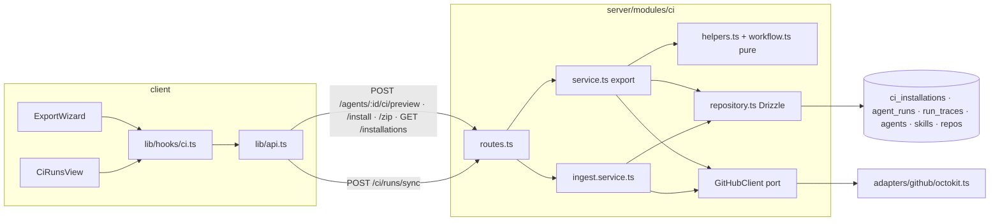

# Implementation Plan: Export to CI (worktree B) — SIMPLE version
**Spec:** `/Users/volodymy.rzhutenko/emdash/worktrees/dev-digest-95942142/emdash-export-to-ci-tg8ip/specs/2026-10-13-export-to-ci.md` (Date: 2026-10-13, Status when planned: approved)
**Execution mode:** multi-agent, at most 5 implementers (chosen by the user)
**Status:** ready (2026-10-13: user confirmed D1 = add `yaml@^2.6.1`, R3 = Preview warning only, spec synced from the Deviations table; run with fix-cap 1, ≤2 fix agents, implementer writes no tests)
**Replaces:** the earlier 10-task plan with the same file name (overwritten 2026-10-13 at the user's request).

## Summary (10 lines)
1. The simplified scope the user agreed on overrides the spec. Every conflict with the spec is listed in "Deviations from spec" (17 rows). The parent passes that table to `spec-creator`.
2. There are 6 tasks run by 5 implementer spawns in 3 waves: T1 contracts → (T2 server export ‖ T3 agent-runner ‖ T5→T6 client) → T4 server ingest.
3. Server: one new `ci` module (routes → service → repository, plus pure `helpers.ts`/`workflow.ts`). The existing `GitHubClient` port gets 3 read methods. There is no new client class and no new table.
4. DB: `ci_installations` gets 4 columns plus a unique key on (agent_id, repo), via a schema edit and `pnpm db:generate`. `agent_runs`, `run_traces` and `ci_runs` keep their schema.
5. Ingest is a pull model with a single endpoint (`POST /ci/runs/sync`). It runs in-process, serialized per workspace, and is idempotent on `github_run_id:attempt` (the key is stored in the trace).
6. agent-runner: the artifact gets more fields, the PR head SHA comes from the event payload, and `post_as` falls back to the manifest when no env var is set. `DEVDIGEST_POST_AS` is **already read** today (`agent-runner/src/index.ts:24-33`).
7. Client: a CI tab with a 4-step wizard and history, a CI Runs page and a GLOBAL sidebar entry. Filtering happens client-side and the page refetches every 60 s.
8. The implementer writes **no new tests**. Acceptance is typecheck plus the existing suites staying green (plus a build where relevant). Test coverage is an optional `test-writer` step outside the budget.
9. After the implementers: `architecture-reviewer` → `plan-verifier`. Then **one** fix iteration with **at most two** fix subagents. Anything left over goes to the user, with no further loop.
10. The top risk is that the ncc bundle may not run as `.devdigest/runner/index.mjs`. T3 has an explicit execution gate for it (R1).

## Agent budget
| Role | Count | Owns |
|---|---|---|
| implementation-planner | 1 | this plan + cards |
| implementer A | 1 | T1 (wave 1) |
| implementer B | 1 | T2 (wave 2) |
| implementer C | 1 | T3 (wave 2) |
| implementer D | 1 | T5 then T6 (wave 2, sequential in one spawn — all client files have one owner) |
| implementer E | 1 | T4 (wave 3) |
| architecture-reviewer | 1 | after wave 3 |
| plan-verifier | 1 | after architecture-reviewer (end of the pipeline) |
| fix subagents | ≤ 2 | ONE iteration only, on reviewer/verifier findings; leftovers are reported to the user |
| optional: test-writer, doc-writer | 0–2 | outside the implementer budget, see "Possible follow-ups" |
| **Total** | **9–13** | 1 + 5 + 1 + 1 + ≤2 (+ ≤2 optional) |

## Deviations from spec (for the parent → spec-creator)
| AC / item | Spec says | Plan does | Why |
|---|---|---|---|
| All `Verify:` clauses that call for new unit/RTL/`.it` tests (e.g. AC-7, AC-8, AC-11, AC-17, AC-21–29, AC-34, AC-35, AC-53–58) | A specific new test per AC | No new tests from the implementer. Acceptance is typecheck + existing tests + build + manual demo-repo run. The tests become the optional test-writer step | User: implementer writes no tests |
| AC-6 edge case "existing workflow → 'will be replaced'" | Preview marks a file that already exists on the default branch | Not shown. Preview does no GitHub read; the PR diff shows the change | Simplicity, no extra GitHub call |
| AC-19 / OQ-6 (c) | Neutral, then "verified by run <time>" | Configure always shows the neutral "required — cannot be checked from DevDigest". The CI tab shows the last-run time per installation as plain information | Simplicity |
| AC-34, AC-56, OQ-14 | Dependencies include the `reviewer-core` revision baked into the bundle | Runner version, Node version, model, manifest version and skill versions only. No reviewer-core revision, no bundle sha256 | User dropped it |
| AC-40 edge case (merged/closed PR) + OQ-16 | Reset `devdigest/ci` to the default head when it is safe; otherwise `branch_conflict` 409 | If the branch exists, add one commit on top (existing `commitFiles` behaviour). If there is no open PR, open a new one. No reset, no `branch_conflict` | User dropped reset logic |
| AC-43 | Message names the specific missing permission; `branch_conflict` code | GitHub 401 → `token_missing`, 404 → `repo_not_accessible`, 403 → `token_permission_missing` with one fixed message naming all three needed permissions (contents, pull requests, workflows write), other errors → `github_unavailable`. Zip stays available | A 403 does not reliably say which permission; simpler |
| AC-44 | Header has **Update CI config** and **Add to CI** | Only **Add to CI**. Running the wizard again for the same repo upserts the installation and adds a commit to `devdigest/ci` | User dropped the separate update flow |
| AC-48 | Notice says the change reaches CI after **Update CI config** is merged | Notice says it reaches CI after you export again (**Add to CI**) and merge the PR | Follows AC-44 |
| AC-49, OQ-15 | Update CI config opens a prefilled wizard | Dropped (no prefill; the installation does not store triggers or post mode) | User dropped it |
| AC-51 | **Add repository** opens the picker with installed repos marked | Dropped. **Add to CI** opens the wizard on the Target step (repo picker) | Simplicity |
| AC-53 | The repo id is compared with the installation's repository id | The artifact `repository_id` is compared with the Actions run's `repository.id`. The run is fetched from the installation's repo, so they are equivalent. No repo id is stored | Avoids a column and an extra GitHub call |
| AC-61 | Filters: time range, agent, repository, status | Agent and repository only, client-side | User |
| AC-62, OQ-13 | Ingest on open + Refresh, auto-refresh 60 s | Same, implemented as one `POST /ci/runs/sync` (ingest, then list) used as the query function, with `refetchInterval: 60_000` | Single endpoint |
| OQ-17 | Exporting a different agent shows "replaces <agent>" | Preview shows a warning when another agent is installed in that repo. Nothing is deleted from the repo (see R3) | User: warning only |
| OQ-18 | Statuses pending / active / outdated / error | Stored status is `pending` or `active` only. "Outdated" is a derived client badge (installed manifest/workflow version < current). No `error` and no `repo_disconnected` | User dropped extra statuses |
| AC-65 | The fork note is on Configure **or** Install | Shown on both Configure and Install as a static note | — |
| AC-6 runner path | `.devdigest/runner/index.js` | `.devdigest/runner/index.mjs`: the ncc bundle is ESM, and `.mjs` runs as ESM on every Node version without an extra `package.json` (R1 resolved after wave 1) | Wave-1 execution gate: a lone `index.js` fails on Node < 22.7 |
| Delivery / e2e | e2e flow implied for user-visible flows (AGENTS.md validation) | No e2e flow 16. Manual verification on a demo repo replaces it | User |

Everything else in the spec is implemented as written, including AC-1–5, AC-7, AC-9–18, AC-20–33, AC-35–39, AC-41, AC-42, AC-45–47, AC-50, AC-52, AC-54, AC-55, AC-57–60, AC-63 and AC-64.

## Definition of Done
- [x] The spec was read-only: not edited by me (it is untracked, `git status` `??`), and nothing in it was executed.
- [x] The spec is `approved`; the mode was given by the user (multi-agent, ≤5 implementers).
- [x] Every AC has a verdict (table below). The non-clear ones are resolved by the user's simplified scope (Deviations).
- [x] Every AC maps to a task or a deviation; every task traces to ACs.
- [x] Every task has files, owned paths, executor, depends-on, skills and a measurable acceptance.
- [x] The dependencies form a DAG; waves are disjoint; there is one checkpoint per package per wave.
- [x] The contracts task comes first, with both vendor copies named and the edits to existing shared contracts called out.
- [x] The testing strategy covers every touched package (no new tests by the implementer, per the user).
- [x] Open decision D1 (confirmed by the user: add yaml) (`yaml` dependency for the server) still needs confirmation. A default is given.
- [x] Facts are evidenced; unverified items are listed.
- [x] Reviewer handoff filled; plan and cards saved (overwriting the old pair, as the parent instructed); empty Delivery log.

## Requirements review (condensed)
| AC | Verdict | Finding | Resolution |
|---|---|---|---|
| AC-1–3, 5–7, 9, 10, 12–18, 20–33, 35–39, 41, 42, 46, 47, 50, 52, 54, 57–60, 63–65 | clear | — | Implemented as written |
| AC-4 | clear | Only GHA is registered → exactly one card | T5 |
| AC-8 | clear | Both sides import the same `AgentManifest` (`agent-runner/src/manifest.ts:4`) | The parity test is optional (test-writer) |
| AC-11 | clear | — | T2 validator (4 rules). Install is blocked, zip stays available (OQ-11) |
| AC-19, 34, 40, 43, 44, 48, 49, 51, 53, 56, 61, 62 | conflicts with the user's simplified scope | — | Deviations table |
| AC-45 | clear | No stored `outdated`; derived from versions | T5 helper |
| AC-55 | clear | `agent_runs` has no external-id column (`server/src/db/schema/runs.ts:18-43`) | Key in the trace + per-workspace in-process lock (R4) |
| Edge: install PR runs before base has the runner | gap | Base checkout has no runner on the install PR | Workflow step exits 0 with a job-summary notice (T2) |

## Recommendations
- Store the ingest idempotency key in a real unique column later (`agent_runs.external_run_key`). Today's trace-key + in-process lock is enough for a single local studio process. — approach
- Let `commitFiles` accept deletions so that exporting agent B deletes agent A's manifest. That turns the OQ-17 warning into a working replace. It is ~10 lines in the octokit adapter, but the user excluded it for now. — requirement
- Split the spec's ACs to match this plan once the deviations are accepted, so that `plan-verifier` checks against the simplified text. — requirement

## Context found
- `GitHubClient` has `commitFiles`, `findOpenPr` and `openPullRequest`, and has no Actions methods — `server/src/vendor/shared/adapters.ts:163-185`. Implementations: `adapters/github/octokit.ts:29`, `adapters/mocks.ts:135`. Port-type users without their own implementation: `modules/intent/service.ts:59`, `test/eval.it.test.ts:105` (uses `MockGitHubClient`). Nothing else implements it.
- `commitFiles` creates the branch from `base` if it is missing, else commits on top. The tree is layered on the parent, so it never deletes files — `octokit.ts:264-300`.
- Shared CI contracts are `AgentManifest`, `CiExportInput`, `CiInstallation`, `CiExport`, `CiRun` and `CiResultArtifact` — `server/src/vendor/shared/contracts/eval-ci.ts:489-596`. The client copy lacks `AgentManifest`, and its import line lacks `Provider`/`CiFailOn` (`client/src/vendor/shared/contracts/eval-ci.ts:3`). The only consumers outside vendor are in agent-runner (`manifest.ts`, `artifact.ts`, `run.ts`, `run.test.ts`).
- `ci_installations(id, agent_id, repo, target_type, installed_at)` has no workspace column and no unique key — `server/src/db/schema/ci.ts:4-12`. `agent_runs` and `run_traces` are at `server/src/db/schema/runs.ts:18-52`. The latest migration is `0017_spooky_doctor_doom.sql`.
- The PR cost sum filters `agent_runs.pr_id` (`server/src/modules/pulls/routes.ts:148-159`), and PR history filters by `prId` (`reviews/repository/run.repo.ts:41-52`). CI rows with `pr_id NULL` stay out of the PR feed (AC-57).
- The runner already reads `DEVDIGEST_POST_AS` (`agent-runner/src/index.ts:24-33`). The artifact is built at `agent-runner/src/artifact.ts:32-55`, with `RUNNER_VERSION='1'`. The context reads the event payload (`context.ts:40,75-92`) but not `head.sha`.
- `agent-runner/.gitignore:2` ignores `dist/` (this overrides the root `!agent-runner/dist/`, `.gitignore:5`). The build is `ncc build src/index.ts -o dist` (`agent-runner/package.json`). There is no `dist/` in the worktree now.
- The server has `fflate` (`server/package.json:33`) but **no `yaml` package**. agent-runner uses `yaml ^2.6.1`.
- Errors: `AppError(code, message, statusCode)` and `ConflictError` — `server/src/platform/errors.ts:7-50`. `getContext` is in `modules/_shared/context.ts:14`.
- Client: the sidebar is `client/src/vendor/ui/nav.ts` (sanctioned edit). `activeKeyFor` already maps `/ci-runs` → `ci-runs` (`components/app-shell/helpers.ts:41`). The nav tests check only WORKSPACE/SKILLS LAB and key uniqueness (`app-shell/nav.test.ts`). Agent editor tabs are listed in `AgentEditor/constants.ts:11-16` (`agents.json` already has `editor.tabs.ci`). `messages/en/ci.json` already has `runs`, `exportWizard`, `ciTab` and `page` groups. `CI_FAIL_ON_VALUES` is in `ConfigTab/constants.ts:10`.
- INSIGHTS traps: the entry guard `file://${argv[1]}` never fires on a path containing a space (`server/INSIGHTS.md:12`; the runner uses the same guard, `agent-runner/src/index.ts:66-69`). The `db:generate` rename prompt needs a TTY (`server/INSIGHTS.md:279`; it does not trigger for pure column adds). Use `.nullish()` for new jsonb contract fields (`server/INSIGHTS.md:161`). A fine-grained PAT only sees the repos chosen when it was created (`server/INSIGHTS.md:268`).

## Affected packages & contracts
| Package | Folder | Change |
|---|---|---|
| shared (both copies) | `server/src/vendor/shared/contracts/eval-ci.ts`, `client/src/vendor/shared/contracts/eval-ci.ts` | Reshape the CI contracts (T1) |
| shared port (both copies) | `server/src/vendor/shared/adapters.ts`, `client/src/vendor/shared/adapters.ts` | 3 Actions read methods + types (T2) |
| server | `src/modules/ci/*` (new), `src/adapters/github/octokit.ts`, `src/adapters/mocks.ts`, `src/db/schema/ci.ts`, migration (generated), `src/modules/index.ts`, `src/platform/config.ts` | T2, T4 |
| agent-runner | `src/artifact.ts`, `src/context.ts`, `src/run.ts`, `src/index.ts`, `README.md` (+ `scripts/dev.sh` note) | T3 |
| client | `src/lib/api.ts`, `src/lib/hooks/ci.ts`, agent editor CI tab + wizard, `components/ci-runs-table/`, `app/ci-runs/`, `vendor/ui/nav.ts`, `messages/en/ci.json`, `agents.json` | T5, T6 |

Contracts (T1). These edit **existing** shared contracts deliberately; the only consumers are in agent-runner, and they are updated in T3:
- `AgentManifest` + `version: int nullish`, `skill_versions: record<string,int> nullish`, `post_as: CiPostAs nullish`. Added to the client copy too, together with the `Provider`/`CiFailOn` import.
- `CiPostAs = enum(github_review, pr_comment, none)`; `CiTrigger = enum(opened, synchronize, reopened)`.
- `CiExportRequest { repo_id: uuid, triggers: CiTrigger[] (min 1, unique), post_as: CiPostAs, workflow?: string (max 64 KiB) }`. It replaces `CiExportInput`.
- `CiFile { path, contents, editable }` (unchanged) · `CiWorkflowViolation { rule: 'yaml_invalid'|'forbidden_trigger'|'extra_permissions'|'unpinned_action', message }` · `CiPreview { files: CiFile[], workflow_violations: CiWorkflowViolation[], warnings: string[] }`.
- `CiInstallation` + `manifest_version: int`, `workflow_version: int`, `pr_url: string|null`, `status: 'pending'|'active'`, `repo_id: string|null`. `CiInstallResult { installation, pr_url: string|null }` replaces `CiExport`.
- `CiResultArtifact` + `artifact_version: literal(2)`, `repository: string`, `repository_id: int`, `head_sha: string (40 hex)`, `manifest_version: int nullish`, `model: string`, `runner_version: string`, `node_version: string`, `verdict: 'pass'|'fail'`, `blockers: int`, `skill_versions: record nullish`. Existing fields stay; numeric fields are bounded (`.nonnegative()`, `max`).
- `CiRunItem` (replaces `CiRun`): `{ id, agent_id|null, agent_name, repo, pr_number|null, pr_url|null, commit_sha|null, status: 'done'|'failed'|'skipped', verdict: 'pass'|'fail'|null, blockers|null, findings_count|null, critical|null, warning|null, suggestion|null, cost_usd|null, duration_ms|null, ran_at, job_url }`. `CiSyncResult { runs: CiRunItem[], accepted, duplicates, rejected }`.
- Server-only error codes (AppError `code`): `no_repository`, `repo_not_accessible`, `token_missing`, `token_permission_missing`, `agent_not_exportable`, `runner_bundle_missing`, `workflow_invalid`, `github_unavailable`.

## Design

- Pure, testable functions live in `modules/ci/helpers.ts` (slug, manifest object → YAML, file list, outdated rule, artifact-vs-run verification, run → agent_runs mapping) and `modules/ci/workflow.ts` (template + validator). Neither imports Fastify, Drizzle or SDKs.
- `service.ts` (export) and `ingest.service.ts` take **narrow deps** (`repo: CiRepository`, `agents: AgentsRepository` via `container.agentsRepo`, `github: () => Promise<GitHubClient>`, `readRunnerBundle: () => Promise<string|null>`, `log`). This follows onion §5. There is no container change.
- `repository.ts` is the only Drizzle file. It reads `repos`/`skills`/`agents` and writes `ci_installations`, `agent_runs` and `run_traces` (a transaction opened by the service; `Tx` type added to `db/client.ts` only if absent; to verify by implementer).
- The runner bundle is read from `config.agentRunnerBundlePath` (default `<server cwd>/../agent-runner/dist/index.js`). If the file is missing, the service throws `AppError('runner_bundle_missing', …, 409)`. The Preview returns the runner as a placeholder (`// bundled agent-runner, N bytes`, editable false). Install and zip use the real bytes, so the client never sends files back; only `workflow` edits travel.

## Phased tasks

### Phase 1 — Contracts
- **T1** (covers AC-7, AC-8, AC-17, AC-34, AC-54, AC-56, AC-60 shapes)
  - **Action:** Edit the CI section of both `eval-ci.ts` copies exactly as listed in "Affected packages & contracts". Add `AgentManifest` and its imports to the client copy. Then update the agent-runner compile sites only as far as needed to keep **typecheck green** (no behaviour). The real runner behaviour is T3, done by the same spawn right after.
  - **Package / Type:** shared (server + client copies) — core
  - **Executor:** implementer (A)
  - **Skills to use:** zod, typescript-expert
  - **Owned paths:** `server/src/vendor/shared/contracts/eval-ci.ts`, `client/src/vendor/shared/contracts/eval-ci.ts`
  - **Depends-on:** none
  - **Risk:** low
  - **Checkpoint:** yes (server, client)
  - **Known gotchas:** new optional fields `.nullish()` (`server/INSIGHTS.md:161`). Do not "sync" the rest of the client file (AGENTS.md).
  - **Acceptance:** `cd server && pnpm typecheck` and `cd client && pnpm typecheck` pass. `cd agent-runner && pnpm typecheck` may fail **only** on `artifact.ts` missing new required fields, which T3 fixes in the same spawn. No new tests.

### Phase 2 — Producers (parallel)
- **T2** (covers AC-6, AC-7, AC-9, AC-11, AC-12, AC-13, AC-17, AC-21–29, AC-37–39, AC-41, AC-42, AC-43 (simplified), OQ-8, OQ-17 warning, OQ-20)
  - **Action:**
    1. Schema: in `ci_installations` add `manifestVersion integer not null default 1`, `workflowVersion integer not null default 1`, `prUrl text`, `status text enum ['pending','active'] not null default 'pending'`, and `uniqueIndex` on (agentId, repo). Run `pnpm db:generate` (never hand-edit) and then `pnpm db:migrate` locally.
    2. Port: in both `adapters.ts` copies add `CiWorkflowRun { id, run_attempt, head_sha, path, status, conclusion|null, html_url, repository_id, updated_at }`, `CiRunArtifactRef { id, name, size_in_bytes, expired }` and the methods `listWorkflowRuns(repo, workflowFile, { perPage })`, `listRunArtifacts(repo, runId)` and `downloadArtifact(repo, artifactId): Promise<Uint8Array>`. Implement them in `octokit.ts` (`actions.listWorkflowRuns`, `actions.listWorkflowRunArtifacts`, `actions.downloadArtifact` with `archive_format:'zip'`; map SDK errors to `ExternalServiceError`, and keep the HTTP status in `details`) and in `MockGitHubClient` (configurable fixtures via `MockGitHubOptions`, record calls).
    3. `modules/ci/constants.ts`: `CI_BRANCH='devdigest/ci'`, `CI_PR_TITLE='Add DevDigest CI review'`, `CI_WORKFLOW_PATH='.github/workflows/devdigest-review.yml'`, `CI_WORKFLOW_FILE='devdigest-review.yml'`, `CI_WORKFLOW_VERSION=1`, `CI_RUNNER_PATH='.devdigest/runner/index.mjs'`, `CI_ARTIFACT_NAME='devdigest-result'`, and the pinned action SHAs (`actions/checkout`, `actions/upload-artifact`, each with a `# vX.Y.Z` comment; verify each SHA with `gh api repos/actions/<name>/git/ref/tags/<tag>`).
    4. `workflow.ts` (pure): `renderWorkflow({ triggers, postAs })` emits a stable `name: DevDigest Review` and job id `review` with `name: DevDigest Review`, `on: pull_request: types: [...]` only, and the `permissions` block `contents: read` + `pull-requests: write` only. The `review` job has `if: github.event.pull_request.head.repo.full_name == github.repository`, checks out `ref: ${{ github.event.pull_request.base.sha }}` with `persist-credentials: false`, and has a run step that exits 0 with a `$GITHUB_STEP_SUMMARY` notice when `.devdigest/runner/index.mjs` is absent, else `node .devdigest/runner/index.mjs`. Its env is `OPENROUTER_API_KEY: ${{ secrets.OPENROUTER_API_KEY }}`, `GITHUB_TOKEN: ${{ github.token }}`, `PR_NUMBER: ${{ github.event.pull_request.number }}`, `DEVDIGEST_POST_AS: <mode>`. Then upload-artifact `if: always()`, `if-no-files-found: ignore`. A second job `fork-notice` (`if:` the inverse) writes a job-summary line and uses no secret. No PR text in any `run:`. Header comment `# devdigest-workflow-version: 1`. `validateWorkflow(text): CiWorkflowViolation[]` parses with `yaml`, then checks: (a) parse error → `yaml_invalid`; (b) `on` contains `pull_request_target`, `issue_comment`, `pull_request_review_comment` or `workflow_run` → `forbidden_trigger`; (c) a top-level or job-level `permissions` that is not exactly `{contents: read, pull-requests: write}` (or a subset of it) → `extra_permissions`; (d) any `uses:` not matching `@[0-9a-f]{40}` (local `./` paths excepted) → `unpinned_action`.
    5. `helpers.ts` (pure): `slugify(name)` (lowercase kebab, stable); `isExportable(agent)` (provider === 'openrouter'); `buildManifest(agent, skills)` returns an `AgentManifest` object (version, skill_versions, post_as, ci_fail_on, strategy, skills = enabled linked skills in order), checked with `AgentManifest.parse`; `manifestYaml` (via `yaml.stringify`); `buildFiles({ manifest, skills, runner, workflow })` in the AC-6 order (`.devdigest/agents/<slug>.yaml`, `.devdigest/skills/<skill-slug>.md`…, `.devdigest/memory.jsonl` empty, `.devdigest/runner/index.mjs` editable false, workflow editable true); `toInstallationDto(row)`.
    6. `repository.ts`: `getRepoForWorkspace(workspaceId, repoId)`, `listInstallations(workspaceId, agentId)` (join agents for the workspace scope), `upsertInstallation({ agentId, repo, manifestVersion, workflowVersion, prUrl, status })` (on conflict (agent_id, repo) update), `otherAgentInstalled(workspaceId, repo, agentId)`.
    7. `service.ts` `CiExportService`: `preview` (agent not found → 404; not OpenRouter → `agent_not_exportable` 422; repo not in workspace → `no_repository` 404; bundle missing → `runner_bundle_missing` 409; returns files with a runner placeholder, validator violations for the supplied or generated workflow, and the OQ-17 warning); `install` (same, plus violations → `workflow_invalid` 422; `commitFiles({ branch: CI_BRANCH, base: repo.defaultBranch, message, files })` → `findOpenPr` → reuse, else `openPullRequest(head CI_BRANCH → base default)`; upsert the installation `pending` with the PR URL; map GitHub errors as in the Deviations row AC-43; log agent id, repo, outcome and code, never tokens); `zip` (same validation; `fflate.zipSync` of path → bytes; upsert `pending` with `pr_url null`; **no GitHub call**); `listInstallations`.
    8. `routes.ts`: `POST /agents/:id/ci/preview`, `POST /agents/:id/ci/install`, `POST /agents/:id/ci/zip` (reply `application/zip` + `content-disposition: attachment; filename="devdigest-ci-<slug>.zip"`), `GET /agents/:id/ci/installations`. Thin handlers with Zod route schemas from shared. Register `ci` in `modules/index.ts`. Add `agentRunnerBundlePath` to `platform/config.ts` (env `AGENT_RUNNER_BUNDLE_PATH`, with the default above).
  - **Package / Type:** server — backend
  - **Executor:** implementer (B)
  - **Skills to use:** onion-architecture, fastify-best-practices, drizzle-orm-patterns, postgresql-table-design, zod, security, typescript-expert
  - **Owned paths:** `server/src/modules/ci/{constants,workflow,helpers,repository,service,routes}.ts`, `server/src/modules/index.ts`, `server/src/platform/config.ts`, `server/src/db/schema/ci.ts`, `server/src/db/migrations/**` (generated only), `server/src/db/rows.ts` (if a row type is added), `server/src/db/client.ts` (only to add `Tx` if absent), `server/src/vendor/shared/adapters.ts`, `client/src/vendor/shared/adapters.ts`, `server/src/adapters/github/octokit.ts`, `server/src/adapters/mocks.ts`, `server/package.json` + `server/pnpm-lock.yaml` (only via `pnpm add yaml@^2.6.1`, D1)
  - **Depends-on:** T1
  - **Risk:** high
  - **Checkpoint:** yes (server, wave 2)
  - **Known gotchas:** fine-grained PAT scope → 404 = `repo_not_accessible` (`server/INSIGHTS.md:268`). The workflow-file write needs the token's workflow permission, so a 403 on commit maps to `token_permission_missing`. Never log the token or the clone URL. No `reply.status` for errors; throw `AppError`. Don't import `modules/agents/*`; use `container.agentsRepo`.
  - **Acceptance:** `cd server && pnpm typecheck` passes. `pnpm exec vitest run --exclude '**/*.it.test.ts'` is green (existing tests unchanged). A new migration file and journal entry appear under `server/src/db/migrations/`, generated. `grep -n "pull_request_target\|review-action\|OPENAI_API_KEY" server/src/modules/ci/workflow.ts` matches only inside the validator's forbidden list. The onion grep checklist (onion §9) prints nothing for `modules/ci`. No new tests by implementer.

- **T3** (covers AC-17, AC-30–36, AC-34 fields, R1)
  - **Action:** `context.ts`: read `pull_request.head.sha` and `repository.id` from the event payload (hard-fail if they are missing). `artifact.ts`: build the T1 artifact (`artifact_version: 2`, repository, repository_id, head_sha, manifest_version = manifest.version, model, runner_version = `RUNNER_VERSION` (bump to `'2'`), node_version = `process.version` passed in from `index.ts`, verdict = gateTriggered ? 'fail' : 'pass', blockers, skill_versions = manifest.skill_versions). `index.ts`: `post_as` = env `DEVDIGEST_POST_AS` if valid, else `manifest.post_as`, else `github_review` (move the resolution so the manifest is known, or pass both to `runCi`; keep the change minimal). Make the entry guard robust: compare `import.meta.url` with `pathToFileURL(process.argv[1]).href` (INSIGHTS space bug). Update the existing `run.test.ts` fixtures **only** where the new required context or artifact fields make them fail (fixtures, not new cases). Document `pnpm install && pnpm build` in `agent-runner/README.md`, and add a one-line note in `scripts/dev.sh` (echo/comment: "export to CI needs `cd agent-runner && pnpm build`").
  - **Package / Type:** agent-runner — core
  - **Executor:** implementer (A, right after T1 in the same spawn)
  - **Skills to use:** typescript-expert, zod, security
  - **Owned paths:** `agent-runner/src/{artifact,context,run,index}.ts`, `agent-runner/src/run.test.ts` (fixture updates only), `agent-runner/README.md`, `scripts/dev.sh`
  - **Depends-on:** T1
  - **Risk:** medium
  - **Checkpoint:** yes (agent-runner)
  - **Known gotchas:** entry guard and path with a space (`server/INSIGHTS.md:12`). Never print env values. Keep `<untrusted>` wrapping untouched.
  - **Acceptance:** `cd agent-runner && pnpm typecheck && pnpm test` green. `pnpm build` produces a bundle. **Execution gate (R1):** from a path without spaces, `cd /tmp-scratch && node <abs>/agent-runner/dist/index.js; echo $?` prints `[agent-runner] FAILED:` and `1`. If ncc emits `index.mjs`, or the file fails to load as `.js` without `"type":"module"`, stop and report the actual output file and module format to the parent: T2's `agentRunnerBundlePath`/file list must then follow (see R1). No new tests by implementer.

- **T5** (covers AC-1–6, AC-10–20, AC-37, AC-41–47, AC-50, AC-65; deviations AC-44/48/51)
  - **Action:**
    1. `lib/api.ts`: `ciPreview(agentId, body)`, `ciInstall(agentId, body)`, `ciZip(agentId, body): Promise<Blob>` (a non-JSON fetch path; to verify how `api.ts` handles blobs), `ciInstallations(agentId)`, `ciSyncRuns()`.
    2. `lib/hooks/ci.ts`: `useCiPreview` (mutation), `useCiInstall`, `useCiZip`, `useCiInstallations(agentId)`, `useCiRuns()` (query with `queryFn: api.ciSyncRuns`, `refetchInterval: 60_000`, `refetchIntervalInBackground: false`).
    3. Agent editor: add `{ key: "ci", labelKey: "editor.tabs.ci", icon: … }` to `TABS`, and route `tab === "ci"` to `<CiTab>`.
    4. `CiTab/`: header "CI deployment" · "Active in N repos" (count of `active` installations) · **Add to CI**; rows (repo, GitHub Actions, installed manifest/workflow version, derived **outdated** badge via `helpers.ts isOutdated(inst, agent.version, CURRENT_WORKFLOW_VERSION)`, last run outcome/time from `useCiRuns` filtered by agent); empty state with Add to CI; a **Fail CI on** select bound to the existing agent update mutation (`CI_FAIL_ON_VALUES`); the AC-48 notice when any installation is outdated; history = `<CiRunsTable runs={filtered}>`.
    5. `CiTab/_components/ExportWizard/`: a modal dialog (UI-kit modal; focus trap, Escape, Close button, `aria-current="step"`) with the steps Target → Preview → Configure → Install. Target: repo picker over the connected repos (active preselected; Continue disabled plus a "connect a repository" message when there are none), one GHA card "recommended". Preview: calls `useCiPreview`; file list; viewer read-only except the workflow `<textarea>`; shows `workflow_violations` and warnings; typed-error messages (`agent_not_exportable`, `runner_bundle_missing`). Configure: trigger toggle chips (`aria-pressed`, opened + synchronize on by default, reopened off, none → Continue disabled), post-as radio group (review default), secrets list (`OPENROUTER_API_KEY` neutral "required — cannot be checked from DevDigest", `GITHUB_TOKEN` "provided by Actions"), Fail-CI-on + required-check note, fork note; if the workflow was edited, a note that changing the triggers or post mode regenerates the workflow and discards the edits (OQ-12). Install: Open a PR (default; names the repo, the PR title and `files.length`) vs Download .zip; Install disabled while `workflow_violations.length > 0` for the PR option (zip stays enabled); success shows the PR link; errors render by code.
    6. `components/ci-runs-table/CiRunsTable.tsx` (shared by the CI tab and the CI Runs page): columns repository, PR (`#n` linked to `pr_url`), agent, verdict/status, findings with severity breakdown, cost (`—` when null, via the existing cost formatter if one exists), duration, job link (accessible name). Rendered as a table with column headers.
    7. i18n: all new strings go into `messages/en/ci.json` (reuse the existing `exportWizard`/`ciTab`/`runs` keys, add the missing ones) and `agents.json` if needed. No hard-coded strings.
  - **Package / Type:** client — ui
  - **Executor:** implementer (D)
  - **Skills to use:** frontend-architecture, react-best-practices, next-best-practices, zod, security
  - **Owned paths:** `client/src/lib/api.ts`, `client/src/lib/hooks/ci.ts`, `client/src/app/agents/[id]/_components/AgentEditor/{AgentEditor.tsx,constants.ts}`, `client/src/app/agents/[id]/_components/AgentEditor/_components/CiTab/**`, `client/src/components/ci-runs-table/**`, `client/messages/en/ci.json`, `client/messages/en/agents.json`
  - **Depends-on:** T1
  - **Risk:** medium
  - **Checkpoint:** no (T6 is the client checkpoint)
  - **Known gotchas:** a runtime import from the `@devdigest/shared` barrel can break only under webpack (planner rule); hence the `next build` gate in T6. Import `@/lib/hooks/ci`, not a barrel. `page.tsx` stays thin.
  - **Acceptance:** `cd client && pnpm typecheck` passes. `pnpm exec vitest run src/app/agents` is green (existing agent tests, incl. `AgentEditor.test.tsx`). No new tests by implementer.

- **T6** (covers AC-59–64; deviation AC-61/62)
  - **Action:** `client/src/vendor/ui/nav.ts`: add a section `{ section: "GLOBAL", items: [{ key: "ci-runs", label: "CI Runs", icon: <existing icon>, href: "/ci-runs" }] }` (a deliberate sanctioned edit; say so in the commit body). `app/ci-runs/page.tsx` (thin, renders `<CiRunsView />`). `app/ci-runs/_components/CiRunsView/`: title/subtitle, **Refresh** (`refetch()`), "auto-refresh on", agent + repo `<select>` filters (pure `helpers.ts filterRuns(runs, { agentId, repo })`, options derived from the data), skeleton / "No CI runs yet" empty state / error state with retry, `<CiRunsTable>` newest first. The strings already exist in `ci.json` `runs.*`; D adds missing keys there (same owner).
  - **Package / Type:** client — ui
  - **Executor:** implementer (D, after T5 in the same spawn)
  - **Skills to use:** frontend-architecture, react-best-practices, next-best-practices
  - **Owned paths:** `client/src/vendor/ui/nav.ts`, `client/src/app/ci-runs/**`, (and `client/messages/en/ci.json`, already owned by D)
  - **Depends-on:** T5
  - **Risk:** low
  - **Checkpoint:** yes (client, wave 2)
  - **Known gotchas:** `activeKeyFor` already supports `/ci-runs` (`components/app-shell/helpers.ts:41`). The nav tests assert WORKSPACE/SKILLS LAB contents only.
  - **Acceptance:** `cd client && pnpm typecheck && pnpm test` green (full suite). `pnpm build` (`next build`) succeeds and lists `/ci-runs` and `/agents/[id]` (no `distDir` override exists in `client/next.config.*`; stop a running `pnpm dev` first, since both use `.next`). No new tests by implementer.

### Phase 3 — Ingest
- **T4** (covers AC-52, AC-53 (simplified), AC-54, AC-55, AC-56 (simplified), AC-57, AC-58, AC-60 data, AC-62 server side)
  - **Action:** `modules/ci/ingest.ts` (pure): `verifyArtifact(artifact, run, expected)` returns `{ ok } | { reason }`. It checks `CiResultArtifact.safeParse` (on bytes ≤ 64 KiB), `artifact.repository_id === run.repository_id`, `artifact.head_sha === run.head_sha`, `run.path === CI_WORKFLOW_PATH`, and the artifact's `agent` matches the installation's agent name/slug (to verify by implementer: the artifact's `agent` field holds the manifest name). Also `toCiRunRecord(...)`, which maps an accepted artifact, or an artifact-less completed run (status `failed` when the conclusion is failure/cancelled/timed_out, `skipped` when success/skipped without an artifact), to agent_runs values (`source:'ci'`, `prId: null`, `provider:'openrouter'`, model, durationMs, costUsd, findingsCount, blockers, `status:'done'|'failed'|'skipped'`, ranAt = run.updated_at) plus the trace document `{ source:'ci', ci_run_key:"<id>:<attempt>", repo, pr_number, pr_url, commit_sha, job_url, agent_name, manifest_version, model, verdict, severity counts, dependencies: { runner_version, node_version, skill_versions } }`. `modules/ci/ingest.service.ts` `CiIngestService.sync(ctx)`: guard with a per-workspace in-process promise, so that a second concurrent call awaits the first. For each installation of the workspace: `listWorkflowRuns(repo, CI_WORKFLOW_FILE, { perPage: 30 })`, completed runs only, skip keys already stored. `listRunArtifacts` → the artifact named `devdigest-result` (not expired, size bound) → `downloadArtifact` → `fflate.unzipSync` → `devdigest-result.json` → `JSON.parse` in try/catch → verify. Accepted: insert agent_runs + run_traces in one transaction and set the installation to `active`. Rejected: log the reason and store nothing. A GitHub error on one installation: log it and continue. Return the `CiSyncResult` with the list (`listCiRuns(workspaceId)`, newest first, limit 200, join run_traces; agent name from the trace, so a deleted agent still shows). Log counts only (installations checked, accepted, duplicates, rejected with reasons), never artifact bodies. Repository additions: `hasCiRunKey(workspaceId, key)` (jsonb `trace->>'ci_run_key'`), `insertCiRun(tx, values, trace)`, `markInstallationActive`, `listCiRuns`, `listWorkspaceInstallations`. Route `POST /ci/runs/sync` (schema from shared).
  - **Package / Type:** server — backend
  - **Executor:** implementer (E)
  - **Skills to use:** onion-architecture, fastify-best-practices, drizzle-orm-patterns, zod, security
  - **Owned paths:** `server/src/modules/ci/ingest.ts`, `server/src/modules/ci/ingest.service.ts`, `server/src/modules/ci/repository.ts`, `server/src/modules/ci/routes.ts`, `server/src/modules/ci/constants.ts` (append only), `server/src/db/client.ts` (only if `Tx` is still absent)
  - **Depends-on:** T2 (and T3, for the artifact fields; already landed in wave 1)
  - **Risk:** high
  - **Checkpoint:** yes (server, wave 3)
  - **Known gotchas:** `agent_runs` goes terminal before `run_traces` in the local executor (`server/INSIGHTS.md:258`); write both in one transaction here. Aggregations over `agent_runs` should use `status='done'` (`server/INSIGHTS.md:193`). Never set `pr_id` (OQ-2, AC-57). Treat artifact text as data only.
  - **Acceptance:** `cd server && pnpm typecheck` passes. `pnpm exec vitest run --exclude '**/*.it.test.ts'` is green. If Docker is available, `pnpm exec vitest run .it.test` is green (existing tests). `grep -n "prId" server/src/modules/ci/*.ts` shows only `prId: null`. No new tests by implementer.

## Execution order (multi-agent, 5 implementers)
| Wave | Spawn | Tasks | Checkpoint |
|---|---|---|---|
| 1 | A | T1 → T3 (sequential, one spawn) | server + client typecheck (T1); agent-runner full (T3) |
| 2 | B ‖ D | B: T2 · D: T5 → T6 (sequential, one spawn) | server: T2 · client: T6 |
| 3 | E | T4 | server: T4 |
Then `architecture-reviewer` → `plan-verifier`, then **one** fix iteration with **≤ 2** fix subagents, then report leftovers to the user. The parent passes each wave's baseline (one line per package: typecheck + unit result) to the next wave's tasks instead of re-running it.

Owned paths are disjoint within each wave. B and E both touch `modules/ci/{repository,routes,constants}.ts`, sequentially (E depends on B), so each file has one owner at a time. B owns both `adapters.ts` copies; A owns both `eval-ci.ts` copies; D owns every client file except `client/src/vendor/shared/adapters.ts` (B).

## Testing strategy
- **No new tests by the implementer** (user instruction). Every task: typecheck + the existing tests of its package stay green.
- server: `pnpm typecheck`; `pnpm exec vitest run --exclude '**/*.it.test.ts'`; integration `pnpm exec vitest run .it.test` when Docker is up (validation phase).
- client: `pnpm typecheck`; `pnpm test`; plus a `next build` of the touched routes (T6).
- agent-runner: `pnpm typecheck`; `pnpm test`; `pnpm build` + the execution gate (T3).
- Manual validation (replaces e2e flow 16): build the runner, run the stack, export an OpenRouter agent to a demo repo → check the PR contents (permissions, pinned SHAs, base checkout) → merge, add `OPENROUTER_API_KEY` → open a PR → check the review and the check → CI Runs Refresh shows the run with its job link.
- Optional `test-writer` step (outside the budget), in priority order: (1) `validateWorkflow`, one case per rule plus a generated workflow passing; (2) manifest/runner parity (`buildManifest` → YAML → `loadAgentManifest`); (3) `verifyArtifact` with a forged repo id, a mismatched SHA, the wrong workflow path, oversize, and replay (the same key twice → one row, `.it`); (4) an artifact secret-leak check with sentinel env values in `run.test.ts`.

## Risks & traps
- **R1 (high):** the ncc output format/name. `agent-runner` is `"type":"module"`, and ncc may emit ESM (or `index.mjs`). As `.devdigest/runner/index.mjs` inside a repo without `"type":"module"`, Node would treat it as CJS and fail. Mitigation: T3's execution gate. If it fails, the fallback is to build as CJS (ncc option or a `.cjs` entry), or ship `.devdigest/runner/package.json` `{"type":"module"}` (adds one file to AC-6 → a deviation the parent must accept). Evidence: `agent-runner/package.json` (`"type": "module"`, `ncc build`).
- **R2:** the `dist/` bundle is git-ignored (`agent-runner/.gitignore:2`), so a fresh clone gets `runner_bundle_missing`. Mitigation: README + `scripts/dev.sh` note (T3) and a typed 409 (T2).
- **R3:** exporting a second agent to the same repo leaves two manifests, and the runner hard-fails "Expected exactly one agent manifest" (`agent-runner/src/manifest.ts:42`). Mitigation: the Preview warning tells the user to delete the old `.devdigest/agents/*.yaml` in the PR (Recommendation 2 would fix it properly).
- **R4:** idempotency is check-then-insert on a jsonb key and is not DB-enforced. The in-process per-workspace lock covers the 60 s refetch + Refresh + CI-tab overlap in a single server process.
- **R5:** a same-repo PR author can edit the workflow in their PR (`pull_request` uses the PR's workflow file) and reach `OPENROUTER_API_KEY`. This is inherent to `pull_request` for writers. Document it in the maintainer note; it is out of scope to fix.
- **R6:** a skipped `review` job (fork) may satisfy a required check (OQ-5, unverified). It is covered by the wizard's fork note (AC-65).
- **R7:** `client/src/vendor/shared/adapters.ts` edited by B, while D works in the client at the same time. They are disjoint files, but the client typecheck in D's checkpoint will include B's change if it has already landed. It is type-only (an interface), so the risk is low.

## Open decisions
- **D1:** The server has no YAML library, and both the manifest YAML and the validator ("valid YAML") need one. **Recommended default:** `cd server && pnpm add yaml@^2.6.1` (same major as agent-runner; this lockfile change is intended). Alternative: emit the manifest as JSON (valid YAML 1.2) and skip the YAML-validity rule. That is less readable and drops one AC-11 rule. Used by: T2.

## Handoff to reviewers
- Architecture reviewer: `modules/ci` layering (only `repository.ts` imports Drizzle/schema; services take narrow deps; no `modules/agents/*` import; handlers are thin; errors are `AppError`); the port + octokit adapter + mock trio and SDK types not leaking; client placement (CiTab route-local, `components/ci-runs-table` promoted because it has 2 consumers, hooks only in `lib/hooks/ci.ts`, thin `page.tsx`); both shared copies in step.
- Security reviewer (via the optional follow-up, or architecture-reviewer if it covers security): the generated workflow (permissions, triggers, pinned SHAs, base checkout, `persist-credentials: false`, no PR text in `run:`, fork job without secrets); `validateWorkflow` cannot be bypassed on install/zip; ingest verifies before writing, bounds size, wraps `JSON.parse`, never sets `pr_id` and never logs artifact bodies or tokens; no GitHub token in errors.

## Possible follow-ups (optional, one line each)
- test-writer (4 priority test groups above) — cost medium, value high (the security invariants are untested otherwise) — **recommended**.
- doc-writer (agent-runner README section, `server/docs` note on `modules/ci`) — cost low, value low/medium — optional.
- Security-focused review of `workflow.ts` + `ingest.ts` — cost low, value high for a secret-handling feature — **recommended**.
- `/pr-self-review` before any push — cost low, value high — **recommended (AGENTS.md)**.
- Manual lab run on a demo repo (Testing strategy) — cost medium (needs a repo + OpenRouter key), value high — **recommended**; it is the only end-to-end proof.
- engineering-insights recording (R1 outcome, the ncc format, ingest quirks) — cost low, value medium — **recommended** at wrap-up.

## Unverified
- The exact SHAs for `actions/checkout` and `actions/upload-artifact`. The implementer must verify them with `gh api` (T2).
- Whether ncc emits `dist/index.js` as ESM or CJS, and whether the guard fires in the bundle (R1, T3 gate).
- Whether a workflow run's `head_sha` for `pull_request` equals `pull_request.head.sha` (believed yes). Whether `listWorkflowRunArtifacts` returns artifacts per attempt or only the latest. The ingest key uses run metadata `run_attempt` either way.
- How `client/src/lib/api.ts` handles non-JSON (blob) responses, and whether the server's `buildApp` already registers a raw-body reply for `application/zip` (T2/T5 verify).
- Whether `db/client.ts` already exports `Tx`.
- GitHub's handling of skipped required checks (OQ-5).

## Delivery log
- Phase A (implement) — 2026-10-13 — 6 tasks (T1–T6) done by 5 implementers in 3 waves (A: T1→T3 · B: T2 · D: T5→T6 · E: T4; E ran alongside D). Runner path became `.devdigest/runner/index.mjs` after the wave-1 execution gate (ncc output is ESM). Migration `0018_lush_plazm` generated, NOT applied. No tests written by implementers (user rule).
- Phase B (review) — 2026-10-13 — architecture: CRITICAL 0 / HIGH 0 / MEDIUM 1 (no tests for new code, by design) / LOW 3; plan-verifier: incomplete, PASS 68 / PARTIAL 2 / MISSING 0 / UNVERIFIED 1.
- Phase C round 1 — 2026-10-13 — fixed 2 (AC-20 Configure note wording; AC-35 runner fatal-log redaction), carried 0, new 0. Cap (1 round, ≤2 fix agents) reached; leftovers below.
- Phase E (done) — 2026-10-13 — typecheck green (server, client, agent-runner); tests server 527 / client 467 / agent-runner 23; `next build` OK; runner gate on `index.mjs` exits 1 with `[agent-runner] FAILED:` and no secret in output. Not committed. Open: manual demo-repo run, `.it`/new tests (test-writer), `run.path` suffix risk, AC-10 `editable` flag, tidy-ups (LOW 2–4), migration not applied.
- Live testing — 2026-10-14 — demo repo `vzhut/conventions-demo`: install PR merged, CRITICAL test PR turned the check red, studio ingested 4 CI runs (`pr_id` null). Fixed during testing: install now asks GitHub for the real default branch (`getDefaultBranch`; stored `default_branch` was `main`, real was `master`), richer failure log (`githubDebugOf`), workflow reduced to ONE job (fork-notice removed). Evidence: `docs/retro/2026-10-14-export-to-ci/`.
- Phase T (tests) — 2026-10-14 — 3 test-writers (server / agent-runner / client), no production code touched: server 527→617 unit + 7 `.it`, client 467→573, agent-runner 23→99.
- Phase C round 2 (cleanup) — 2026-10-14 — AC-10 (`editable: false` except the workflow), install/zip success log with target/branch/base/outcome, `CiInstallation.current_workflow_version` (server-provided "outdated" threshold; client constant removed), `CI_FAIL_ON_VALUES` moved to `AgentEditor/constants.ts`, `runner-bundle.ts` + one repository in routes, narrow `CiExportRepo`/`CiIngestRepo` types.
- Final review — 2026-10-14 — architecture (incremental): CRITICAL 0 / HIGH 0 / MEDIUM 0 / LOW 0, earlier LOW-1..5 resolved (LOW-1 accepted: repositories in this repo open their own transactions); plan-verifier: PASS 70 / PARTIAL 3 / MISSING 0 / UNVERIFIED 1. Open: AC-57 (no test reading PR cost after ingest), NFR-Sec (no `.it` token-sentinel on the export path), NFR-A11y (no manual keyboard walk), NFR-Perf (no timing test). Not committed.
- pr-self-review — 2026-10-16 — full tier (skills routed to 2 reviewer sub-agents: backend 20 files, ui 64 files; gates R1-R14 clean): PASS, 0 critical / 0 high / 2 medium / 6 low. Fixed afterwards: validator now rejects a workflow with no `permissions` (server/src/modules/ci/workflow.ts), Back disabled after a successful install/zip, the zip is saved by the mutation itself (survives closing the wizard), test stub restore. Open: ingest attribution when two agents share a repo (accepted limit), no index/unique key for `hasCiRunKey`, install-method cards lack radio-group keyboard behaviour, polling test only checks the option. The skill's scripts assume `.git` is a directory, so they were run from a patched scratch copy (see root INSIGHTS.md).
- Commits — 2026-10-16 — on branch `emdash/export-to-ci-tg8ip`, not pushed: `0b8c623` shared contracts + port, `8607693` agent-runner, `c3b165e` server ci module, `dca23ba` client, `475cd2c` specs/docs.

