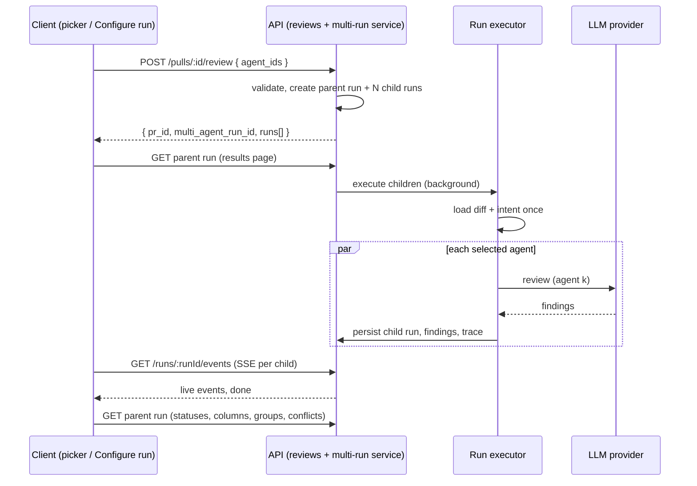
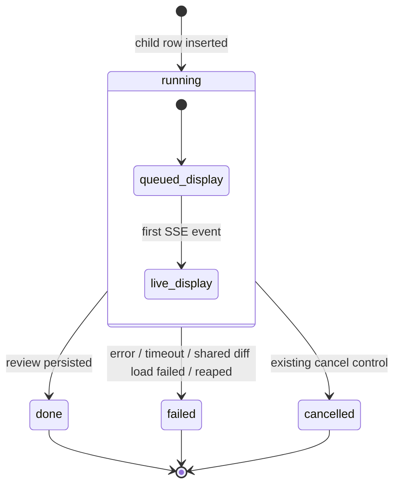

# Spec: Multi-Agent Review and live statuses (worktree A)
Date: 2026-10-13
Status: approved
Supersedes: none

## Problem and user
One pull request can carry a security risk, a performance problem and a domain-rule violation at the same time. A
reviewer (the DevDigest user) gets wider coverage by running several specialised agents on it, but today that only adds
noise: the PR page can start one agent or "all enabled", the agents' findings are listed per run with no link between
runs, overlapping findings from different agents appear as unrelated duplicates, nobody can see where agents *disagree*,
and the user picks agents without knowing what the run will cost or how long it takes. Multi-agent review is useful only
if the product groups duplicates (without losing who said what), shows disagreement, and does not hide the price.

This is the L07 "Multi-agent review · Run Trace / Live Log" feature (`README.md` lesson roadmap), explicitly requested as
worktree A, so the lesson-scope rule in `AGENTS.md` does not exclude it. The finding action **Learn** (write one
`learning` memory entry from a finding) is in scope; memory *retrieval* into prompts, the Memory page, the memory curator,
per-agent stats pages and CI runs are other L07 parts and stay out of this spec.

### Iteration 1 scope (read this first)
This is a **deliberately simple first iteration**; we will iterate once we know what users need. Build exactly the active
ACs below and nothing more:
- **Reuse instead of building:** the existing Run Trace drawer as is (no new drawer UI apart from the grounding list under Stats), the existing cancel control, the existing FindingCard actions, and the existing live-log stream.
- **Simple rules:** estimates are averages of the last 5 successful runs. Group and conflict computation is pure and runs on read. Parent status is derived, never stored.
- **Testing:** component and server tests only (unit + `.it`); no e2e flow, no new seed data.
- **Out of this iteration:** everything in "Deferred to next iteration" at the end of the acceptance criteria. Deferred ACs keep their numbers and are marked in place, so AC numbering stays stable.

### Baseline — what already exists (verified) vs. what is new
| Piece | State today | Evidence |
|---|---|---|
| `POST /pulls/:id/review` | Exists. Accepts `{agentId}` or `{all:true}` only; no way to pass an explicit set of agents. Creates one `agent_runs` row per agent up front, returns run ids, executes in the background. Rate-limited 10/min. | `server/src/modules/reviews/routes.ts:28`, `server/src/vendor/shared/contracts/platform.ts:267` |
| run-executor | Exists. Loads the diff and intent **once** for all queued runs, isolates per-agent failures, fails every run if the shared diff load fails. **Runs agents one after another, not in parallel** — making it concurrent is in scope (decision 1). | `server/src/modules/reviews/run-executor.ts:111-133` |
| Live events per run | Exists: `GET /runs/:id/events` (SSE, replay-first), `GET /pulls/:id/runs/active`, `POST /runs/:id/cancel`. | `server/src/modules/reviews/routes.ts:50-120` |
| `multi_agent_runs` table | Exists (`id, workspace_id, pr_id, ran_at`) but is unused, and `agent_runs` has **no link** to it and no stored agent name. | `server/src/db/schema/runs.ts:18,54` |
| Multi-agent wire contracts | `MultiAgentRun`, `AgentColumn`, `Conflict`, `ConflictTake` exist in both shared copies; no route serves them. `AgentColumn.status` has no `queued`/`cancelled`; there is no contract for finding groups. | `server/src/vendor/shared/contracts/observability.ts:23-86` |
| Finding-grouping heuristic | **Not found** in `server/`, `reviewer-core/`, `client/`, `docs/` or `specs/`; the rule is now fixed by decision 2 (AC-18). | grep, 2026-10-13 |
| `LiveLogStream`, `RunTraceDrawer`, `RunStatus` | Exist (PR page). The trace drawer is route-local to the PR page and mounted only by `PrDetailView` (`?trace=<runId>`). It takes `runId`, `agentName`, `prNumber`, `findings`, `running`, `onClose`, and shows tokens, cost and the grounding summary string (`"2/2 passed"`). It has no Stop run action and no error display. The grounding gate already produces per-finding drop reasons. | `client/src/vendor/ui/LiveLogStream.tsx`, `client/src/app/repos/[repoId]/pulls/[number]/_components/RunTraceDrawer/`, `reviewer-core/src/grounding.ts:20` |
| Finding actions | Accept / Dismiss exist; Turn into eval case exists but only for an accepted/dismissed finding. `learn` is already a value of `FindingActionKind`, but the server rejects it (`invalid_action`, 400), no route exposes it and the finding card has no Learn button. | `server/src/vendor/shared/contracts/findings.ts:111`, `server/src/modules/reviews/findings.ts:9,31`, `server/src/modules/reviews/routes.ts:19`, `client/.../FindingCard/_components/EvalCaseAction/EvalCaseAction.tsx:34` |
| Memory store | The `memory` table exists (`workspace_id, repo_id, scope repo/global/team, kind incl. 'learning', content, embedding vector(1536) nullable, confidence, sources jsonb, timestamps`) and the `MemoryKind`/`MemoryItem`/`MemorySource` contracts exist (`MemorySource` = `{ pr, context }` only). **No server module reads or writes it**, there is no memory route, and findings have no "learned" marker. The client already ships `messages/en/memory.json` (its empty state says memory "is created by the 'Learn' action on findings") but has no Memory page. An `Embedder` port exists in the container. | `server/src/db/schema/knowledge.ts:8-29`, `server/src/vendor/shared/contracts/knowledge.ts:66-90`, `server/src/db/schema/reviews.ts:49-50`, `client/messages/en/memory.json`, `server/src/vendor/shared/adapters.ts:111` |
| Run Review dropdown on the PR page | Exists, one click = one agent or all enabled; no checkboxes, no estimates. | `client/.../RunReviewDropdown/RunReviewDropdown.tsx` |
| Multi-Agent Review page / nav entry | Absent. | `client/src/vendor/ui/nav.ts` |

Worktree A boundary (from the request): PR page, the Multi-Agent Review area, the multi-run service and its new files
(including making run-executor concurrent, and the Learn write path for findings). `agent-runner/` and `ci/` are not changed:
- `agent-runner/` is **not a dependency of this feature.** It is the standalone CI CLI that is exported into a target
  repo's PR and run by that repo's GitHub Actions (`agent-runner/package.json` description). It imports only
  `@devdigest/reviewer-core` and `@devdigest/shared` through path aliases (`agent-runner/tsconfig.json:21-26`), and nothing
  in `server/src`, `client/src` or `reviewer-core/src` imports it. The studio multi-agent run goes through the server's
  route → run-executor → reviewer-core. The two only share reviewer-core and the server's copy of `@devdigest/shared`. That
  means shared-contract changes here must stay additive, so `agent-runner` still type-checks without being edited.
- There is no `ci/` folder in the repo (checked 2026-10-13).

### Design sources
The design bundle is the design-of-record; the screenshots fill what the bundle lacks. **Every design source is static:**
nothing shows a queued, running, failed or cancelled agent. Those states are specified by this spec (AC-15, AC-33) and
reuse the existing Run Trace / Live Log visuals.

| Screen | Source of record | Notes |
|---|---|---|
| Results — Columns mode, header + meta row, "Where agents disagree" (ConflictsSection), no-enabled-agents empty state | Bundle `e0b63c99-ae7f-4b2f-b40c-a5de790c55f5.js` (`screen_multiagent.jsx`); screenshots 4 and 6 | Columns share the width up to 5 agents, horizontal scroll beyond 5; empty state "Enable agents to run reviews" + CTA "Go to Agents" |
| Results — Tabs + detail mode | Bundle `e0b63c99-….js` (TabsView) + FindingCard in `d0caa2b3-0c3f-4652-9061-86dac67bb661.js`; screenshots 5 and 7 | The bundle's FindingCard has Accept, Dismiss, Learn, Reply to author. Learn is kept (AC-35…AC-38), Reply to author is excluded, and Turn into eval case comes from the current app |
| Run Trace + Live Log drawer (live and historical, prompt-block search modal) | Bundle `5465d8b4-af17-4543-889f-f69d630c33e5.js` (`screen_trace.jsx`) — **already implemented** as the PR page's `RunTraceDrawer` (`client/src/app/repos/[repoId]/pulls/[number]/_components/RunTraceDrawer/RunTraceDrawer.tsx`, opened from Agent runs via `?trace=`, `PrDetailView.tsx:214-222`) | The multi-agent screens draw only the "View trace" link, not the drawer; the drawer is **reused as-is, not redesigned** (AC-28). The implemented drawer is 720 px with Trace and Live log tabs. Trace shows Configuration, Stats, Prompt assembly (prompt blocks + search modal), Tool calls, Raw output and Findings; the footer has "Copy raw output". Live log streams run events into `LiveLogStream`, which has a filter box. Unlike the bundle, it has **no "Stop run" button and no error display** today; both stay absent in iteration 1 (deferred) |
| PR page "Run Review" trigger | Bundle `6c17e254-eba9-4ebf-995d-58ab14a15d65.js` (trigger only; its menu is the old "Run all enabled agents" list), PR detail in `a0cf9546-ce35-4eaf-9fe3-621243bff2b0.js` | The "Pick agents to run" checkbox menu exists **only in screenshot 1** |
| Configure run (empty and filled) | **Screenshots 2 and 3 only** — not in the bundle | |
| FindingsPanel / FindingCard | Bundle `d0caa2b3-….js` | Existing app components are the baseline |

## Goals / Non-goals
- Goals:
  - G1. Let the user pick a set of agents for one PR — from the PR page or a dedicated Configure run screen — seeing an estimate of time and cost from past runs before starting.
  - G2. Run the picked agents as one parent multi-agent run whose child agent runs are linked to it and run concurrently.
  - G3. Show per-agent live status while the run is in flight; one agent's failure never discards the others' results.
  - G4. Group similar findings across agents without modifying or hiding the original findings and their authors.
  - G5. Show where agents disagree on the same code location, including explicit "did not flag".
  - G6. Results page in two modes: Columns (live) and Tabs + detail (finding actions), each agent linked to its trace.
  - G7. Record the actual measured numbers for "1 agent vs 3 agents" without fitting them to an expected 3×.
- Non-goals:
  - **Reply to author** (in the Tabs screenshots and the bundle's FindingCard, not in the requirements).
  - Anything that *uses* the memory Learn writes: retrieval into agent prompts (`memory_pulled` stays empty), the Memory page, editing/deleting entries, the curator, and un-learning from the finding card.
  - Per-agent stats / Agent Performance page, Memory page, CI Runs page (other nav items in the mockups).
  - Any change to `agent-runner/` or `ci/`; any change to how a single agent reviews (prompt, grounding rules, scoring).
  - A list/history page of past multi-agent runs (the results page opens one run by its link).
  - An LLM-based merge or summary of grouped findings — grouping is deterministic and costs no model call.
  - An explanation of why an agent did not flag a location (no agent produces one).

## User stories
- **US-1**: As a reviewer on a PR page, I want to tick several agents and start them together, so that I get broad coverage in one action.
- **US-2**: As a reviewer, I want a Configure run screen where I choose the PR and the agents, so that I can start a multi-agent review from outside the PR page.
- **US-3**: As a reviewer, I want to see each agent's estimated time and cost, and the total, before I run, so that the price is never hidden.
- **US-4**: As a reviewer, I want each agent's status to update live while the run is in progress, and a failing agent not to wipe out the others, so that I can trust partial results.
- **US-5**: As a reviewer, I want similar findings from different agents grouped, while still seeing which agent said what in its own words, so that I read each issue once without losing attribution.
- **US-6**: As a reviewer, I want to see, for one code location, what every agent concluded — including "did not flag" — and to filter to real conflicts, so that I can judge disagreements.
- **US-7**: As a reviewer, I want a Columns view and a Tabs + detail view of the results, with confidence, suggested fix and the finding actions Accept, Dismiss, Learn and Turn into eval case, so that I can both compare and act.
- **US-10**: As a reviewer, I want to click Learn on a finding to save what it teaches as a project learning, with a record of where it came from, so that the lesson outlives this PR.
- **US-8**: As a reviewer, I want to open any agent's trace from its column, so that I can explain its tokens, cost and grounding decisions.
- **US-9**: As the course author/engineer, I want the actual numbers of a 1-agent run vs a 3-agent run recorded, so that the cost/time claim of multi-agent review rests on measurement, not expectation.

## Acceptance criteria (EARS)

### Agent picker and Configure run
- **AC-1** (event-driven, covers US-1): WHEN the user opens the Run Review control on a PR page, the system shall show a "Pick agents to run" list with one checkbox per **enabled** agent, all checked initially, each with its estimated duration, plus a Clear action, a "Run multi-agent review (N)" button where N is the number of checked agents, and a "Configure agents…" link. — *Verify: component test with 3 enabled + 1 disabled agent renders 3 checked rows with estimates and "(3)"; ticking/unticking updates N; Clear sets N to 0.*
- **AC-2** (state-driven, covers US-1, US-2): WHILE zero agents are checked, or no PR is selected, the system shall keep the "Run multi-agent review (N)" button disabled. — *Verify: component test on both the dropdown and the Configure run screen (no PR → disabled; PR + 0 agents → disabled).*
- **AC-3** (ubiquitous, covers US-2): The system shall provide a Multi-Agent Review entry in the sidebar. The entry is a sanctioned one-line addition to the vendored `client/src/vendor/ui/nav.ts`, pointing at `/repos/:repoId/multi-agent` (AC-24). It opens the repo's last multi-agent run (AC-24) or, when the repo has none yet, a Configure run screen with step 1 "Pull request" (a PR selector) and step 2 "Agents to run": one card per **enabled** agent, none checked initially, each showing the agent's name, the agent's own description and its estimated time and cost, plus a Select all action, the run button and the totals line. — *Verify: component test: the nav entry links to the page; enabled agents only, 0 checked, card text equals the agent description, Select all checks every card.*
- **AC-4** (state-driven, covers US-2): WHILE no PR is selected on the Configure run screen, the system shall show the empty state "Pick a pull request first" in place of the agent list. — *Verify: component test.*
- **AC-5** (event-driven, covers US-1, US-2): WHEN the user starts a multi-agent review (from the PR page or Configure run), the system shall submit exactly the checked set of agents for that PR in one request and shall navigate to the results page of the created parent run. — *Verify: hook/component test asserts one request whose `agent_ids` equal the checked ids; navigation goes to the run's results URL.*

### Estimates and price
- **AC-6** (ubiquitous, covers US-3): The system shall estimate each agent's duration and cost as the average over that agent's last 5 successful runs (status `done`, `source = 'local'`) in the workspace. A run without a recorded cost is left out of the cost average only. Failed and cancelled runs don't count because they store tokens as `0`, not `NULL` (`server/INSIGHTS.md` "Failed `agent_runs` store tokens `0`"). — *Verify: unit test: 7 local done runs + failed/cancelled/ci runs → only the latest 5 local `done` runs are averaged.*
- **AC-7** (ubiquitous, covers US-3): The system shall show the selection total as "≈ <max of selected durations> · <sum of selected costs> · parallel fan-out", recomputed on every checkbox change. — *Verify: unit test: 8.2s/7.4s/6.9s/7.1s and $0.06/$0.05/$0.04/$0.05 → "≈ 8.2s · $0.20 · parallel fan-out"; component test recomputes on toggle.*
- **AC-8** (unwanted behaviour, covers US-3): IF an agent has no successful run to estimate from, THEN the system shall show "no estimate" for that agent and leave it out of the total. There is no other partial or unknown variant. *(Simplified in iteration 1: no "partial total" label.)* — *Verify: component test with one history-less agent: its row says "no estimate", and the total covers the others.*
- **AC-9** (event-driven, covers US-3, US-4): WHEN a child agent run finishes, the system shall show that agent's actual duration and cost, and the results meta row shall read "N agents · parallel · <wall-clock> total · <cost>", where wall-clock is the parent run's total time and cost is the sum of known costs. — *Verify: integration test of the parent-run read; component test: 4 agents, 8.2 s, $0.20 → "4 agents · parallel · 8.2s total · $0.20".*
- **AC-10** (unwanted behaviour, covers US-3): IF a child run's actual cost is unknown (null), THEN the system shall show that agent's cost as "unknown", never as $0, and the header total shall sum only the known costs. *(Simplified in iteration 1: no "partial total" label.)* — *Verify: component test renders "unknown" for the null-cost column and the total of the others.*

### Parent run, execution and live status
- **AC-11** (event-driven, covers US-1, US-4, US-5): WHEN a request `{ agent_ids }` is accepted, the system shall create one parent multi-agent run for the PR and one child agent run per distinct selected agent, each child linked to the parent and storing the agent's name at run time, and shall return the parent id and the child run ids before any agent finishes. — *Verify: `.it` test: after the POST, one `multi_agent_runs` row and N `agent_runs` rows reference it, each with the agent name; the response returns immediately with ids.*
- **AC-12** (ubiquitous, covers US-4): The system shall prepare the PR diff and intent once per parent run and shall start all of the parent's child agent reviews concurrently — all selected agents at once, at most 10 per request. — *Verify: server test with a mock LLM that blocks until all N calls have started (N concurrent calls observed); the diff loader is called once.*
- **AC-13** (unwanted behaviour, covers US-4): IF one child agent run fails or is cancelled, THEN the system shall finish the other child runs and persist their findings, and the parent run shall end as partially successful with that agent's error visible in its column. The parent status is **derived on read** from its children, never stored:
  - `running` while any child is running;
  - `done` when every child is done;
  - `failed` when no child is done;
  - `partial` for any other mix.

  This also covers children reaped as failed after a restart. The parent stores only `finished_at` and `duration_ms`. If the parent never finished (it was reaped), its wall-clock is shown as "—". *(Simplified in iteration 1: no fallback computed from the children.)* — *Verify: unit test of the status derivation over all mixes; server test with one throwing mock agent → others `done` with findings, parent `partial`.*
- **AC-14** (unwanted behaviour, covers US-4): IF the shared preparation (diff load) fails, THEN the system shall mark every child run failed with the same error and the parent run as failed. — *Verify: server test with a failing diff loader.*
- **AC-15** (state-driven, covers US-4): WHILE a child run is running, the system shall show in its column and its tab a status label that updates live without a page reload, the elapsed time, and the tail of its live log rendered with the existing live-log stream visual. The label shows "queued" until the child's first live event arrives, then "running". Score, findings and cost appear when the run reaches `done`. `queued` is a client display state only: the server keeps inserting child runs as `running` (`server/src/modules/reviews/repository/run.repo.ts:153`), no new database status is added, and `queued` is added to the contracts' column status enum only as an additive value. — *Verify: component test: no events → "queued", first event → "running", done event → findings shown.*
- **AC-16** (event-driven, covers US-4): WHEN the results page is reloaded or reopened during or after a run, the system shall restore every column's current status, findings and totals from the server. — *Verify: `.it` test of the parent-run read mid-run and after the run; component test renders from that read alone.*
- **AC-17** (ubiquitous, covers US-1): The system shall keep the existing `{agentId}` and `{all:true}` request forms of `POST /pulls/:id/review` working unchanged, without creating a parent run. For those forms the response shall not contain the `multi_agent_run_id` key at all (absent, not `null`), so it stays byte-for-byte as today. — *Verify: existing reviews route tests and `mcp-server` tests stay green; new test asserts no parent row and no `multi_agent_run_id` key for these forms.*

### Grouping and disagreement
- **AC-18** (ubiquitous, covers US-5): The system shall link two findings directly only when **all** of these hold:
  - they come from **different** child runs of the same parent run;
  - they are in the same file;
  - their line ranges overlap, or their start lines are at most 2 apart;
  - they share the category, **or** their titles are similar.

  Titles are similar when, after normalizing each title (lowercase, split on non-alphanumeric characters, drop tokens shorter than 3 characters), |A∩B| / max(|A|,|B|) ≥ 0.5.

  Groups are the transitive closure of direct links within a file. Two findings of the same agent therefore never link directly, but they can share a group through another agent's finding: A1~B1 and A2~B1 ⇒ one group {A1, A2, B1}. A finding with no link forms a single-member group.

  A group's title is the title of its highest-severity member; ties go to the member whose agent comes first in column order. Groups are computed from persisted findings without modifying, merging or deleting any original finding. — *Verify: unit tests:
  - same issue at `:52` from two agents → 1 group;
  - `:27` vs `:28` with different category and titles → 2 groups;
  - two findings of one agent are never a direct pair;
  - A1~B1 + A2~B1 → one group of three;
  - A~B and B~C → one group;
  - title normalization and the 0.5 threshold, e.g. "Retry-After header omitted on 429" vs "429 body has no machine-readable error code";
  - group title by severity, then column order;

  plus an `.it` test that finding rows are unchanged after reading groups.*
- **AC-19** (ubiquitous, covers US-5): The system shall show, for every group in the "Where agents disagree" block, each member finding's agent name, original title and severity. Each member's full original text stays available, unmodified, in that agent's column and tab. *(Simplified in iteration 1: no "also flagged by" marker on findings inside the columns.)* — *Verify: component test of a 2-member group (e.g. Security + Customer-Facing on `ratelimit.ts:52`) shows both agents and both original titles.*
- **AC-20** (ubiquitous, covers US-6): The system shall show a "Where agents disagree" block listing every group, single-member groups included, by code location (file:line + group title). Each group has one cell per agent of this parent run:
  - the agent's severity and note when it flagged the location;
  - "did not flag", with no explanation text, when it completed without flagging it;
  - a failed/cancelled marker when it produced no result;
  - a "pending" marker while it is still running.

  Agents not in the parent run do not appear. — *Verify: unit test of the take builder (flagged / did not flag / failed / pending; non-participant absent; single-member group listed); component test asserts a "did not flag" cell has no note.*
- **AC-21** (event-driven, covers US-6): WHEN the user turns on "Show only conflicts", the system shall show only locations where at least one completed agent flagged and another completed agent did not, or where flagging agents gave different severities. Pending, failed and cancelled takes are ignored by this test. WHEN it is off, the system shall show every group. — *Verify: unit test of the conflict predicate; component test toggling the switch.*

### Results page modes, actions and traces
- **AC-22** (event-driven, covers US-7): WHEN the user selects Columns mode, the system shall show one column per selected agent with its name, status, score ring, actual time and cost, its findings (title, severity, file:line), a findings count and a "View trace" link; up to 5 columns share the page width, and with more than 5 the columns scroll horizontally. — *Verify: component tests with 4 columns (no horizontal scroll) and 6 columns (horizontally scrollable).*
- **AC-23** (event-driven, covers US-7): WHEN the user selects Tabs mode, the system shall show one tab per agent with its score, an agent summary card (score, summary, time, cost, View trace) and expandable findings showing confidence, rationale, suggested fix and exactly the actions Accept, Dismiss, Learn and Turn into eval case. — *Verify: component test expands a finding, finds the four actions and no "Reply to author" control.*
- **AC-24** (ubiquitous, covers US-7): The system shall serve the Multi-Agent Review page at `/repos/:repoId/multi-agent`, keeping the parent run in `?run=<id>` so that a reload or shared link reopens the same results. Without `?run=` the page shows the results of the repo's LAST multi-agent run (AC-43) and falls back to the Configure run screen only when the repo has none yet; `?configure=1` always shows Configure run. The results header has a "Configure run" button that opens it, and Configure run has a "Back to last run" button when a run exists, so a user can always return to the last run and start a new one from the same page. The Columns/Tabs mode and the selected tab are page state, defaulting to Columns. *(Simplified in iteration 1: `?mode=` / `?tab=` in the URL are deferred.)* — *Verify: component test: `?run=` renders that run's results; no params with a latest run renders its results with the Configure run button; no params and no run renders Configure run; `?configure=1` renders Configure run.*
- **AC-25** (event-driven, covers US-7): WHEN the user accepts or dismisses a finding on the results page, the system shall persist the decision on that original finding and reflect it wherever that finding appears (its column, its tab, its group). — *Verify: component test + existing `/findings/:id/accept|dismiss` tests.*
- **AC-26** (state-driven, covers US-7): WHILE a finding is undecided, the system shall keep Turn into eval case disabled with the existing "needs decision" explanation, as on the PR page. — *Verify: component test.*
- **AC-27** (state-driven, covers US-1, US-2): WHILE the workspace has no enabled agents, the system shall show on the Multi-Agent Review screen the empty state "Enable agents to run reviews" — "Multi-agent review runs the PR through every enabled agent in parallel. You have no agents enabled yet." — with a "Go to Agents" action opening the Agents page, and the PR-page picker shall show the same message with a link to Agents instead of an empty checkbox list. — *Verify: component tests with 0 enabled agents on both surfaces; the CTA navigates to `/agents`.*
- **AC-28** (event-driven, covers US-8): WHEN the user clicks "View trace" on any agent's column (Columns mode) or on the agent header card (Tabs mode), the system shall open the **same** Run Trace + Live Log sidebar the PR page opens from Agent runs → a run, reused rather than redesigned, for that child run. The drawer receives:
  - the child run id as its run;
  - the agent name and PR number for its title;
  - that child's persisted findings for its Findings section;
  - "running" exactly when the child's server status is `running`, which includes the client-only "queued" display state of AC-15.

  Every section of the drawer is available for every child run of the parent:
  - Trace tab: Configuration, Stats, Prompt assembly with prompt blocks and their search, Tool calls, Raw output, Findings;
  - Live log tab, with its filter;
  - the "Copy raw output" footer action.

  While the child is running (shown as queued or running), the drawer opens on Live log, streaming live, and the Trace tab shows the existing "trace pending" note. Once the child has finished, it opens on Trace with the full persisted trace. — *Verify: component tests: View trace on column k and on tab k opens the drawer with run id = child k, the agent name and PR number in the title, child k's findings in the Findings section; running child → Live log tab active + pending note on Trace; done child → Trace tab with all five trace sections and the copy action.*
- **AC-29** (ubiquitous, covers US-8): The system shall show in each child run's trace its tokens in/out, its cost (or "unknown"), and the grounding gate result including which findings were dropped and why. Today the drop reasons reach only the log, as `grounding dropped "<title>": <reason>` lines (`reviewer-core/src/review/run.ts:293-295`). The trace shall also carry them as an optional structured `grounding_dropped[]` list (title, file, lines, reason), filled from the review outcome's `dropped` and rendered under Stats.
  - The field is added in both shared copies of `RunTrace` as a targeted edit, because `trace.ts` already differs between the server and client copies.
  - It is optional, so traces stored before this change still parse. — *Verify: server test: a run with one dropped finding persists `grounding_dropped` with its reason; component test: the reason is visible under Stats; a legacy trace without the field still renders.*
- **AC-33** (unwanted behaviour, covers US-4, US-8): IF a child run ends `failed` or `cancelled`, THEN its column and tab shall show that status, the error message (failed) or "Cancelled" (cancelled), the time spent and any known cost, no score ring, and a working "View trace" link, while the other columns stay unaffected. — *Verify: component test with one failed and one cancelled column next to two done ones.*
- **AC-34** (event-driven, covers US-4): WHEN a child run is cancelled through the cancel control that already exists today (the PR page's Cancel for live runs, which calls `POST /runs/:id/cancel` per run — `FindingsTab.tsx:47-49`), the system shall end only that child run as `cancelled`, while its siblings keep running, and the results page shall show it as cancelled (AC-33). No new stop/cancel UI is added in iteration 1. *(Reworded: the drawer's "Stop run" button is deferred.)* — *Verify: server test: cancelling one child → that child `cancelled`, siblings finish `done`.*
- **AC-39** — **Deferred to next iteration:** a dedicated error display in the drawer for failed/cancelled children. Reason: the drawer is reused as is; a failed or cancelled child's drawer simply opens and shows whatever the existing drawer shows (persisted trace/log, or its "no trace" note), and the error itself is already visible in the column (AC-33).
- **AC-40** (ubiquitous, covers US-8): The system shall use one drawer implementation for both the PR page and the Multi-Agent Review page (no copy and no fork), with the PR page's behaviour unchanged and its existing drawer tests still passing. Where the shared drawer lives is decided by the plan, following the project's rule for code used by two routes. — *Verify: a single drawer component is imported by both routes; the existing `RunTraceDrawer.test.tsx` cases pass unchanged (apart from the import path); the PR-page `?trace=` flow still opens it.*
- **AC-41** (state-driven, covers US-7, US-8): WHILE a trace drawer is open on the results page, the system shall allow only that one drawer (opening another agent's trace replaces it). WHEN the drawer is closed, the system shall keep the page's Columns/Tabs mode, the selected tab and the "Show only conflicts" state unchanged. — *Verify: component test: open A then B → one drawer showing B; close → mode, tab and toggle unchanged.*
- **AC-42** (unwanted behaviour, covers US-8, Security NFR): IF `POST /runs/:id/cancel` or `GET /runs/:id/trace` is called for a run that belongs to another workspace (or does not exist), THEN the system shall return 404 and neither cancel the run nor return its trace. Today both routes skip the ownership check (`server/src/modules/reviews/routes.ts:116-128`). Behaviour for callers in the run's own workspace stays unchanged. `GET /runs/:id/events` (SSE) is deliberately left as is; see the Security NFR. — *Verify: `.it` tests: cancel and trace with another workspace's run id → 404 and the run is still `running` / no trace body; same calls from the owning workspace → unchanged results.*
- **AC-43** (ubiquitous, covers US-2, US-7): The system shall serve `GET /repos/:id/multi-agent-runs/latest` returning `{ id }` with the id of the repo's most recent parent run in the caller's workspace, or `{ id: null }` when there is none. — *Verify (code-only in iteration 1): another workspace's or another repo's runs are never returned; the sidebar entry reopens that run.*
- **AC-44** (state-driven, covers US-1, US-7): WHILE the PR has at least one multi-agent run, the PR page header shall show a separate "Last multi-agent run" button next to Run Review (not inside the picker menu) that opens `/repos/:repoId/multi-agent?run=<id>` for that PR's most recent parent run, served by `GET /pulls/:id/multi-agent-runs/latest` (`{ id }` or `{ id: null }`, workspace-scoped). WHEN the PR has none, the button shall not be shown. — *Verify (code-only in iteration 1): the link appears after a first run and opens that run's results.*

### Learn
- **AC-35** (event-driven, covers US-10): WHEN the user clicks Learn on a finding (on the results page or the PR page — wherever the finding card shows its actions), the system shall persist exactly one memory entry of kind `learning`, scope `repo` (the PR's repo), in the finding's workspace. The entry's content shall be built from the finding without an LLM call: title, `file:start_line`, and the rationale, plus the suggested fix when there is one. Its confidence shall be the finding's confidence. The entry shall be stored **without an embedding** (the column stays empty, no `Embedder` call is made), so Learn works with no embedding key configured; later retrieval/curator work back-fills embeddings. — *Verify: `.it` test: POST learn → one `memory` row with kind `learning`, scope `repo`, repo id = the PR's repo, content containing the title and `file:line`, `embedding` null; LLM and Embedder mock call counts = 0; the test passes with no embedding key set.*
- **AC-36** (ubiquitous, covers US-10, US-5): The system shall store with every learning entry its provenance: finding id, PR id and number, producing agent id and the agent name stored on the run, the child run id, the parent multi-agent run id when there is one, the finding's decision at learn time (accepted / dismissed / undecided), the time of learning, and `origin: 'agent_output'` (marks the content as untrusted agent output). The original finding shall stay unchanged apart from its learned marker. — *Verify: `.it` test reads the entry's sources back for a finding from a multi-agent child run and for a finding from a plain single-agent run (parent id empty).*
- **AC-37** (event-driven, covers US-10): WHEN Learn succeeds, the system shall show the finding as "Learned" (a tag like Accepted/Dismissed, and the Learn button in a pressed, non-repeatable state) everywhere that finding appears; the tag is the confirmation, with no separate toast. A second Learn request for the same finding, from any tab, client or reload, shall return the existing entry and create no duplicate. — *Verify: component test of the learned state; `.it` test: two POSTs → one row, same entry id in both responses.*
- **AC-38** (unwanted behaviour, covers US-10): IF saving the learning fails, THEN the system shall leave the finding not learned, show an error message, keep Learn available for retry, and leave no partial memory entry. IF the finding is not in the caller's workspace, THEN the system shall return 404 and write nothing. — *Verify: server test with a failing write → no row and an error response; component test shows the error and Learn still enabled; `.it` test with another workspace's finding → 404.*

### 1 vs 3 measurement
- **AC-30** (ubiquitous, covers US-9): The system shall persist, for every parent run, its wall-clock duration and end time, and for every child run its duration, tokens in/out and cost, so that the 1-vs-N comparison can be recomputed from stored data. Persistence changes come in **one generated migration** (schema edit → `pnpm db:generate`, never a hand-written SQL file) that adds:
  - `multi_agent_runs.finished_at` and `multi_agent_runs.duration_ms`;
  - `agent_runs.multi_agent_run_id` (foreign key to `multi_agent_runs`, indexed) and `agent_runs.agent_name`;
  - `findings.learned_at` and `findings.learned_memory_id`, for Learn (AC-35…AC-38). — *Verify: `.it` test reads these values back after a completed parent run; the migration journal gains exactly one new entry.*

*AC-31 and AC-32 are run by the parent/coordinator during validation, not as an implementer task: they need a real LLM provider key and spend money.*
- **AC-31** (event-driven, covers US-9): WHEN the feature is validated, the team shall run the same PR once with 1 agent and once with 3 agents (the 1 agent being one of the 3, same models), and shall record in `specs/2026-10-13-multi-agent-review.measurements.md` a table with: parent run ids, wall-clock time, sum of per-agent durations, tokens in/out and cost per agent and in total, and the measured ratios (time 3:1, cost 3:1, tokens 3:1) computed from those numbers to two decimals. — *Verify: file exists; every number in it matches the stored rows for the listed run ids.*
- **AC-32** (unwanted behaviour, covers US-9): IF a measured ratio differs from 3×, THEN the record shall keep the measured value and state the observed causes (e.g. shared diff/intent preparation, provider caching, different response lengths), and shall not adjust any number toward 3×. — *Verify: review of the measurements file against the stored rows.*

### Deferred to next iteration
Not built in iteration 1. Each item has a one-line reason; AC numbers are kept so the numbering stays stable.
- **AC-39** — dedicated error display in the drawer for failed/cancelled children. *Reason:* the drawer is reused as is, and the column already shows the error (AC-33).
- **"Stop run" button in the drawer** (was part of AC-34). *Reason:* the existing cancel control is enough to start with; AC-34 now covers only isolated cancellation.
- **`?mode=` / `?tab=` in the URL** (was part of AC-24). *Reason:* only `?run=` is needed for reload and sharing; mode/tab persistence waits for real use.
- **"Also flagged by" marker on findings inside columns** (was part of AC-19). *Reason:* group membership is already visible in "Where agents disagree".
- **"Partial total" labels for estimates and actual cost** (were part of AC-8, AC-10). *Reason:* "no estimate" / "unknown" per agent already avoid hiding a price.
- **Wall-clock fallback for a reaped parent** (was part of AC-13). *Reason:* rare restart case; showing "—" is enough.
- **Seed data on PR #482 and e2e flow 16.** *Reason:* iteration 1 is verified by component and server tests; the e2e flow comes with the next iteration.
- **"≤ 1 s first render" performance target.** *Reason:* no measured need yet; revisit with real data volumes.
- **Drawer subtitle showing the parent multi-agent context** (design-review proposal). *Reason:* closing the drawer already returns to the parent page.

## Edge cases
- PR selector on Configure run is changed after agents were checked → checks kept, estimates unchanged (they are per agent, not per PR), button stays enabled. (covers AC-2, AC-7)
- The same agent id is sent twice in one request → it runs once; N counts distinct agents. (covers AC-11)
- An agent id in the request belongs to another workspace or does not exist → the whole request is rejected with 404 and no parent or child run is created. (covers AC-11, Security NFR)
- Empty agent list, or more than 10 agents, in the request → 400 `invalid_run_request`, nothing created. (covers AC-2, AC-11, AC-12)
- A disabled agent id is sent directly to the API → accepted (the API stays as permissive as today's `{agentId}` form); only the UI limits the list to enabled agents. (covers AC-1, AC-3)
- One of 4 agents times out → 3 columns `done` with findings, 1 column `failed` with the error and a working View trace; the disagreement block marks that agent "failed", never "did not flag". (covers AC-13, AC-20, AC-33)
- One child is cancelled through the existing cancel control → only that child becomes `cancelled`; others keep running. (covers AC-13, AC-34)
- The drawer is opened for a failed child → it opens and shows whatever trace/log was persisted (or its "no trace" note); the error is read in the column. (covers AC-28, AC-33)
- Server restarts mid-run → orphaned children are reaped as failed by the existing reaper; the results page shows them failed, the parent as partial/failed. (covers AC-16, AC-33)
- Two agents flag `ratelimit.ts:52` with the same issue ("Retry-After header omitted on 429") → one group, both authors and both original titles visible; in the disagreement block both appear as flagged (screenshot 4 wrongly shows Security as "did not flag" there). (covers AC-18, AC-19, AC-20)
- Two agents flag adjacent lines (`:27` pipeline INCR+EXPIRE vs `:28` magic number 3600) with different categories and titles → two separate groups, not merged by proximity. (covers AC-18)
- One agent reports two findings that would match each other → no direct link between them. If no other agent's finding links to both, they stay in separate groups. If another agent's finding links to each of them (A1~B1, A2~B1), all three share one group through that finding. (covers AC-18)
- All selected agents agree (all flag, same severity) → the location is listed with the toggle off and hidden with "Show only conflicts" on. (covers AC-21)
- Only one agent selected → valid parent run with one column; the disagreement block lists that agent's findings as single-member groups with one cell each, and "Show only conflicts" leaves it empty. (covers AC-5, AC-20, AC-21)
- One agent still running while others are done → its cells show "pending"; a location is not called a conflict because of a pending take. (covers AC-20, AC-21)
- Parent run reaped after a restart (never finished) → status derived from its children; wall-clock shown as "—". (covers AC-13, AC-30)
- Another workspace's run id sent to cancel or trace → 404, run untouched. (covers AC-42)
- 7 agents selected → 7 columns, horizontally scrollable; the header totals still cover all 7. (covers AC-22, AC-9)
- Agent with no successful past runs → "no estimate", left out of the total; a finished child with null cost → "unknown", left out of the header sum. (covers AC-8, AC-10)
- Agent deleted or renamed after the run → its column and its findings keep the agent name stored on the child run. (covers AC-11, AC-19)
- All agents get disabled while the Configure run screen is open → after the next agent-list refresh the empty state of AC-27 replaces the list. (covers AC-27)
- Learn clicked twice quickly, or once in Columns and once in Tabs → one memory entry; both clicks end in the "Learned" state. (covers AC-37)
- Learn on a dismissed finding → allowed; provenance records `dismissed`, so a later consumer can treat it as a false-positive lesson. (covers AC-36)
- Learn on two findings of the same group (two agents, same issue) → two entries, each with its own finding and agent provenance; grouping never merges them. (covers AC-35, AC-36, AC-18)
- Learn on a finding whose agent was deleted → allowed; provenance keeps the agent name stored on the run, agent id empty. (covers AC-36, AC-11)
- Learn fails (e.g. the database is unavailable) → error message, no "Learned" tag, retry works. (covers AC-38)

## Non-functional requirements
- Performance: with 3 agents of comparable duration, the parent wall-clock time shall be below the sum of the three child durations (evidence of concurrency, not a 3× target); grouping/disagreement computation makes zero LLM calls. *(The first-render time target is deferred.)* — *Verify: the measurements file (AC-31); a server test counting LLM calls during the parent-run read = 0.*
- Security: every read and write is scoped to the caller's workspace (parent run, child runs, agent ids, PR id), including the per-run cancel and trace routes (AC-42). The number of agents per request is at most 10, and the existing route rate limit still applies. Finding text from agents is rendered through the existing safe markdown path, never as raw HTML. — *Verify: `.it` tests with another workspace's PR/agent/run ids → 404; request with 11 agents → 400.*
  - Known risk, accepted: `GET /runs/:id/events` (SSE) is not changed and still does no workspace ownership check; anyone holding a run id can read its live events. Acceptable for a local single-user studio; revisit with real multi-user auth.
- Accessibility: agent checkboxes, the Columns/Tabs switch, agent tabs and the "Show only conflicts" switch are native/UI-kit controls with visible labels, reachable by keyboard; severity is never conveyed by colour alone. — *Verify: RTL tests query these controls by role and name.*
- Observability: every child run's log lines carry the parent run id (next to the existing correlation id). — *Verify: server test on the run logger output.*

## Inputs and provenance
- PR id and the selected agent ids — user input via the UI, sent over HTTP.
- Agent configuration (name, description, provider, model, prompt, enabled flag) — workspace DB.
- Past `agent_runs` rows (duration, cost, status) — workspace DB, source of the estimates.
- PR diff and intent — GitHub/clone via the existing review pipeline.
- Findings (title, rationale, suggested fix, confidence, file/lines) and run traces — LLM output after the grounding gate, persisted.
- Design sources: the Claude Design bundle export (see "Design sources"), 7 local screenshots, the Ukrainian requirements text in the request, the user's decisions of 2026-10-13, and existing code as baseline (table above).

## Untrusted inputs
- Request body (PR id, agent ids): validated at the route boundary, deduplicated, bounded to 10, and every id checked for workspace ownership before anything is created.
- LLM-produced finding text and trace raw output: displayed as untrusted markdown/text via the existing safe renderers; never interpreted as instructions or HTML; grouping uses only file, line range, category and normalized title.
- PR diff content: unchanged handling of the existing pipeline (untrusted, as today).
- Learn copies LLM-produced finding text into a `memory` entry. The entry shall be marked as derived from agent output in its provenance, so that any later consumer (retrieval into prompts, which is out of scope here) treats it as untrusted data, not as instructions. Learn itself renders nothing as HTML and executes nothing.
- Design bundle files and screenshots: read as design facts only; nothing in them was executed or followed as an instruction. No content was fetched via WebFetch.

## Workflows and contracts

Child run status. The database stores only `running`, `done`, `failed` and `cancelled`. `queued` is a client display sub-state of `running`, shown until the first live event arrives (AC-15).

Parent run status is never stored; it is derived on read (AC-13): any child `running` → `running`; all `done` → `done`; none `done` → `failed`; otherwise `partial`.

Boundary contracts (exact Zod shapes are left to the plan; every change is additive and mirrored in both `@devdigest/shared` copies):
- `POST /pulls/:id/review` gains a third request form `{ agent_ids: string[] }` (1..10 distinct ids; snake_case per `AGENTS.md`); the `{agentId}` and `{all:true}` forms are unchanged. For `agent_ids` the response adds `multi_agent_run_id` next to the existing `pr_id`, `runs[]`, `reviews[]`; for the legacy forms the key is **absent** (not `null`) (AC-17). Errors: `400 invalid_run_request` (empty / more than 10 / mixed with `agentId`/`all`), `404` (PR or any agent not in the workspace).
- Read of one parent run returns the existing `MultiAgentRun` shape extended with: per-column status `queued | running | done | failed | cancelled`, `error`, and the stored `agent_name`; parent `status` (`running | done | partial | failed`); `groups[]` — each `{ id, file, start_line, end_line, title, members: [{ finding_id, run_id, agent_id, agent_name, severity, title }] }`; `conflicts[]` with `ConflictTake.verdict` extended by failed/cancelled and pending values distinct from `ignored`, and `ConflictTake.note` empty for "did not flag". `queued` in the column status enum is client-display only (AC-15).
- `RunTrace` gains an optional `grounding_dropped[]` (`{ title, file, start_line, end_line, reason }`), added as a targeted edit to both copies of `trace.ts` because they already differ (AC-29).
- `/runs/:id/cancel` and `/runs/:id/trace`: same shapes as today, plus `404` for a run outside the caller's workspace (AC-42).
- Per-agent estimate read: `{ agent_id, est_duration_ms | null, est_cost_usd | null }` for the agents shown in the picker (average of the last 5 local `done` runs; `null` = "no estimate", AC-6, AC-8).
- Learn: `POST /findings/:id/learn` (next to accept/dismiss, which reuses the existing `learn` value of `FindingActionKind`) → `{ finding, memory: { id, kind: 'learning', scope: 'repo', content, created: boolean } }`. `created: false` on a repeat. The finding DTO gains a `learned_at` timestamp (nullable), backed by `findings.learned_at` / `findings.learned_memory_id` (AC-30). Errors: `404` (finding not in workspace), `500`-class with the standard error envelope on a failed write. Provenance lives in the entry's `sources`. `MemorySource` (`{ pr, context }` today) is extended with optional fields `finding_id, agent_id, agent_name, run_id, multi_agent_run_id, decision` and `origin: 'agent_output'`, the provenance flag of the Untrusted-inputs section.

New for Learn (nothing exists yet): the server write path for `memory` rows, the `learn` branch of the finding action plus its route, a per-finding learned marker (what makes Learn idempotent and lets the card show "Learned"), the additive `MemorySource` and finding-DTO fields in both shared copies, the client API call and hook, the Learn button with its learned and error states, and the i18n strings.

## Design review notes
- Gaps found in the supplied design:
  - The design is entirely static: no queued, running, failed or cancelled agent is drawn in the bundle or the screenshots. Now specified by AC-15 and AC-33, reusing the existing trace drawer and `LiveLogStream`; the exact in-column layout (where the log tail sits, status chip style) is still a visual decision for the implementer.
  - Header copy "fan-out via worktrees" and "this PR through every enabled agent in parallel" (bundle MetaRow/header, screenshot 6) do not match the behaviour: agents run in-process on a user-selected set. Resolved: the meta row reads "N agents · parallel · <wall-clock> total · <cost>" (AC-9).
  - Screenshots 4–7 and the bundle's ConflictsSection show an "Architecture" cell although Architecture was not selected — a non-participating agent must not appear (AC-20).
  - The "did not flag" cells carry explanations ("Not a security concern."); no agent produces them, so AC-20 shows "did not flag" alone.
  - Configure run cards in screenshot 3 show a previous-verdict sentence; AC-3 shows the agent's own description instead.
  - Screenshot 2 shows "Run multi-agent review (4)" enabled with no PR picked; AC-2 disables it.
  - Groups of similar findings are not drawn anywhere; AC-19 shows group members in "Where agents disagree" (an "also flagged by" marker in columns is deferred).
  - Screenshot 5 has "Turn into eval case" on an undecided finding; in the app it is enabled only after a decision (AC-26).
  - The bundle's FindingCard has Learn and Reply to author. Learn is kept and made functional (AC-35…AC-38); Reply to author is excluded (Non-goals, AC-23). The bundle draws no learned, learning-in-progress or learn-failed state; AC-37 and AC-38 define them, reusing the Accepted/Dismissed tag style.
  - The bundle's PR-page Run Review menu is the old "Run all enabled agents" list; the checkbox picker exists only in screenshot 1, and Configure run only in screenshots 2–3.
  - The bundle's no-enabled-agents empty state is drawn only for the results screen; AC-27 extends it to the PR-page picker.
  - The multi-agent screens draw a "View trace" link but not the sidebar it opens. AC-28 and AC-40 settle this: the PR page's drawer is reused as is. The only addition is the grounding drop list under Stats (AC-29). The bundle's "Stop run" button and an error display are deferred.
  - The drawer knows only its own run: it has no reference to, or link back to, the parent multi-agent run. Iteration 1 leaves it unchanged (deferred), since closing the drawer already returns to the parent page (AC-41).
- Uncovered corner cases not yet turned into an AC/Edge case:
  - What the PR page's Agent runs tab shows for child runs of a parent run (grouped under the parent vs flat as today) — unchanged today; a grouping there would be a later improvement.
- Cross-module communication: the client talks only to the API; the multi-run service reads agents through the existing agents repository access, child runs through the reviews pipeline, and live status through the existing per-run SSE. Grouping and conflicts are derived on read from persisted findings (consistent with the `Conflict` contract comment "Computed from persisted findings; not stored"). `mcp-server` keeps using the unchanged `{agentId}` form (AC-17).
- UX improvement proposals:
  - Preselect, on the PR page, the agents of the user's last multi-agent run on this PR, falling back to all enabled agents.
  - Show "N unique issues · M raw findings" in the results header so the effect of grouping is visible.
  - Offer "Retry failed agent" on a failed column (a new child in the same parent) — not required now.

## Traceability
| US | Covered by AC(s) | Edge cases |
|---|---|---|
| US-1 | AC-1, AC-2, AC-5, AC-11, AC-17, AC-27 | duplicate ids, foreign ids, empty / >10 list, disabled id via API |
| US-2 | AC-2, AC-3, AC-4, AC-5, AC-27 | PR changed after checks, single agent, all agents disabled meanwhile |
| US-3 | AC-6, AC-7, AC-8, AC-9, AC-10 | history-less / null-cost agents |
| US-4 | AC-9, AC-11, AC-12, AC-13, AC-14, AC-15, AC-16, AC-33, AC-34 | timeout, cancel one via existing control, server restart |
| US-5 | AC-11, AC-18, AC-19 | same issue at `:52`, adjacent lines, same-agent pair, deleted agent |
| US-6 | AC-20, AC-21 | failed agent ≠ did not flag, all agree, single agent |
| US-7 | AC-22, AC-23, AC-24, AC-25, AC-26, AC-41 | 7 agents → horizontal scroll |
| US-8 | AC-28, AC-29, AC-33, AC-40, AC-41, AC-42 | timeout column keeps View trace; failed child drawer opens as is; switching drawers; foreign run id → 404 |
| US-9 | AC-30, AC-31, AC-32 | — |
| US-10 | AC-35, AC-36, AC-37, AC-38 | double click, dismissed finding, two members of one group, deleted agent, write failure |

## Open questions
All open questions of the first draft were answered by the user on 2026-10-13:
- [ANSWERED] Parallel execution — yes: run-executor runs child runs truly in parallel (AC-12), in scope for worktree A.
- [ANSWERED] Grouping rule — the recommended default (AC-18); originals, authors and text always preserved.
- [ANSWERED] Concurrency cap — all selected agents at once, at most 10 per request (AC-12, Security NFR).
- [ANSWERED] Picker list — enabled agents only; PR-page menu all preselected; Configure run none preselected plus Select all (AC-1, AC-3).
- [ANSWERED] Learn — first removed (AC-27 was reused for the empty state), then reversed by the user: Learn is required and must work (AC-23, AC-35…AC-38); Reply to author stays out.
- [ANSWERED] Header meta copy — "N agents · parallel · <wall-clock> total · <cost>" (AC-9).
- [ANSWERED] Is `agent-runner/` needed? — No. It is the standalone CI CLI and only shares reviewer-core and the shared contracts; it is not on the studio run path (see the boundary note under Baseline).
- [ANSWERED] Text under each agent on Configure run — the agent's own description (AC-3).
- [ANSWERED] "did not flag" — shown with no explanation text (AC-20).
- [ANSWERED] After starting from the PR page — navigate to the results page (AC-5).
- [ANSWERED] Request field — `agent_ids` (snake_case); `{agentId}` and `{all:true}` unchanged (AC-17, contracts).
- [ANSWERED] Deleted agent — the agent name is stored on each child run so columns and attribution survive (AC-11).

- [ANSWERED] Learn embedding — the entry is stored without an embedding (nullable column, no `Embedder` call, works with no embedding key); later retrieval/curator work back-fills embeddings (AC-35).
- [ANSWERED] Same-agent findings vs transitivity — transitivity wins; same-agent findings never link directly but may share a group through another agent's finding. Title similarity and group title rules are pinned in AC-18.
- [ANSWERED] `queued` — no new DB status; client display state until the first SSE event; additive enum value in the contracts (AC-15, AC-28).
- [ANSWERED] Workspace scoping of `/runs/:id/cancel` and `/runs/:id/trace` — in scope (AC-42); SSE events stay as is (Security NFR risk note).
- [ANSWERED] Estimates — average of the last 5 local `done` runs; no runs → "no estimate" (AC-6, AC-8); total format includes "· parallel fan-out" (AC-7).
- [ANSWERED] Parent status — derived on read, only `finished_at`/`duration_ms` stored; a reaped parent shows wall-clock "—" (AC-13).
- [ANSWERED] Disagreement block — every group including single-member; pending takes excluded from the conflict test (AC-20, AC-21).
- [ANSWERED] Grounding drop reasons — today only as log lines (`reviewer-core/src/review/run.ts:293-295`); add optional structured `grounding_dropped[]` to `RunTrace` (AC-29).
- [ANSWERED] Persistence — one generated migration (AC-30); `multi_agent_run_id` absent for legacy requests (AC-17); `MemorySource.origin: 'agent_output'` (AC-36).
- [ANSWERED] Page URL — `/repos/:repoId/multi-agent` with `?run=` (mode/tab in the URL deferred); nav entry in `client/src/vendor/ui/nav.ts` (AC-3, AC-24).
- [ANSWERED] Iteration 1 simplification — see "Iteration 1 scope" and "Deferred to next iteration" (first-render target, Stop run, drawer error display, seed + e2e flow 16 deferred).
- [ANSWERED] 1-vs-3 measurement — run by the parent during validation with a real provider key, not by an implementer (AC-31, AC-32).

No open questions remain.
