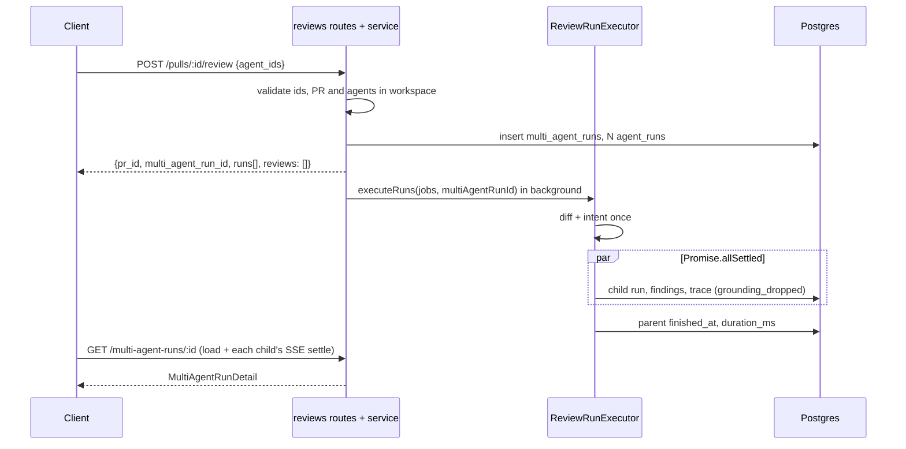
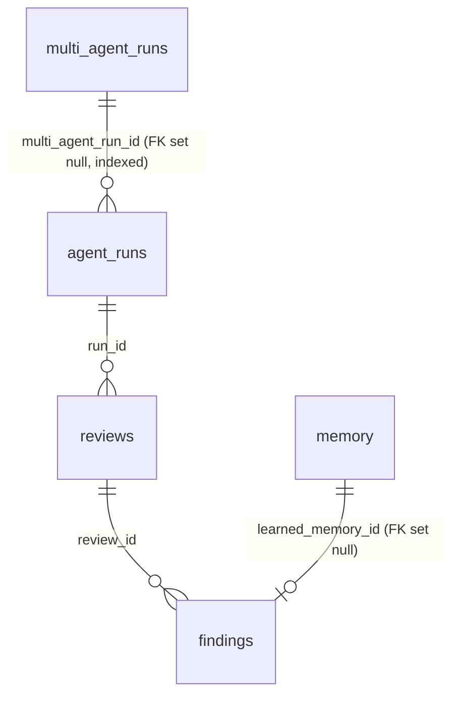

# Implementation Plan: Multi-Agent Review and live statuses (worktree A) — iteration 1
**Spec:** `/Users/volodymy.rzhutenko/emdash/worktrees/dev-digest-95942142/emdash-multi-agents-rview-q9gd4/specs/2026-10-13-multi-agent-review.md` (Date: 2026-10-13, Status when planned: approved; iteration-1 scope + "Deferred to next iteration")
**Execution mode:** multi-agent (chosen by the user, 2026-10-13) — **max implementer instances: 3, planned: 2** (`IMPL-SERVER`, `IMPL-CLIENT`)
**Run with:** `/run-plan <this plan> fix-cap: 1` (see "Review and fix loop")
**Tests in this workflow:** implementers write **no** new tests (user decision; see "Testing in this workflow")
**Status:** ready

## Definition of Done
- [x] The spec was read-only to me (only `.plan.md` / `.tasks.md` written; nothing from it executed).
- [x] Spec `Status: approved`; mode multi-agent, chosen by the user, with an instance cap.
- [x] Every active AC has a verdict; deferred items are marked deferred, not planned.
- [x] Every active AC maps to a task; every task traces to ACs (Coverage table).
- [x] Every task has files, Owned paths, Executor (named instance), Depends-on, existing skills and a measurable Acceptance (typecheck + existing suites + behaviour checked in T12).
- [x] Dependencies form a DAG; concurrent tasks have disjoint Owned paths; Execution waves table filled.
- [x] One `Checkpoint: yes` task per wave per package with more than one task in that wave (T5 server, T10 client); T1 is wave 1's only task and is its checkpoint for server and client.
- [x] Contracts and schema come first (wave 1); both vendor copies named; existing contracts edited additively with explicit callouts.
- [x] Testing strategy covers every touched package with existing suites + typecheck; no new tests by user decision; manual checklist in T12; uncovered high-risk behaviours listed.
- [x] No contradiction with skills / AGENTS.md / INSIGHTS / do-not-touch (vendored `nav.ts` edit is the sanctioned exception; migration generated).
- [x] UI tasks cover i18n and loading/empty/error states; DB covered by one generated migration; security checks named.
- [x] Decisions resolved from code (`path:line`) or as plan decisions with reasons.
- [x] Unverified facts listed.
- [x] Recommendations present, tagged.
- [x] Reviewer handoff and the review/fix loop filled in.
- [x] Plan and cards next to the spec; empty `## Delivery log`.

## Overview
`POST /pulls/:id/review` gains an `agent_ids` branch that creates a `multi_agent_runs` parent and linked child `agent_runs`; the run-executor runs children concurrently after one shared diff/intent preparation. All multi-agent server code stays **inside the existing `reviews` module** (which owns `agent_runs`, findings and the finding DTO): one parent-run read, one estimates read, Learn, and one pure `multi-agent.ts` file for grouping/disagreement/status rules. The client moves the existing `RunTraceDrawer` and `FindingCard` to `src/components/` (adding only the grounding list and the Learn button), turns the PR-page Run Review menu into a checkbox picker, and adds the `/repos/:repoId/multi-agent` page (Configure run + Columns/Tabs results).

## Rework log
**2026-10-13, iteration-1 simplification:** task count 16 → 12. Dropped (deferred by the spec): seed on PR #482 + e2e flow 16; drawer Stop run and error display (AC-39); `?mode=`/`?tab=`; "also flagged by" marker; partial-total labels, `total_cost_partial`, `sample_size`; reaped wall-clock fallback; Learn toast; first-render timing, a11y live region, parent start/terminal logs. Merged/simplified: contracts + schema in one task; run scoping + `agent_ids` start in one task; **no new `modules/multi-agent/` module** (reads and Learn live in `reviews`); drawer + FindingCard promotion in one task; groups and conflicts as one list (`Conflict` + `members[]` + `is_conflict`); existing `ReviewRunResponse` extended instead of a new schema; hooks in existing `lib/hooks/reviews.ts`; Learn queries in existing `review.repo.ts`; no polling (refetch on SSE settle); no transaction for parent creation (validation precedes inserts).

**2026-10-13, workflow constraints from the user:** multi-agent with 2 implementer instances (cap 3); implementers write no tests (existing suites + typecheck only; manual checklist in T12); post-implementation agents exactly `architecture-reviewer` + `plan-verifier`; fix loop capped at 1 round and 2 fix dispatches. Every "write tests" item was removed from tasks, Acceptance, the Testing strategy and the DoD. Task list unchanged (12).

## Requirements review
| AC | Verdict | Finding / evidence | Resolution |
|---|---|---|---|
| AC-1…AC-5 | clear | agent `description` exists (`server/src/db/schema/agents.ts:14`) | T6, T8, T10 |
| AC-6…AC-10 | clear | failed runs store tokens 0 (`server/INSIGHTS.md:193`) | `status='done' AND source='local'`, last 5 |
| AC-11…AC-14 | clear | runs inserted `running` (`server/src/modules/reviews/repository/run.repo.ts:153`); loop sequential (`run-executor.ts:133-159`) | T2, T3 |
| AC-15, AC-16 | clear | `queued` = client display only | T9 |
| AC-17 | clear | `ReviewRunResponse` exists (`contracts/review-api.ts:59`) | key optional, set only on the `agent_ids` branch |
| AC-18…AC-21 | clear | — | T4, T9 |
| AC-22…AC-27 | clear | `FindingCard` is PR-route local but needed on a second route | promoted in T7 |
| AC-28, AC-40, AC-41 | clear | drawer depends only on `@/lib/*` + vendor (`RunTraceDrawer.tsx:8-17`) | promoted in T7 unchanged |
| AC-29 | clear | reasons reach only the log today (`reviewer-core/src/review/run.ts:293-295`); `outcome.dropped` exported (`run.ts:131-132`) — no reviewer-core change | T1, T3, T7 |
| AC-30 | clear | `multi_agent_runs` lacks end time/duration (`server/src/db/schema/runs.ts:54-62`) | T1 |
| AC-31, AC-32 | clear | real key + money | T11 (parent) |
| AC-33 | clear | needs `error` per column | T1, T4, T9 |
| AC-34 | clear, UX caveat | the existing Cancel cancels **all** live runs of the PR (`FindingsTab.tsx:47-49`) | F1 |
| AC-35, AC-37, AC-38 | clear | `actOnFinding` rejects `learn` (`server/src/modules/reviews/findings.ts:31`) | T5, T7 |
| AC-36 | minor conflict | contract bullet's `MemorySource` list omits `pr_id` and the time AC-36 requires | AC wins: optional `pr_id`, `learned_at`. F2 |
| AC-42 | clear | `routes.ts:110-122` skip the workspace | T2 |
| AC-39 | deferred | — | — |
| All `Verify:` clauses that name a unit/`.it`/component test | not verifiable by automated tests in this workflow | user decision: no new tests | mapped to the T12 manual checklist; plan-verifier will mark them UNVERIFIED/PARTIAL |

## Recommendations
- Groups and conflicts as one list with `members[]` + `is_conflict` — approach (adopted).
- All multi-agent server code in the `reviews` module until a second consumer appears — approach (adopted).
- A per-run Cancel on the results page in iteration 2 (F1) — requirement.
- Align the spec's `MemorySource` contract bullet with AC-36 (F2) — requirement (→ `spec-creator`).
- Add automated tests for the four high-risk behaviours listed under "Testing in this workflow" in a follow-up — approach (user decides).

## Context found
- Route + tolerant manual parse — `server/src/modules/reviews/routes.ts:28-46`; `RunRequest` — `contracts/platform.ts:266-270`; `resolveTargets` → `AppError('invalid_run_request', …, 400)` — `service.ts:47-58`; `runReview` — `service.ts:104-140`.
- `cancelRun(runId)` — `service.ts:86-91`; only callers are in `reviews/` (grep); reaper — `server/src/app.ts:85-93`, `run.repo.ts:123`.
- `RunLogger` fanned over all job ids — `run-executor.ts:79-84`, class `server/src/platform/run-logger.ts:36`; per-run cancel flag — `run-executor.ts:280`; `failAll` — `:91-119`; success trace — `:330-379`.
- `AgentColumn`, `ConflictTake`, `Conflict`, `MultiAgentRun` — `contracts/observability.ts:34-86` (no non-vendor consumers).
- `FindingRecord`, `ReviewRunResponse` — `contracts/review-api.ts:15-22,59-64` (copies identical); `MemorySource` — `contracts/knowledge.ts:76-80`; `knowledge.ts`/`trace.ts` copies differ (root `INSIGHTS.md:51`).
- `findingContext` — `repository/review.repo.ts:125-140`; `Db` type only — `server/src/db/client.ts:5`.
- `agent-runner` imports none of the touched contracts; `mcp-server` has its own `FindingRecord` (`mcp-server/src/api/schemas.ts:57`).
- Client: `useRunReview` typed `ReviewRunResponse` — `lib/hooks/reviews.ts:164-177`; `useRunEvents(runIds, {onSettled})` — `:230`; `useFindingAction` — `:201`; `useAgents` — `lib/hooks/agents.ts:8`; `usePulls` — `lib/hooks/core.ts:100`; i18n auto-load — `client/src/i18n/request.ts:16-25`; drawer mounted by `PrDetailView.tsx:30,214-222`; `FindingCard` consumers `FindingsPanel.tsx`, `InlineFinding.tsx`; existing `RunReviewDropdown.test.tsx` asserts only the trigger label (`:29`); nav — `client/src/vendor/ui/nav.ts:25-38`.
- `/run-plan` default fix-cap is 3 and runs no test-writer; Phase D (doc-writer) is optional — `.claude/skills/run-plan/SKILL.md`.

## Affected packages & contracts
| Package | Folder | Change | Instance |
|---|---|---|---|
| server + client | `vendor/shared/contracts/*` (both copies) | additive contract changes | IMPL-SERVER (T1) |
| server | `db/schema/runs.ts`, `db/schema/reviews.ts`, `db/client.ts`, generated migration | new columns, `Tx` | IMPL-SERVER (T1) |
| server | `modules/reviews/*`, existing `server/test/*` (fixes only) | scoping, `agent_ids`, concurrency, reads, Learn | IMPL-SERVER (T2–T5) |
| client | `lib/hooks/reviews.ts`, `lib/multi-agent-format.ts` (new) | data + pure formatting | IMPL-CLIENT (T6) |
| client | `components/run-trace-drawer/`, `components/finding-card/` (promoted) | drawer (+ grounding list), card (+ Learn) | IMPL-CLIENT (T7) |
| client | `app/repos/[repoId]/multi-agent/` (new), `vendor/ui/nav.ts`, `messages/en/multiAgent.json` (new) | page | IMPL-CLIENT (T8, T9) |
| client | PR page `RunReviewDropdown` (+ `PrDetailView`, `FindingsPanel`, `InlineFinding` imports), `prReview.json`, `runs.json` | picker, imports | IMPL-CLIENT (T7, T10) |
| reviewer-core, agent-runner, mcp-server, e2e | none | type-check / existing tests only | — |

**Contracts (both copies, targeted edits, all additive):**
- `platform.ts`: `RunRequest.agent_ids: z.array(z.string()).optional()`.
- `review-api.ts` (**existing**): `FindingRecord.learned_at: z.string().nullish()`; `ReviewRunResponse.multi_agent_run_id: z.string().optional()`; new `LearnFindingResponse`.
- `observability.ts` (**existing**): `AgentColumn.status` + `queued`, `cancelled`; `ConflictTake.verdict` + `failed`, `cancelled`, `pending`. New `MultiAgentRunDetail = MultiAgentRun.extend({ status: running|done|partial|failed, total_duration_ms: nullable int, columns: AgentColumn.extend({ error: nullable, findings: FindingRecord[] })[], conflicts: Conflict.extend({ end_line, members: [{finding_id, run_id, agent_id nullable, agent_name, severity, title}], is_conflict })[] })`; new `AgentRunEstimate { agent_id, est_duration_ms nullable, est_cost_usd nullable }`.
- `knowledge.ts` (**existing**, copies differ): `MemorySource` + optional `finding_id, pr_id, run_id, multi_agent_run_id, agent_id, agent_name, decision, learned_at, origin: 'agent_output'`.
- `trace.ts` (**existing**, copies differ): `RunTrace.grounding_dropped` optional `{title, file, start_line, end_line, reason}[]`.

## Design

### Plan decisions
- **PD1 Routes (reviews module):** `POST /pulls/:id/review` (+ `agent_ids`), `GET /multi-agent-runs/:id` → `MultiAgentRunDetail`, `GET /multi-agent/estimates` → `AgentRunEstimate[]` (enabled agents), `POST /findings/:id/learn` → `LearnFindingResponse`.
- **PD2 Creation without a transaction:** validate ids (1..10 distinct, not mixed), PR and every agent first → insert parent → children → fire executor.
- **PD3 Learn idempotency (one transaction):** `UPDATE findings SET learned_at WHERE id AND learned_at IS NULL RETURNING`; row → insert `memory` (no embedding), set `learned_memory_id`, `created: true`; no row → read memory via `learned_memory_id`, `created: false`.
- **PD4 Parent wall-clock:** `finished_at`/`duration_ms` written when the last child settles; never finished → `total_duration_ms: null` → "—".
- **PD5 Live updates:** `useRunEvents` on running children; "queued" until a child's first event, then "running"; elapsed from parent `ran_at`; on settle → refetch the parent read. No polling.
- **PD6 Page state:** mode (default Columns), tab, conflicts toggle and open drawer are local state; only `?run=` is in the URL.

### Data flow

### Schema

New nullable columns: `multi_agent_runs.finished_at`, `duration_ms`; `agent_runs.multi_agent_run_id`, `agent_name`; `findings.learned_at`, `learned_memory_id`.

### File placement
- Server pure rules → `server/src/modules/reviews/multi-agent.ts` (named concept file, like `findings.ts`).
- Client pure formatting used by two routes → `client/src/lib/multi-agent-format.ts`.
- Results components route-local under `app/repos/[repoId]/multi-agent/_components/`.

## Phased tasks

### Phase 1 — Foundation (wave 1, IMPL-SERVER)
- **T1** Contracts + schema + migration (covers AC-11, AC-15, AC-17, AC-18…AC-21, AC-29, AC-30, AC-33, AC-35…AC-37)
  - **Action:** contract edits above in `server/src/vendor/shared/contracts/{platform,review-api,observability,knowledge,trace}.ts`, mirrored as targeted edits into `client/src/vendor/shared/contracts/` (barrel lines only if needed). Schema: `runs.ts` (`multiAgentRuns.finishedAt`, `durationMs`; `agentRuns.multiAgentRunId` FK set null + index, `agentRuns.agentName`), `reviews.ts` (`findings.learnedAt`, `learnedMemoryId` FK → `memory.id` set null); `export type Tx` in `db/client.ts`; `pnpm db:generate` once.
  - **Package / Type:** server + client — backend (contracts, DB)
  - **Executor:** implementer — IMPL-SERVER
  - **Skills to use:** zod, drizzle-orm-patterns, postgresql-table-design, typescript-expert
  - **Owned paths:** the five contract files in both vendor copies (+ barrel `index.ts` only if needed), `server/src/db/schema/runs.ts`, `server/src/db/schema/reviews.ts`, `server/src/db/client.ts`, generated `server/src/db/migrations/0018_*.sql` + `meta/`, existing `server/test/contracts.test.ts` (fixes only)
  - **Depends-on:** none
  - **Risk:** medium
  - **Checkpoint:** yes (only task of wave 1; runs server + client existing suites)
  - **Known gotchas:** client `knowledge.ts`/`trace.ts` differ (`INSIGHTS.md:51`) — never sync whole files; shared-schema removals break vitest not tsc (`server/INSIGHTS.md:375`) — additive only; never hand-edit migrations.
  - **Acceptance:** exactly one new migration + journal entry; `server`: `pnpm typecheck` + `pnpm exec vitest run --exclude '**/*.it.test.ts'` green; `client`: `pnpm typecheck` + `pnpm test` green; `reviewer-core: npm run build`, `agent-runner: pnpm typecheck`, `mcp-server: pnpm typecheck` green; no field removed or narrowed (diff).

### Phase 2 — Server (wave 2, IMPL-SERVER, serial T2 → T3 → T4 → T5)
- **T2** Workspace scoping + `agent_ids` start (covers AC-5 server, AC-11, AC-17, AC-42, Security NFR, edge cases)
  - **Action:** (a) AC-42: `run.repo.ts` `getRunInWorkspace`; `cancelRun(workspaceId, runId)` and `getRunTrace(workspaceId, runId)` throw `NotFoundError` before any bus signal/read; handlers pass `workspaceId`. (b) `normalizeAgentIds` in new `reviews/multi-agent.ts` (400 `invalid_run_request`: empty, > 10 distinct, mixed with `agentId`/`all`; dedupe, order kept); `ReviewService.startMultiAgentReview` per PD2; `createAgentRun` gains optional `multiAgentRunId`, `agentName` (legacy runs store `agentName` too); route branch on `body.agent_ids !== undefined` returns `{ pr_id, multi_agent_run_id, runs, reviews: [] }`; legacy response object unchanged. Add the optional `multiAgentRunId` param to `executeRuns`.
  - **Package / Type:** server — backend
  - **Executor:** implementer — IMPL-SERVER
  - **Skills to use:** onion-architecture, fastify-best-practices, security, zod
  - **Owned paths:** `server/src/modules/reviews/{routes,service,repository,multi-agent}.ts`, `server/src/modules/reviews/repository/run.repo.ts`, `server/src/modules/reviews/run-executor.ts` (signature only), existing `server/test/**` (fixes only)
  - **Depends-on:** T1
  - **Risk:** medium
  - **Checkpoint:** no
  - **Known gotchas:** keep the tolerant manual body parse (`routes.ts:33`); `AppError` subclasses report `name: 'AppError'` (`server/INSIGHTS.md:434`).
  - **Acceptance:** `pnpm typecheck` green; existing reviews tests (`server/test/reviews-helpers.test.ts`, `routes-smoke.test.ts`) green; `mcp-server: pnpm test` green; behaviour checked in T12 (M1–M4).
- **T3** Concurrent executor + `grounding_dropped` + parent end (covers AC-12, AC-13 execution, AC-14, AC-29 server, AC-30 write, AC-34, Observability NFR)
  - **Action:** `multi_agent_run_id` in the `RunLogger` context next to `correlation_id`; replace the loop (`run-executor.ts:133-159`) with `Promise.allSettled`; keep diff + intent once and `failAll`; after all settle write parent `finished_at`/`duration_ms`; map `outcome.dropped` to `grounding_dropped` in the saved trace (`:330-379`, and `platform/trace-builder.ts` input if that path uses it).
  - **Package / Type:** server — backend
  - **Executor:** implementer — IMPL-SERVER (SendMessage continuation)
  - **Skills to use:** onion-architecture, typescript-expert
  - **Owned paths:** `server/src/modules/reviews/run-executor.ts`, `server/src/modules/reviews/repository.ts`, `server/src/modules/reviews/repository/run.repo.ts`, `server/src/platform/trace-builder.ts`, existing `server/test/**` (fixes only)
  - **Depends-on:** T2
  - **Risk:** high
  - **Checkpoint:** no
  - **Known gotchas:** fanned-out `RunLogger` (`run-executor.ts:79-84`) — per-run `logFor` must stay separate; terminal status before trace write (`server/INSIGHTS.md:258`); boot reaper (`server/INSIGHTS.md:388`); `run_traces.log` drops structured `data` (`server/INSIGHTS.md:334`).
  - **Acceptance:** `pnpm typecheck` green; existing executor-related tests green (`reviews.it.test.ts` grounding case at `:166` if Docker is up); behaviour checked in T12 (M5–M8).
- **T4** Parent-run read + estimates + grouping/disagreement (covers AC-6, AC-9 data, AC-10, AC-13 status, AC-16 read, AC-18, AC-19 data, AC-20, AC-21, AC-30 read, AC-33 data, Performance NFR zero-LLM, Security NFR)
  - **Action:** pure rules in `multi-agent.ts` (title tokens: lowercase, split on non-alphanumerics, drop < 3 chars; similar when |A∩B|/max ≥ 0.5; direct link only across different child runs, same file, overlap or start lines ≤ 2 apart, same category or similar titles; transitive closure per file, singletons kept; title = highest severity, ties by column order; takes flagged / `ignored` with `''` / `failed` / `cancelled` / `pending`; `is_conflict` over completed takes; `deriveParentStatus`; `sumKnownCost`; `averageEstimate` over the last 5 local done runs, cost ignoring nulls). Workspace-scoped repository reads; service `getMultiAgentRun`, `agentEstimates`; routes per PD1.
  - **Package / Type:** server — backend
  - **Executor:** implementer — IMPL-SERVER (SendMessage continuation)
  - **Skills to use:** onion-architecture, drizzle-orm-patterns, fastify-best-practices, zod
  - **Owned paths:** `server/src/modules/reviews/{multi-agent,service,routes,repository}.ts`, `server/src/modules/reviews/repository/run.repo.ts`, existing `server/test/**` (fixes only)
  - **Depends-on:** T3
  - **Risk:** high
  - **Checkpoint:** no
  - **Known gotchas:** aggregate over `done` only (`server/INSIGHTS.md:193`); every query scoped by `workspaceId`; no LLM access in the read path.
  - **Acceptance:** `pnpm typecheck` green; existing tests green; behaviour checked in T12 (M9–M13).
- **T5** Learn (covers AC-35, AC-36, AC-37 server, AC-38 server)
  - **Action:** pure `buildLearningContent`, `buildLearningSource` (AC-36 fields, `decision` from timestamps, `origin: 'agent_output'`) in `multi-agent.ts`; learn context + `markLearned`, `insertLearningMemory` (no embedding), `getMemory` in `repository/review.repo.ts`; `ReviewService.learnFinding` (workspace check first → 404; PD3 in `db.transaction`); `findingRowToDto` adds `learned_at`; route `POST /findings/:id/learn`. No LLM/Embedder.
  - **Package / Type:** server — backend
  - **Executor:** implementer — IMPL-SERVER (SendMessage continuation)
  - **Skills to use:** onion-architecture, drizzle-orm-patterns, security
  - **Owned paths:** `server/src/modules/reviews/{multi-agent,service,routes,repository,helpers}.ts`, `server/src/modules/reviews/repository/review.repo.ts`, existing `server/test/**` (fixes only)
  - **Depends-on:** T4
  - **Risk:** medium
  - **Checkpoint:** yes (server, wave 2: full existing unit suite; `.it` suite if Docker is up)
  - **Known gotchas:** `learned_at` in `findingRowToDto` may break exact DTO equality in existing tests (`reviews.it.test.ts`, `contracts.test.ts`) — fix those fixtures only; transaction owned by the service (onion §4.3).
  - **Acceptance:** `pnpm typecheck` + `pnpm exec vitest run --exclude '**/*.it.test.ts'` green (+ `pnpm exec vitest run .it.test` if Docker); onion review greps (onion-architecture §9) print nothing for new lines; behaviour checked in T12 (M14–M17).

### Phase 3 — Client (wave 2, IMPL-CLIENT, serial T6 → T7 → T10 → T8 → T9)
- **T6** Data layer + pure formatting (covers AC-5, AC-6 display, AC-7, AC-8, AC-9, AC-10, AC-37/38 data)
  - **Action:** in `lib/hooks/reviews.ts`: start multi-agent review (body `{ agent_ids }`, typed `ReviewRunResponse`), `useMultiAgentRun(id)`, `useAgentEstimates()`, `useLearnFinding()` (invalidates PR reviews + multi-agent run); `useFindingAction` also invalidates the multi-agent run. New `lib/multi-agent-format.ts`: `formatSelectionTotal`, `estimateLabel`, `formatRunMeta`.
  - **Package / Type:** client — ui (data)
  - **Executor:** implementer — IMPL-CLIENT
  - **Skills to use:** frontend-architecture, typescript-expert
  - **Owned paths:** `client/src/lib/hooks/reviews.ts`, `client/src/lib/api.ts` (only if needed), `client/src/lib/multi-agent-format.ts`, existing client tests (fixes only)
  - **Depends-on:** T1
  - **Risk:** low
  - **Checkpoint:** no
  - **Known gotchas:** `import type` only from `@devdigest/shared` (`client/INSIGHTS.md:137`); `useRunEvents` keys on a joined id string (`client/INSIGHTS.md:51`).
  - **Acceptance:** `pnpm typecheck` green; existing `lib/hooks/reviews.test.tsx` green; behaviour checked in T12 (M18).
- **T7** Promote drawer (+ grounding list) and FindingCard (+ Learn) (covers AC-23 actions, AC-25, AC-26, AC-28 drawer, AC-29 render, AC-35 UI, AC-37, AC-38 UI, AC-40)
  - **Action:** move `…/pulls/[number]/_components/RunTraceDrawer/` → `client/src/components/run-trace-drawer/` and `…/FindingCard/` → `client/src/components/finding-card/` (plain `PascalName/` sub-folders; existing tests moved with them; old folders deleted, no shim); update imports in `PrDetailView.tsx`, `FindingsPanel.tsx`, `InlineFinding.tsx`. Drawer: only addition is `trace.grounding_dropped` under Stats. Card: Learn button (pending; `learned_at` → "Learned" tag + `aria-pressed` disabled; failure → inline error, Learn enabled; no toast). i18n in `runs.json`, `prReview.json`.
  - **Package / Type:** client — ui
  - **Executor:** implementer — IMPL-CLIENT (SendMessage continuation)
  - **Skills to use:** frontend-architecture, react-best-practices
  - **Owned paths:** `client/src/components/run-trace-drawer/**`, `client/src/components/finding-card/**`, old `…/_components/RunTraceDrawer/**` and `…/_components/FindingCard/**` (deleted), `…/PrDetailView/PrDetailView.tsx`, `…/FindingsPanel/FindingsPanel.tsx`, `…/DiffTab/_components/InlineFinding/InlineFinding.tsx`, `client/messages/en/runs.json`, `client/messages/en/prReview.json`
  - **Depends-on:** T6
  - **Risk:** medium
  - **Checkpoint:** no
  - **Known gotchas:** moved tests change only their import paths, incl. deep relative message imports (`RunTraceDrawer.test.tsx:5`, `FindingCard.test.tsx:5`, `EvalCaseAction.test.tsx:6`); webpack-only failures are caught by the parent in T12 (`client/INSIGHTS.md:137`).
  - **Acceptance:** `pnpm typecheck` green; moved drawer/card/EvalCaseAction tests and FindingsPanel/DiffTab tests green with only path changes; `grep -rn "RunTraceDrawer\b" client/src` shows one implementation; behaviour checked in T12 (M19–M22).
- **T10** PR-page agent picker (covers AC-1, AC-2 dropdown, AC-5 PR page, AC-7, AC-8, AC-27 PR page, A11y NFR)
  - **Action:** rework `RunReviewDropdown`: enabled agents all checked, `estimateLabel` per row, Clear, "Run multi-agent review (N)" disabled at 0, total line, "Configure agents…" → `/repos/:repoId/multi-agent`; 0 enabled → AC-27 message + `/agents`; Run → one request → `router.push('/repos/:repoId/multi-agent?run=<id>')`. Selection helpers in the component's `helpers.ts`.
  - **Package / Type:** client — ui
  - **Executor:** implementer — IMPL-CLIENT (SendMessage continuation)
  - **Skills to use:** frontend-architecture, react-best-practices
  - **Owned paths:** `client/src/app/repos/[repoId]/pulls/[number]/_components/RunReviewDropdown/**`, `…/PrDetailView/PrDetailView.tsx` (only if props change), `client/messages/en/prReview.json`
  - **Depends-on:** T6 (after T7 in the serial order: shared `prReview.json`, `PrDetailView.tsx`)
  - **Risk:** medium
  - **Checkpoint:** no
  - **Known gotchas:** replaces the one-click menu items (F3); the existing test asserts only the trigger label (`RunReviewDropdown.test.tsx:29`).
  - **Acceptance:** `pnpm typecheck` green; existing `RunReviewDropdown.test.tsx` green; behaviour checked in T12 (M23–M24).
- **T8** Multi-Agent route, nav entry, Configure run (covers AC-2, AC-3, AC-4, AC-5, AC-7, AC-8, AC-24, AC-27 page, A11y NFR)
  - **Action:** thin `client/src/app/repos/[repoId]/multi-agent/page.tsx` → `MultiAgentView` (`?run=` absent → `ConfigureRun`, present → `MultiAgentResults`, placeholder until T9); `ConfigureRun`: PR selector, enabled-agent cards none checked (name, description, estimate), Select all, total, Run disabled without PR or 0 checks, "Pick a pull request first", AC-27 empty state + "Go to Agents"; start → `?run=<id>`. One-line nav entry in `client/src/vendor/ui/nav.ts` (sanctioned; note it in the commit body). Namespace `client/messages/en/multiAgent.json`.
  - **Package / Type:** client — ui
  - **Executor:** implementer — IMPL-CLIENT (SendMessage continuation)
  - **Skills to use:** frontend-architecture, next-best-practices, react-best-practices
  - **Owned paths:** `client/src/app/repos/[repoId]/multi-agent/page.tsx`, `…/multi-agent/_components/MultiAgentView/**`, `…/multi-agent/_components/ConfigureRun/**`, `client/src/vendor/ui/nav.ts`, existing `client/src/vendor/ui/nav.test.ts` (fixes only, if present), `client/messages/en/multiAgent.json`
  - **Depends-on:** T6
  - **Risk:** medium
  - **Checkpoint:** no
  - **Known gotchas:** Server Component importing `@devdigest/ui` crashes `next dev` (`client/INSIGHTS.md:68`); `useSearchParams` needs Suspense.
  - **Acceptance:** `pnpm typecheck` green; existing client suite green; behaviour checked in T12 (M25–M27).
- **T9** Results page (covers AC-9, AC-10, AC-13 display, AC-15, AC-16 UI, AC-19, AC-20, AC-21, AC-22, AC-23, AC-24 results, AC-25, AC-28 page, AC-33, AC-41, A11y NFR)
  - **Action:** `_components/MultiAgentResults/`: `RunHeader` (`formatRunMeta`), mode switch, `ColumnsView/AgentColumn` (status label per PD5, elapsed, `LiveLogStream` tail while running, score ring with text when done, cost or "unknown", findings, count, View trace; failed/cancelled: status + error/"Cancelled", time, known cost, no ring; > 5 columns scroll horizontally), `TabsView/AgentTab` (summary card + `FindingCard`), `ConflictsSection` (members, one cell per agent, "did not flag" without note, failed/cancelled/pending markers, "Show only conflicts" filtering on `is_conflict`); one drawer (`RunTraceDrawer`) in local state.
  - **Package / Type:** client — ui
  - **Executor:** implementer — IMPL-CLIENT (SendMessage continuation)
  - **Skills to use:** frontend-architecture, react-best-practices
  - **Owned paths:** `client/src/app/repos/[repoId]/multi-agent/_components/MultiAgentResults/**`, `…/multi-agent/_components/MultiAgentView/**`, `client/messages/en/multiAgent.json`
  - **Depends-on:** T7, T8
  - **Risk:** high
  - **Checkpoint:** yes (client, wave 2: full existing client suite)
  - **Known gotchas:** server data stays in the TanStack cache; split per frontend-architecture §6.
  - **Acceptance:** `pnpm typecheck` + `pnpm test` (full existing suite) green; behaviour checked in T12 (M28–M37).

### Phase 4 — Validation (parent)
- **T11** 1 vs 3 measurement (covers AC-31, AC-32, Performance NFR concurrency)
  - **Action:** on the running stack with a real key: same PR with 1 agent, then 3 (the 1 among them, same models); read `multi_agent_runs`/`agent_runs`; write `specs/2026-10-13-multi-agent-review.measurements.md` (ids, wall-clock, sum of child durations, tokens in/out and cost per agent and total, ratios 3:1 to two decimals, observed causes, SQL used). No adjustment toward 3×.
  - **Executor:** parent · **Owned paths:** `specs/2026-10-13-multi-agent-review.measurements.md` · **Depends-on:** T3, T4, T10 · **Risk:** medium (spends money)
  - **Known gotchas:** failed runs store tokens 0 (`server/INSIGHTS.md:193`) — rerun on a failed child.
  - **Acceptance:** numbers match stored rows; parent wall-clock < sum of the three child durations, or the cause is stated.
- **T12** Validation + manual checklist (covers every AC whose `Verify:` names a test; AC-40 PR-page `?trace=`)
  - **Action:** run the Testing strategy commands; client webpack check (`next build` into a separate dist dir with nothing on port 3000); run the manual checklist below and record each line's result in the Delivery log; `engineering-insights`; then Phase B (see "Review and fix loop").
  - **Executor:** parent · **Owned paths:** package `INSIGHTS.md`, the plan's `## Delivery log` · **Depends-on:** T1–T10 · **Risk:** medium
  - **Known gotchas:** never `pnpm build` while `next dev` runs (`client/INSIGHTS.md:147`).
  - **Acceptance:** all commands green; every manual line recorded PASS/FAIL with evidence (screenshot, curl output, SQL row).

#### T12 manual checklist (replaces the spec's test-based Verify items)
Setup: dev stack running, a seeded repo with one PR, ≥ 3 enabled agents with a working key, `psql` on the dev DB, a second workspace id for foreign-id checks (or a random UUID).
- **M1 (AC-11, edge dupes):** `curl -X POST /pulls/<pr>/review -d '{"agent_ids":["a","b","a"]}'` → response has `multi_agent_run_id` and 2 runs; SQL: 1 `multi_agent_runs` row, 2 `agent_runs` with that id and `agent_name`.
- **M2 (AC-11 security, edge foreign/empty/>10):** unknown agent id → 404, row counts unchanged; `[]` and 11 ids → 400 `invalid_run_request`; `{agent_ids, all:true}` → 400.
- **M3 (AC-17):** `{agentId}` and `{all:true}` → response has no `multi_agent_run_id` key; no new parent row; `cd mcp-server && pnpm test` green.
- **M4 (AC-42):** `POST /runs/<random-uuid>/cancel` and `GET /runs/<random-uuid>/trace` → 404; for a run of another workspace (SQL-insert one, or change its `workspace_id`) → 404 and its status stays `running`; own run → unchanged behaviour.
- **M5 (AC-12, NFR concurrency):** 3-agent run → server log shows all three "agent … started" lines before any "done"; `Loading PR diff` appears once.
- **M6 (AC-13):** run 3 agents with one agent set to an invalid model → that column `failed` with its error, the others `done` with findings; parent status `partial`.
- **M7 (AC-14):** make the diff load fail (e.g. PR with a deleted clone / bad head) → every child `failed` with the same error, parent `failed`.
- **M8 (AC-34, AC-29 server, AC-30, Observability):** cancel one child via `POST /runs/<child>/cancel` → it `cancelled`, siblings `done`; SQL: parent `finished_at`/`duration_ms` set; a trace with a dropped finding has `grounding_dropped[].reason` (`SELECT trace->'grounding_dropped' FROM run_traces`); child log lines carry `multi_agent_run_id`.
- **M9 (AC-18, AC-19 data):** on a finished parent, compare `GET /multi-agent-runs/:id` `conflicts[]` against the findings by hand: same-issue findings from two agents at the same/overlapping lines share an entry; adjacent findings with different category/title don't; two findings of one agent are not grouped unless linked through another agent.
- **M10 (AC-20, AC-21):** each entry has one take per participating agent only; non-flaggers `ignored` with empty note; a failed agent shows `failed`, not `ignored`; `is_conflict` false where all flaggers agree on severity and every completed agent flagged.
- **M11 (AC-13 status, AC-16):** read mid-run (status `running`, pending takes) and after (status `done`/`partial`); reload the results page mid-run and after → same columns.
- **M12 (AC-6):** `GET /multi-agent/estimates` vs SQL average of the last 5 local `done` runs per agent; an agent with no done runs → nulls.
- **M13 (Security, NFR zero LLM):** another workspace's parent id → 404; the server log shows no LLM call during the read; finding rows unchanged before/after (`SELECT md5(…)` of the findings).
- **M14 (AC-35):** Learn on a finding → one `memory` row: `kind='learning'`, `scope='repo'`, `repo_id` = PR's repo, content with title and `file:line`, `embedding IS NULL`; works with the embedding key removed.
- **M15 (AC-36):** `sources` contains finding/PR/run/agent ids, agent name, `multi_agent_run_id` (empty for a single-agent run), `decision`, `learned_at`, `origin='agent_output'`; Learn on a dismissed finding → `decision='dismissed'`.
- **M16 (AC-37):** two Learn clicks (and two parallel `curl` POSTs) → one row; second response `created:false`, same id.
- **M17 (AC-38):** foreign finding id → 404, no row; simulate a write failure (stop Postgres briefly or revoke insert) → error shown, no row, `learned_at` null, retry works after recovery.
- **M18 (AC-7, AC-8, AC-9, AC-10):** picker totals "≈ <max> · <sum> · parallel fan-out", history-less agent "no estimate" and left out; results meta "N agents · parallel · <wall-clock> total · <cost>", null-cost column "unknown" and left out of the sum, unfinished parent "—".
- **M19 (AC-29 UI):** drawer of a run with a dropped finding lists the reason under Stats; an old run's drawer still opens.
- **M20 (AC-40):** PR page `?trace=<id>` opens the same drawer as before.
- **M21 (AC-37, AC-38 UI):** Learn → "Learned" tag + pressed button in column/tab and on the PR page; a failed Learn → error text, button enabled.
- **M22 (AC-23, AC-25, AC-26):** Tabs finding shows exactly Accept, Dismiss, Learn, Turn into eval case; eval-case disabled while undecided; Accept in Tabs reflects in its column and group.
- **M23 (AC-1, AC-2, AC-27 picker):** PR picker lists enabled agents only, all checked, estimates; Clear → button disabled; with all agents disabled → message + Agents link.
- **M24 (AC-5 PR page):** Run (N) → network tab shows one POST with exactly the checked ids; navigation to `/repos/:repoId/multi-agent?run=<id>`.
- **M25 (AC-3, AC-24):** sidebar entry opens Configure run; `?run=` opens results; no `?run=` shows Configure run.
- **M26 (AC-2, AC-4, edge PR change):** no PR → "Pick a pull request first" and disabled; PR + 0 checks → disabled; changing PR keeps checks; Select all checks every card; card text = agent description.
- **M27 (AC-27 page, AC-5 Configure run):** 0 enabled agents → empty state, "Go to Agents" → `/agents`; Run → one POST and `?run=`.
- **M28 (AC-15):** during a run a column shows "queued" then "running", elapsed time and a live log tail; when done: score, findings, cost.
- **M29 (AC-22):** 4 agents → no horizontal scroll; 6+ agents → columns scroll horizontally (keyboard-reachable).
- **M30 (AC-33):** failed and cancelled columns show status, error/"Cancelled", time, known cost, no ring, working View trace; others unaffected.
- **M31 (AC-19, AC-20 UI):** a 2-member group shows both agents and both titles; "did not flag" cells have no note; non-participants absent.
- **M32 (AC-21 UI):** "Show only conflicts" hides agreeing locations; off shows every group.
- **M33 (AC-28):** View trace on column k and tab k opens the drawer for child k (title with agent + PR number, its findings); running child → Live log tab; finished → Trace tab with all sections and Copy raw output.
- **M34 (AC-41):** open A then B → one drawer with B; close → mode, tab and toggle unchanged.
- **M35 (Security UI):** a finding title containing `` (SQL-edited) renders as text everywhere.
- **M36 (A11y):** checkboxes, mode switch, tabs and toggle operable by keyboard with visible labels; severity shown as text.
- **M37 (F1 check):** note that the PR page Cancel stops every live child (expected in iteration 1).

## Execution waves
| Wave | Instance | Tasks (in order) | Checkpoint | Runs in parallel with |
|---|---|---|---|---|
| 1 | IMPL-SERVER (fresh spawn) | T1 | T1 (server + client) | — |
| 2 | IMPL-SERVER (SendMessage continuation) | T2 → T3 → T4 → T5 | T5 (server) | IMPL-CLIENT |
| 2 | IMPL-CLIENT (fresh spawn, then SendMessage per task) | T6 → T7 → T10 → T8 → T9 | T9 (client) | IMPL-SERVER |
| — | parent | T12 (validation, manual checklist) then T11 (measurement) | — | — |

- Wave 2 owned paths are disjoint: IMPL-SERVER owns only `server/**`; IMPL-CLIENT owns only `client/**`. The vendored contracts in both copies are finished in wave 1 and not touched again.
- The parent passes wave 1's baseline result (one line per package) to both wave-2 instances; non-checkpoint tasks run typecheck + the existing tests closest to their files; only T5 and T9 run the full existing suite of their package.
- DAG: T1 → {T2, T6}; T2 → T3 → T4 → T5; T6 → T7 → T10 → T8 → T9 (T10 and T8 need only T6; serial order avoids `prReview.json`/`PrDetailView.tsx` and `MultiAgentView/` overlaps inside one instance); T11 ← {T3, T4, T10}; T12 ← all.
- A third instance was considered (splitting the client chain) and rejected: T7/T10 and T8/T9 share files and the chain is serial, so a third implementer adds spawn cost without parallelism.

## Testing in this workflow
- **Decision (user, 2026-10-13, iteration 1):** implementers write no new test files and no new test cases. Each task's gate is: typecheck of the touched package passes and the **existing** test suites still pass. An implementer may only fix imports, mocks, fixtures or paths in existing tests that its own change broke (e.g. moved components, the new `learned_at` field, the new `cancelRun` signature). If an existing case asserts behaviour that an AC intentionally replaced, it may be adapted in place or removed, and the report must say so — no new cases.
- **Consequence:** `plan-verifier` will mark Verify items that name a unit/`.it`/component test as UNVERIFIED or PARTIAL. Per the user, the **absence of a test alone is not a qualifying fix-loop finding**. Those ACs are covered by the T12 manual checklist (M1–M37) instead.
- **Highest-risk behaviours with no automated coverage** (candidates for a follow-up test task, user decides):
  1. AC-18 grouping rule (similarity threshold, transitive closure, same-agent rule) — M9, M10.
  2. Learn idempotency and failure rollback (AC-37 concurrent repeats, AC-38 no partial row) — M16, M17.
  3. Parallel isolation (AC-12 concurrency, AC-13 one failure, AC-14 shared diff failure) — M5–M7.
  4. Workspace 404s (AC-42 cancel/trace, AC-11 foreign agent ids, foreign parent read, foreign Learn) — M2, M4, M13, M17.

## Testing strategy
- **server:** `cd server && pnpm typecheck && pnpm exec vitest run --exclude '**/*.it.test.ts'`; integration (Docker) `pnpm exec vitest run .it.test` — existing suites only.
- **client:** `cd client && pnpm typecheck && pnpm test` — existing suites only (moved tests keep their cases).
- **reviewer-core:** `npm run build`; **agent-runner:** `pnpm typecheck`; **mcp-server:** `pnpm test && pnpm typecheck` — no edits, must stay green.
- **e2e:** none in iteration 1 (spec). The parent's webpack check in T12 guards against barrel-import failures.
- Non-checkpoint tasks: typecheck + existing tests near the touched files. Checkpoints (T1, T5, T9): the package's full existing suite.

## Review and fix loop
- **Phase B (once):** after wave 2 and T12's command run, the parent spawns exactly two agents in one message, both on `sonnet`: `architecture-reviewer` (diff file + base ref = merge-base with `main`) and `plan-verifier` (spec path). No `test-writer`, no `doc-writer` (Phase D skipped), no other agents.
- **Qualifying findings:** only `architecture-reviewer` CRITICAL/HIGH and `plan-verifier` MISSING/PARTIAL items that are **not** test-only (an item that is PARTIAL/UNVERIFIED only because its Verify names a test does not qualify). MEDIUM/LOW and UNVERIFIED go to the final report.
- **Fix cap:** **one round** (`fix-cap: 1`) and **at most two fix dispatches in total** across the whole loop. Every fix dispatch counts toward the two — a `SendMessage` to the live `IMPL-SERVER` or `IMPL-CLIENT` instance counts exactly like a fresh spawn. Prefer `SendMessage` to the instance that owns the file (no new instance; total instances stay ≤ 3); a fresh fix spawn is allowed only if neither instance is live, and it is the third and last instance. Group same-file findings into one dispatch; a natural split is one server dispatch + one client dispatch.
- **Planning gaps:** a MISSING item that no task covered is not sent back to `implementation-planner` within this loop (no extra agents); it is reported to the user.
- **Re-review:** incremental — fresh `architecture-reviewer` on the diff of the files the fix round touched only (+ the previous findings list), fresh `plan-verifier` told which items changed.
- **After the cap:** anything still qualifying is reported to the user with the reason; the loop is never auto-continued.
- **Then:** Delivery log (Phase E) and hand-off to `/pr-self-review` (manual). The parent never commits or pushes without the user.

## Further cut candidates (not cut — for the user to decide)
The user's kept items (queued state, AC-42, `grounding_dropped`, one shared drawer, Learn) are not on this list.
- **Configure run screen + sidebar entry** (AC-2 part, AC-3, AC-4, AC-27 page part): the PR-page picker already starts a run; the results page could be reached only from the picker. Saves most of T8.
- **Estimates** (AC-6–AC-8, AC-7 total line): removes `GET /multi-agent/estimates` and its repository query; the picker would show no times/costs before running (conflicts with G1/US-3, so likely keep).
- **"Show only conflicts" toggle** (AC-21): the block would always show every group; saves the `is_conflict` field and the switch.
- **Live log tail and elapsed time inside columns** (AC-15 parts): the status label (queued/running) stays; the full live log is one click away in the drawer.
- **Horizontal scroll beyond 5 columns** (AC-22 part): trivial CSS, low value to cut — listed only for completeness.

## Coverage
| AC | Tasks | Verified by |
|---|---|---|
| AC-1 | T6, T10 | M23 |
| AC-2 | T8, T10 | M23, M26 |
| AC-3 | T8 | M25 |
| AC-4 | T8 | M26 |
| AC-5 | T2, T6, T8, T10 | M24, M27 |
| AC-6 | T4, T6 | M12 |
| AC-7 | T6, T8, T10 | M18 |
| AC-8 | T4, T6, T8, T10 | M18 |
| AC-9 | T4, T6, T9 | M18 |
| AC-10 | T4, T6, T9 | M18 |
| AC-11 | T1, T2 | M1, M2 |
| AC-12 | T3 | M5 |
| AC-13 | T3, T4, T9 | M6, M11 |
| AC-14 | T3 | M7 |
| AC-15 | T9 | M28 |
| AC-16 | T4, T9 | M11 |
| AC-17 | T2 | M3 |
| AC-18 | T4 | M9 |
| AC-19 | T4, T9 | M9, M31 |
| AC-20 | T4, T9 | M10, M31 |
| AC-21 | T4, T9 | M10, M32 |
| AC-22 | T9 | M29 |
| AC-23 | T7, T9 | M22 |
| AC-24 | T8, T9 | M25 |
| AC-25 | T6, T7, T9 | M22 |
| AC-26 | T7 | M22 |
| AC-27 | T8, T10 | M23, M27 |
| AC-28 | T7, T9 | M33 |
| AC-29 | T1, T3, T7 | M8, M19 |
| AC-30 | T1, T3, T4 | M8 |
| AC-31, AC-32 | T11 | measurements file |
| AC-33 | T1, T4, T9 | M30 |
| AC-34 | T3 | M8, M37 |
| AC-35 | T1, T5, T7 | M14 |
| AC-36 | T1, T5 | M15 |
| AC-37 | T1, T5, T6, T7 | M16, M21 |
| AC-38 | T5, T6, T7 | M17, M21 |
| AC-39 | **deferred** | — |
| AC-40 | T7 | existing drawer tests + M20 |
| AC-41 | T9 | M34 |
| AC-42 | T2 | M4 |
| NFR Performance | T3, T4, T11 | M5, M13, measurements |
| NFR Security | T2, T4, T5 | M2, M4, M13, M17, M35 |
| NFR Accessibility | T8, T9, T10 | M36 |
| NFR Observability | T3 | M8 |

Deferred (not planned): AC-39; drawer Stop run; `?mode=`/`?tab=`; "also flagged by"; partial-total labels; reaped wall-clock fallback; seed + e2e flow 16; ≤ 1 s first render; drawer parent subtitle.

## Risks & traps
- Concurrent children share one `RunLogger` and the intent pre-work — `run-executor.ts:79-84`.
- Up to 10 simultaneous LLM calls may hit provider rate limits → isolated per child (AC-13), no retry.
- Promoting two components rewrites PR-page imports and test message paths → moved tests keep their cases.
- Shared-barrel runtime imports fail only under webpack → T12 webpack check — `client/INSIGHTS.md:137`.
- No automated tests for new behaviour → regressions caught only by the T12 manual checklist (see "Testing in this workflow").
- `GET /runs/:id/events` unscoped — accepted risk (spec Security NFR).

### Flagged for the parent
- **F1 (AC-34):** the only existing cancel control cancels **all** live runs of the PR (`FindingsTab.tsx:47-49`); single-child cancel is API-only in iteration 1, and the results page has no cancel.
- **F2 (AC-36 vs contract bullet):** the spec's `MemorySource` list omits `pr_id` and the time AC-36 requires; the plan adds both as optional (AC wins). Route to `spec-creator`.
- **F3 (AC-1 side effect):** the picker replaces the PR page's one-click "Run all enabled" / per-agent items; one agent becomes a one-child parent run. API forms stay (AC-17).
- **F4 (contract shape):** groups and disagreement are one list (`conflicts[]` with `members[]` + `is_conflict`); the spec leaves exact shapes to the plan.
- **F5:** child runs appear flat in the PR page's Agent runs tab (unchanged).
- **F6 (workflow):** `/run-plan` must be invoked with `fix-cap: 1` (its default is 3), and its Phase A text assumes implementers run "targeted test files"; in this workflow they run existing tests only. Its Phase C "send planning gaps back to implementation-planner" step is replaced by "report to the user" here.
- **F7 (existing tests vs replaced behaviour):** the no-new-tests rule allows adapting or removing an existing case whose behaviour an AC replaced; today only `RunReviewDropdown.test.tsx:29` is near such a change and it asserts the trigger label only, so no removal is expected.

## Open decisions
none — plan-level choices are PD1–PD6.

## Handoff to reviewers
- Architecture reviewer: all new server code in `modules/reviews/` (no new module, no cross-module imports); Drizzle only in repositories; Learn's transaction opened in the service with `tx` passed down; pure rules in `reviews/multi-agent.ts`; drawer and card promoted with no copy/shim; `page.tsx` thin; contracts additive in both copies, targeted edits; exactly one generated migration; no new test files (by decision).
- Security reviewer (via `/pr-self-review`): `agent_ids` ownership checked before any write; parent read, estimates and Learn scoped by workspace; cancel/trace 404 for foreign runs; 1..10 bound and rate limit kept; agent text through existing safe renderers; `origin: 'agent_output'`; no LLM/Embedder in Learn; SSE unscoped by decision.

## Unverified
- Whether the shared barrels need new export lines (T1).
- Whether run-executor's success path uses `platform/trace-builder.ts` (T3).
- Whether `client/src/vendor/ui/nav.test.ts` exists (T8).
- The FindingCard's existing error-display pattern for failed actions (T7).
- Whether `agent-runner` has dependencies installed for `pnpm typecheck`.
- Whether Docker is up for `.it` suites at checkpoint time (`/run-plan` Phase A precheck).

## Delivery log

- Phase A (implement) — 2026-10-13 — 10 implementer tasks done (T1–T10) by 2 implementers (IMPL-SERVER, IMPL-CLIENT), waves: 2. No new tests by design; existing suites green (server 527 unit + 132 `.it`, client 467, mcp-server 118); typecheck clean for server/client; reviewer-core build clean; agent-runner has one pre-existing error at `agent-runner/src/run.ts:124` (not ours, no diff in that package). Migration `0018_freezing_kingpin.sql` applied to the local dev DB.
- Phase B (review) — 2026-10-13 — architecture: CRITICAL 0 / HIGH 0 / MEDIUM 1 / LOW 2; plan-verifier: incomplete, PASS 37 / PARTIAL 5 / MISSING 0 / UNVERIFIED 3 / DEFERRED 1.
- Phase C round 1 (fix-cap 1, 1 of 2 fix dispatches used) — 2026-10-13 — fixed 5 PARTIAL (AC-4, AC-7, AC-9, AC-23, AC-27) + AC-1 heading + drawer `key` (AC-28/41); re-review: architecture CRITICAL 0 / HIGH 0 / MEDIUM 1 / LOW 1; plan-verifier: 7/7 re-checked items PASS.
- Carried to the final report (not fixed, per loop rules): MEDIUM duplicated `enabledAgents`/`toggleId`/`estimatesFor` across `ConfigureRun/helpers.ts` and `RunReviewDropdown/helpers.ts`; MEDIUM English strings in `client/src/lib/multi-agent-format.ts` bypass next-intl; LOW hand-rolled dismiss effect in `RunReviewDropdown`; LOW `POST /pulls/:id/review` handler branches and makes two service calls; LOW local tablist in `TabsView` has `role="tab"` without tabpanel/arrow keys; question: Learn writes `memory` from the reviews repository (no memory repository exists yet).
- Open for the parent (T12/T11): manual checks M1–M37 on a live stack, the AC-31/32 "1 vs 3" measurement (`specs/2026-10-13-multi-agent-review.measurements.md` does not exist yet), webpack/`next dev` check, then `/pr-self-review`.
- Post-loop cleanup (requested by the user) — 2026-10-13 — fixed the carried findings outside the fix cap: shared `lib/agent-selection.ts` (dedup of `enabledAgents`/`toggleId`/`estimatesFor`), `lib/multi-agent-format.ts` now returns parts and `lib/hooks/multi-agent-format.ts` composes them from `multiAgent.json` `format.*` (no hard-coded English), `TabsView` is a real tablist (tabpanel, `aria-controls`, roving tabindex, arrow/Home/End), `RunReviewDropdown/useDismiss.ts`, `ReviewService.startReview` so `POST /pulls/:id/review` makes one service call. Gates: server typecheck + 527 unit green; client typecheck + 467 tests green; `.it` green when run sequentially (parallel Testcontainers flake is an environment load issue, see `server/INSIGHTS.md`).
- Post-review change (user report) — 2026-10-14 — the sidebar entry always showed Configure run (spec AC-24 said so; spec gap, not a code bug). Spec AC-3/AC-24 reworded and AC-43 added; server `GET /repos/:id/multi-agent-runs/latest` (+ `LatestMultiAgentRun` contract in both copies, additive), client `useLatestMultiAgentRun`, `MultiAgentView` shows the last run (or Configure run if none; `?configure=1` forces it), "Configure run" button in the page header and "Back to last run" on Configure run, PR-picker link goes to `?configure=1`. Checked live: endpoint returns the run for `burnjohn/quick-blog` and `{"id":null}` elsewhere; client typecheck + 467 tests, server typecheck green. UI not yet clicked through in a browser.
- Post-review change 2 (user: "how do I open the last run from the PR page?") — 2026-10-14 — added AC-44: `GET /pulls/:id/multi-agent-runs/latest` (server, same contract `LatestMultiAgentRun`), `useLatestPrMultiAgentRun`, and a "Last multi-agent run" link in the PR page's Run Review menu (shown only when the PR has a run). Existing `RunReviewDropdown` / `PrDetailHeader` tests got the new hook in their partial `@/lib/hooks/reviews` mocks (fixtures only). Server typecheck + client typecheck + 467 tests green; endpoint checked live (id for the PR with a run, `{"id":null}` for an unknown PR). UI not clicked through in a browser.
- Post-review change 3 (user: separate button + design fidelity) — 2026-10-14 — AC-44 is now a separate "Last multi-agent run" header button; results/Configure run restyled to the design (segmented Columns/Tabs switch, per-agent icon + color via `lib/agent-appearance.ts` derived from the agent name, columns/tabs/disagreement block per `screen_multiagent.jsx`); fixed "Back to last run" (latest-run query was disabled while configuring), hid the empty total line, clamped disagreement notes to 3 lines, "No findings." in empty columns. Verified in a real browser (agent-browser) against live data: last-run results, Tabs, disagreement block, empty Configure run, PR header button. Not seen in a browser: Configure run with a PR selected, a run in progress, the PR-picker rows.
- Tests added (user lifted the "no tests" rule) — 2026-10-14 — 2 test-writer agents: server +57 hermetic (`server/test/multi-agent-rules.test.ts`) and +22 `.it` (`multi-agent-review.it.test.ts`, `learn-finding.it.test.ts`); client +78 tests in ~20 files (467 → 545). They found 2 real production bugs, both fixed: a cancel that arrives during the in-flight LLM call was overwritten with `done` (AC-34; `run-executor.ts`, re-check `isCancelled || isComplete` because `RunBus.complete()` clears the cancel flag, `platform/sse.ts:79`), and Learn stored a deleted agent's id (`service.ts`, `agent?.id ?? null`). Untestable without production seams: AC-14, parent id in child log lines (NFR-Obs). Parent runs: server typecheck clean, unit 55 files / 584; `.it` sequential 26 files / 154; client 112 files / 545; mcp-server 118; reviewer-core 88 + build; agent-runner = the known pre-existing error only.
- Final review (full diff, fresh agents, sonnet) — 2026-10-14 — architecture: CRITICAL 0 / HIGH 0 / MEDIUM 0 / LOW 3 (misplaced docblock `service.ts:349-352`; inline query keys `["multi-agent-latest", ...]` outside `reviewKeys`; 10-property inline style in `components/agent-icon/AgentIcon.tsx`); plan-verifier (did not re-run suites, trusted the parent's green run): PASS 36 / PARTIAL 9 / MISSING 0 / UNVERIFIED 2 / DEFERRED 1 of 48. PARTIAL: AC-10 (no test for the "unknown" label), AC-14 and NFR-Obs (no tests, known), AC-22 (no 6-column scroll test), AC-23 (no results-page test of the four actions / absence of Reply), AC-25 (no results-page test), AC-28 (drawer mocked), AC-41 (no open-A-then-B test), NFR-Perf (no zero-LLM-calls test). UNVERIFIED: AC-31/32 (1-vs-3 measurement not run).
- Final-review LOWs closed — 2026-10-14 — docblock moved to `getMultiAgentRun` (`service.ts`) and one-liners on the two `latest*` methods; query keys `reviewKeys.latestMultiAgentRunAll` / `latestPrMultiAgentRun` replace the inline literals in `client/src/lib/hooks/reviews.ts`; `AgentIcon` tile style moved to `components/agent-icon/styles.ts`. Server typecheck + 584 unit, client typecheck + 545 tests green. No agent re-reviewed these three mechanical edits.
- pr-self-review fixes — 2026-10-16 — verdict as computed BLOCK on one CRITICAL (R2, `project-docs-fs` timing test) that is a load-induced false positive (file untouched; passes alone 3/3; server unit 55 files / 584 green on re-run). Closed all MEDIUMs and the cheap LOWs: `RunRequest.agent_ids` is `z.array(z.string().uuid())` in both vendor copies; parent + child `agent_runs` are created in one transaction (children use `clock_timestamp()` for `ran_at` so creation order survives); `GET /multi-agent/estimates` is one windowed query (`recentDoneRunsForAgents`) instead of one per agent; `buildLearningContent` capped at 4000 chars; `insertLearning`/`linkFindingMemory` throw instead of `row!`; keyword regexes `api`/`test` word-anchored; new tests `useNow.test.ts`, `useDismiss.test.tsx`. Server typecheck + unit 584 + `.it` sequential 26 files / 154; client typecheck + 114 files / 551. Not fixed (deliberate): `as ColumnStatus` casts, `fireEvent` usage (no user-event dependency), index in ConflictsSection key (rows have no stable id).
- T12 manual checks (partial) — 2026-10-16 — own stack on :3101 (API) / :3100 (web) because :3000/:3001 are held by another worktree's old build. PASS: M1 (3 agents from `[S,T,C,S]`, 1 parent, 3 children with agent_name; parent 12.9 s < sum of children 29.6 s); M2 (unknown id 404, `[]` 400, 11 ids 400, non-uuid 422, row counts unchanged; `agent_ids`+`all` not run live, covered by `multi-agent-rules.test.ts`); M4 (random run: cancel 404, trace 404; random parent 404); M5 (3 "started" lines within 1 ms); M6/M10/M11 (existing parent e0edb831: partial, General Reviewer `failed` and shown as `failed`, not `ignored`); M12 (estimates equal the SQL average of the last 5 done local runs per agent); M13 (findings md5 unchanged after reads); M14–M16 (Learn: kind learning/scope repo, embedding null, sources incl. origin agent_output, decision dismissed; two parallel POSTs → +1 row, one `created:true`, one `created:false`; foreign finding 404); M32/M22/M33 (browser: Show only conflicts toggles, Tabs mode, View trace opens the drawer with trace/log tabs, Stats, Prompt assembly, Copy raw output; screenshot `docs/retro/runs/2026-10-14-multi-agent-review/screenshots/m33-trace-drawer-from-tabs.png`). NOT RUN: M3, M7, M8 (cancel of a live child), M9 (real cross-agent grouping: the stored runs have no overlapping findings, only the 57 unit tests cover it), M17, M18–M21, M23–M31, M34–M37 (rest of the UI checklist). Finding: a request `{agent_ids, all:true}` sent to a stale server started 5 real runs (cancelled at once, cost ≈ 0) — an old build ignores `agent_ids`.
